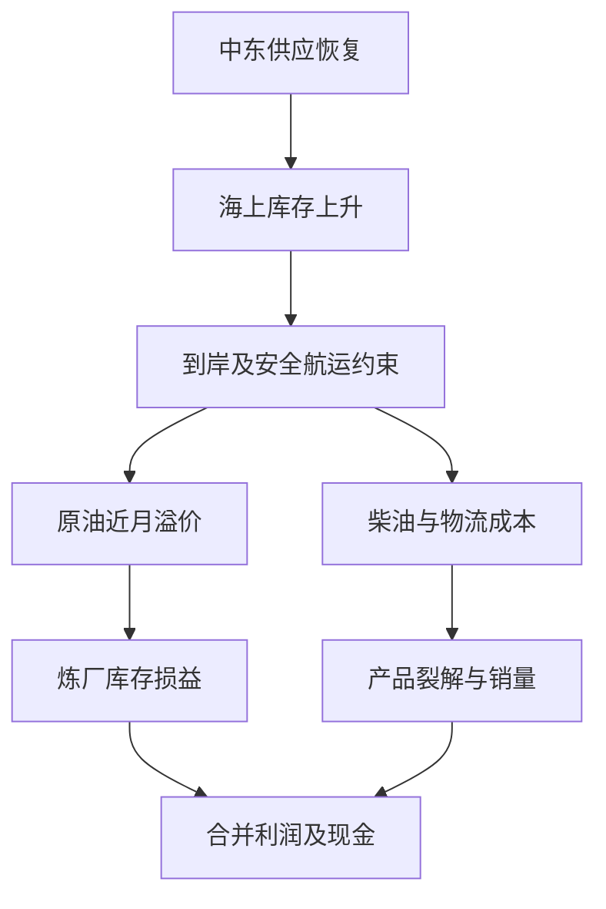

# commodities Radar

run_id: 20261114T232558+0800_d49f7a0503e44d50aef2479c9f84b44d
information_cutoff_utc: 2026-11-14T15:25:58Z
generated_at_utc: 2026-11-14T15:54:11Z
registry_commit: c2081ea56ff1b05c61f6e1cf691952910f0f62a0
prompt_sha256: b16d5d53258533da8c4bd15df8b88350216ec2005a92b9127f3ee948721b3f08

## 1. 一句话结论

供应恢复仍支持原油反弹卖出研究，近端紧缺与大限幅压低可用仓位；铜追差缺新价值锚，乙二醇强势优先补到港证据。

## 2. 数据质量与覆盖数表

**口径。** 本次信息截点为2026年11月14日23:25:58北京时间（15:25:58Z），生成时间另列；引用原件可在生成期间取得，但只使用截点前已发布内容。Registry默认分支最新固定提交`c2081ea56ff1b05c61f6e1cf691952910f0f62a0`，GPT入口版本`on_demand_2026-11-14_v5`；统一数据固定`dd21db5d76d4c247ffc4f7aa5d9c10e30ca046cb`。研究覆盖77品种=63基线+14动态新增，按源市场/合约逐项扫描，不把Top3当覆盖范围。数据来自本次唯一统一仓库与公共原件；自动化、执行开关和调度未变更。

|模块|requested/source/observation与生成时间（北京时间）|覆盖与状态|本次可用边界|
|---|---|---|---|
|Futures|11/13；生成11/13 16:46:43|SHFE/INE/DCE/CZCE/GFEX五所，806合约、77品种；verified/scope_verified/full_market_ready=true，日期匹配100%|未知代码、重复、非法OHLC、负量/OI、占位与排除均0；Wind EOD，不是实时盘口|
|Market State|源窗口10/19—11/13，20个交易收益观测；末日11/13|77主力同合约，20收益连续就绪；1/3/5/20日结算端点、RV20、量仓及近次月曲线均扫描|RV按同合约日结算收益；近次月滚动与主力滚动分别记录，不拼成恒定价差历史|
|Physical|requested/source11/12；生成11/12 21:40:29|目标20、18条现货可读、2 unavailable；自身发布/校验通过，但相对报告11/13日期落后|18条派生基差均C级、eligible_for_physical_score=false；品级/区域/税/交割地缺，仓单0、进口平价不足，不能当实体支持或套利价|
|External|requested/source11/11；生成11/11 19:12:37|22目标、17系列、5未映射；11/12更新失败后保留，data_fresh/published=false|不是最新海外收盘；本次以IEA/EIA、Treasury/WGC、USDA等原件补对应机制，未把旧外盘价格换标签|
|Night|周五11/13晚至11/14凌晨；归属11/16；生成11/14 19:32:14|806请求、489合约有已完成夜bar、317无夜成交、55品种代表；覆盖完整，无query/timestamp/price error|last_completed_bar_close；completed_night_5min_bars；official_night_close_verified=false；全部夜OI与ΔOI缺，不能断言夜盘新多/新空|
|Commodity Options|trade/source11/13；生成16:50:25|目标/成功64/64品种、64series、468采样合约；IV435/468=92.95%，OI100%，bid/ask0|core_v1/sample strikes，ATM62、合格skew1（C2701），surface/positioning/execution全0，model Greeks0；vendor Greeks单位逐条，不推dealer Gamma|
|Contract Metadata|requested/source11/9；生成19:01:19|806合同目录；match67.49%、effective73.45%，乘数/tick value/保证金/限幅覆盖30.15%，夜/交割单位0|总体partial。重点SC乘数/tick、18%限幅与20%一般保证金及500手限制由官方补核；日期元数据仍有执行前复核门槛|
|官方crosscheck|源11/11，相对11/13不匹配|SHFE/INE/CZCE/GFEX各为baseline_unavailable；DCE HTTP412 source_error|没有同日可比基线，不能称五所官方复核通过或存在价格差异。另对CU11/13官方日表独立核对准确两腿|
|股指/国债/资金|各source11/13；国债11/14 21:05:07、资金21:07:31生成|股指4产品16期货，期权report_v1样本；国债4期限12合约；资金12/12|只作宏观交叉验证；无夜盘。国债缺CTD/DV01/可融资carry；回购不同市场统计不混算无风险套利|

夜源20:00—03:45是采集窗口，不是所有合约法定交易时间。55个代表末bar实际分布为23:00（42）、01:00（10）、02:30（3）。按照[SHFE官方交易时间](https://www.shfe.com.cn/services/calenderandholidays/tradinghours/)与[2026休市安排](https://www.shfe.cn/publicnotice/notice/202512/t20251217_829805.html)，周五夜归下周一合法，没有calendar_mismatch；周日晚无国内夜盘。AU摘要夜代表AU2612与EOD主力AU2702不同，本次下钻准确AU2702夜bar后另列，未把代表值836.44接到AU2702。

**公司资料限定扫描：2家。** 中石化600028/00386与江西铜业600362，读取2026三季报原始PDF的网页抽取文本（分别HKEX、巨潮）；本地保存原件检索capture，未取得raw PDF字节，覆盖收入/利润/经营现金流/Capex及报表内可闭合现金桥。未取得本次准确股票报价、复权、成交状态、全市场财务和行业成份，不作个股买入或“行业中性”组合。中石化SSE链接失败后通过HKEX原件完成；公司原件的日期是10月披露、报告期1—9月，11月重新读取不当新公告。

**原件与哈希。** [Chat manifest](https://github.com/farfromexact/China-Commodities-Engine/blob/dd21db5d76d4c247ffc4f7aa5d9c10e30ca046cb/data/chat/manifest.json)绑定所有真实index/part。本次report的26/26分片、futures的15/15分片均以base64原字节保存并逐片核索引SHA；再用锁定`radar_chat_input.py`还原。候选night/metadata/options/market_state只按index准确路径下钻，未读不声称全模块已还原。完整输入哈希表、逐品种限制在第10栏；源文件LF规范化hash与还原JSON content hash是不同口径，不混写成同一hash。

本报告“complete”指全范围研究、财务桥、情景、比较与台账完成；不代表全物理数据覆盖或可执行。公开补证仍有局部失败：EG港口/装置原始数据正文不可达、CU最新仓单未取得、NBS11月上旬生产资料正文两次不可达。它们限制对应论点，既非新利空，也不把其他已完成研究清零。

## 3. 商品仪表盘

单位：SC元/桶（不含税）、AU元/克、AG元/千克、JD元/500千克、EC指数点，其余元/吨；量与OI为手。1D/5D一律同合约**结算收益**，不是收盘收益。RV为同合约连续20个结算收益、252日年化。近−次曲线=（近月结算/次月结算−1）×100，合同对写明；*为该对滚动。

|板块/主力|日收/结|结算1D/5D %|日量/OI/ΔOI|RV20 %|近−次合同对/曲线 %|
|---|---:|---:|---:|---:|---|
|黑色与建材/I2701|669.5/670|-0.446/-2.828|215,451/541,395/-1825|14.127|I2612−I2701 / +0.299|
|能源与化工/SC2701|625.5/607.1|+1.880/-3.909|111,907/27,248/+508|43.616|SC2612−SC2701 / +1.334|
|有色与贵金属/CU2612|105150/105040|-0.095/-0.067|115,530/185,375/-4784|9.352|CU2611−CU2612 / +3.123|
|有色与贵金属/AU2702|841.48/840.96|-2.450/-4.469|131,820/132,478/+5434|21.461|AU2611−AU2612 / +0.122|
|有色与贵金属/AG2702|11985/12060|-3.481/-4.095|916,271/277,627/+7346|37.529|AG2611−AG2612 / +0.515|
|能源与化工/EG2701|5197/5159|+3.325/+4.773|1,723,733/361,992/+1479|32.919|EG2611−EG2612 / -0.358|
|黑色与建材/FG701|916/914|+3.044/+2.466|1,920,089/1,191,514/+45465|19.548|FG612−FG701* / +1.204|
|黑色与建材/SA701|991/993|+1.742/+1.951|1,803,474/1,152,318/+42882|17.209|SA612−SA701* / -0.705|
|新能源与材料/LC2701|90580/91580|+2.806/-0.392|314,472/367,672/-16577|34.218|LC2612−LC2701* / +0.743|
|能源与化工/NR2701|16695/16640|+0.483/+6.021|82,357/74,030/+2516|18.122|NR2612−NR2701 / +0.331|
|农产品、油脂油料、饲料和畜牧/M2701|3147/3129|-0.319/+0.903|1,214,441/1,878,990/+9974|12.747|M2612−M2701 / -0.384|
|农产品、油脂油料、饲料和畜牧/P2701|8961/8985|+0.706/+2.686|498,085/502,445/-22138|19.365|P2612−P2701 / -1.347|
|农产品、油脂油料、饲料和畜牧/JD2701|3297/3287|+1.201/+6.307|307,717/189,519/+8406|21.757|JD2611−JD2612 / +7.838|
|软商品与特色农产品/AP701|6244/6240|+2.111/+4.540|336,504/151,359/-10116|34.410|AP612−AP701* / +9.519|
|能源与化工/EC2612|2589.5/2551|+4.186/+8.507|9,490/14,524/-758|52.477|EC2611−EC2612 / -15.543|

|同一主力|最新已完成夜bar/北京时间|vs日收 / vs日结 %；夜量|基差/实体|期权ATM IV % / 信号|
|---|---|---|---|---|
|I2701|662.5 / 11-13T23:00|-1.046/-1.119；87,363|C级 -15.67（11/12）|15.800 / 周弱、铁水待核|
|SC2701|617 / 11-14T02:30|-1.359/+1.631；76,366|无合格基差/仓单|54.110 / 反弹卖出条件|
|CU2612|104390 / 11-14T01:00|-0.723/-0.619；39,756|C级 +3575（11/12）|14.040 / 近端紧已定价|
|AU2702|839.06 / 11-14T02:30|-0.288/-0.226；48,390|无合格基差/仓单|24.445 / 实际利率压制|
|AG2702|11799 / 11-14T02:30|-1.552/-2.164；603,945|无合格基差/仓单|42.870 / 金融/工业同弱|
|EG2701|5216 / 11-13T23:00|+0.366/+1.105；352,982|无合格基差/仓单|35.205 / 强势待到港核验|
|FG701|913 / 11-13T23:00|-0.328/-0.109；464,245|C级 +99.4（11/12）|25.470 / 日强夜回吐|
|SA701|978 / 11-13T23:00|-1.312/-1.511；595,237|C级 +64（11/12）|23.780 / 夜盘反证|
|LC2701|无夜成交代表/日盘品种|不填0|C级 +920（11/12）|46.065 / 收低于结、减仓|
|NR2701|16825 / 11-13T23:00|+0.779/+1.112；22,324|无合格基差/仓单|24.945 / 强势未见实体|
|M2701|3157 / 11-13T23:00|+0.318/+0.895；321,976|C级 +61（11/12）|13.505 / 不追旧正套|
|P2701|9071 / 11-13T23:00|+1.228/+0.957；217,157|C级 -32（11/12）|18.185 / 夜强、实物待核|
|JD2701|无夜成交代表/日盘品种|不填0|无合格基差/仓单|26.900 / 季节/产能待核|
|AP701|无夜成交代表/日盘品种|不填0|无合格基差/仓单|27.325 / IV<RV仅筛查|
|EC2612|无夜成交代表/日盘品种|不填0|无合格基差/仓单|无采样 / 高RV、非原油替身|

所有夜盘OI/ΔOI均缺，价格来自完整5分钟bar、并非官方夜结或实时盘口；无夜盘者不能把空值填0。AU2702用准确月份下钻值839.06，摘要AU2612的836.44单独留在源。铜仪表盘自动近次月是CU2611/2612；重点候选CU2612/2701同刻夜价差2420另算，不拿3.123%替代。SC同刻12−1月夜差10.6与其18%限幅都构成尾部约束。

截点前海外/原件背景：IEA总库存恢复与陆上紧缺并存；美国10年实际利率2.91%；WGC需求为低频支持。External11/11价格未更新到截点，本表未将其当当前海外变动，也未用EIA预测当实盘。来源：[report完整指标](https://github.com/farfromexact/China-Commodities-Engine/blob/dd21db5d76d4c247ffc4f7aa5d9c10e30ca046cb/data/chat/report/index.json)、[806合约准确EOD](https://github.com/farfromexact/China-Commodities-Engine/blob/dd21db5d76d4c247ffc4f7aa5d9c10e30ca046cb/data/chat/futures/index.json)、[候选准确night](https://github.com/farfromexact/China-Commodities-Engine/blob/dd21db5d76d4c247ffc4f7aa5d9c10e30ca046cb/data/chat/night/index.json)、[期权采样index](https://github.com/farfromexact/China-Commodities-Engine/blob/dd21db5d76d4c247ffc4f7aa5d9c10e30ca046cb/data/chat/options_index/index.json)。

## 4. Delta Research

比较基准是已验证完整正式批次`20261114T213826+0800_ee6526047d85461d8235bf05b6186d46`（截点11月14日21:38:26北京时间），不是任意latest文件。先完成本次77品种独立扫描，再看历史9条观点；旧报告仅用于观点与原参数比较。两批之间**没有新的中国日/夜交易会话**，所以不把同一617原油、2420铜价差、5216乙二醇重复记成新催化或新收益。

|变化类型|本次确有增量|对判断的影响|
|---|---|---|
|数据纠错与重估|当前快照20个连续同合约收益完整；前序AP卡所用缺口样本RV36.8057%替换为当前34.410%，ATM IV27.325%的差缩为-7.085pp；SC当前RV43.616%|波动比较口径更可靠，但IV−历史RV仍不能证明未来长波动便宜；这是数据修复，不是市场突然降波动。|
|新版本研究|新SC子观点使用当前技术锚625.5—626.5/640/607.1/587.8、11月20日退出，明确实际5日持有期、混合路径和双停板|条件研究69、当前617锚53；保留父卡到期窗口及635/600/585/11月19日原退出，未移动旧仓风险。短线跌势已定价、近月10.6仍反证，条件尚未通过。|
|原件深化与表达纠错|本次把中石化分部营业利润及现金流变化闭合，江西铜回款/采购/税费现金桥也闭合|“油价回落=炼厂股必受益”被库存收益、销量与内部抵消约束；“铜近端紧张=铜股同样受益”未成立，期货跨月和公司股权不同。旧财报重读只是研究增量。|
|重排研究资源|原AP双买从前序首位降为期权专题观察；CU不再用950—1050旧入场带充当永久公允价；EG仍为局部强势补证优先|AP缺前瞻事件优势；CU目前紧张溢价很大但缺库存交割经济锚；EG两项关键原件尝试未成功，不能据此补上实体一层。没有强行凑足五个机会。|

夜数据合法归属11月16日已由官方会话规则复核，较前序“供应商背景”措辞更明确；仍是已完成5分钟bar且无OI，并未升级为官方夜结或实时盘口。铜12−1月从日收2410到夜末2420只扩10元/吨，结算2130与日收2410的280元差是基准差，不是夜盘扩张；SC日收差6.8到夜差10.6的3.8是真正同类型末价差变化，但不证明此前连续触发了父卡的两根5分钟失效条件。

旧豆粕跨期、黄金/白银、航运等原方案的信号状态与实际持仓仍未知。旧卡窗口过期、参数不明或方向失效继续保留，不把目标价穿越当成交；本期没有账户PnL。全部首次时间、原始计划及上期版本在第10栏可独立追溯。

## 5. 产业链与公司利润校验

### 1）原油—炼化—化工：供应恢复与到岸紧缺同时存在

IEA11月13日估计10月供应月增230万桶/日、总库存增5200万桶，但海上库存增8600万桶、陆上继续下降；需求2026年预计减270万桶/日。EIA11月10日、以11月5日信息集完成的预测也指向供应恢复及第四季度增库，却仍预测11—12月Brent现货约100美元/桶。两份报告是同一个机制的交叉证据，不拆两层；IEA撰写时North Sea Dated约93美元是现货评估，不与EIA预测100作市场“偏差7美元”的套利。[IEA原件](https://www.iea.org/reports/oil-market-report-november-2026)；[EIA预测及信息截止](https://www.eia.gov/outlooks/steo/report/global_oil.php)。

市场已计入绝对油价回落：SC20日结算-14.57%，FU/LU/LPG也明显下跌；但SC12−1月夜差10.6、LU近月升水和仍高的柴油价格显示即期供应价值尚未消失。比较原油短方向、原油跨期、油品裂解及化工加工利润后，只保留反弹失败的SC2701条件卡。用FU/LU替代会混入产品缺口、用远期反套会改变收益来源。最大缺口是同日到岸可交付库存与运输安全的可量化更新；当前置信度中等偏低。

**公司利润桥：中石化，2026/2025年前9个月、IFRS、未审计、人民币亿元。** 原始公告10月29日17:43香港发布，本次读取[HKEX三季报](https://www1.hkexnews.hk/listedco/listconews/sehk/2026/1029/2026102900846.pdf)，不是新盈利催化。下表统一用分部营业利润，不混用公司叙述里的EBIT、CAS归母或IFRS归母。

|分部|2026年前9月|上年同期|同比贡献|
|---|---:|---:|---:|
|勘探开发|401.59|354.62|+46.97|
|炼油|293.70|71.87|+221.83|
|营销分销|73.14|106.81|-33.67|
|化工|-13.11|-70.82|+57.71|
|总部|-12.38|6.73|-19.11|
|内部抵消|-158.10|-2.30|-155.80|
|合并营业利润|584.84|466.91|+117.93|

炼油改善221.83亿元不能全归股东：内部抵消减155.80亿元，营销下降，化工仍亏损。原油加工量167.37百万吨、同比-10.2%，国内成品油销售118.90百万吨、-10.7%；公司解释中有高油价库存收益及产品结构贡献，因此利润改善不等于终端量恢复。原油下跌可能改善未来替代成本与部分裂解，也会使库存收益逆转，取决于售价传导、在库成本和周转期。只有产品裂解与销量守住、库存损失不吞掉成本改善时，炼厂股才可能受益，不能两种油价方向都无条件看多。

|经营现金流桥（同口径亿元）|2026年前9月|上年同期|变化|
|---|---:|---:|---:|
|营运资金前经营现金|2093.24|1461.42|+631.82|
|应收及其他流动资产|-645.28|-447.30|-197.98|
|存货|-135.24|151.95|-287.19|
|应付及其他流动负债|390.05|93.19|+296.86|
|已付所得税|-82.83|-111.44|+28.61|
|经营现金净额|1619.94|1147.82|+472.12|

五项桥精确闭合、残差0。营运资金前增加631.82亿元里，税前利润变化+153.88、折旧+38.62、汇兑/衍生工具调整+307.08、减值调整+160.02，其他调整合计-27.78；这些现金流调节并不等于当期现金收入。存货与应收合计拖累485.17亿元、应付增加补回296.86亿元，说明现金改善不能只归因产品毛利。CFO减现金Capex及勘探井支出为749.13亿元、上年265.82亿元；这是一致现金扣除口径，不与管理层资本支出定义混用。股票当前定价、套保净头寸和少数股东价值未核，故公司只校验商品机制，不能替SC短方向建立证券交易。

### 2）铜—冶炼—加工：近月紧张已经贵，现金回收不等于跨月价值

CU2612/2701日收差2410、夜末2420元/吨，后者占远月101970约2.37%；一个月简化年化约28.5%仅描述价格差，不能当收益率或无风险carry。即便用年融资1.4%—5%的假设区间，月度融资约119—425元/吨（远月101970×利率/12），都远小于2420；差额需要便利收益、交割品稀缺及交割约束解释，不能靠普通利息解释。融资区间是敏感性，不是账户可融资利率；缺仓储、保险、仓单、税与现货可交割资格，不能从这个差额推出应空价差。CU11月到12月的3.123%曲线与本候选12月到1月不是同一对，禁止偷换；11月近交割的挤压也不能直接外推12月。[官方11月13日日表](https://www.shfe.com.cn/reports/tradedata/dailyandweeklydata/?query_product_code=cu_f)及本次固定夜分片均已核。

江西铜业三季报原件显示合并毛利227.60亿元、上年141.64亿元，归母利润116.87亿元；经营现金141.63亿元、上年62.88亿元。现金增加78.75亿元的桥：销售回款+472.50、退税-2.51、其他经营收款+35.44、采购付款-383.25、工资-6.24、税费-54.61、其他经营付款+17.41，精确以元重算闭合0残差（表中亿元四舍五入）。扣现金Capex后的金额113.86亿元、上年36.29亿元。[2026三季报原件](https://static.cninfo.com.cn/finalpage/2026-10-29/1225636802.PDF)。

这支持现金回收改善，而非单凭会计利润。售价、铜/金/银贡献、贸易规模、冶炼TC、套保与税费同时变化，报告未把合并现金完整拆成可交割铜两个月的便利收益；也没有本次股票价格和预期差。股权不能代替“多12月/空1月”，价差也不能代替公司利润。最新仓单原件未取得，使进一步扩张与交割缓解两种解释均存，置信度低于SC；11月16日先补仓单及合格现货，决定继续近多还是等待收敛，不维持旧950—1050永久价值中枢。

### 3）乙二醇—聚酯与玻璃—纯碱：强弱分化尚不足构成产业中性组合

EG2701日结+3.325%、五日+4.773%、20日+5.544%、ΔOI+1479，夜5216较日收+0.366%，强于TA/PX的月度弱势；FG701日+3.044%、ΔOI+45465，但夜913回落；SA701日+1.742%、ΔOI+42882，夜978较日收-1.312%。这是同一盘面里的分化，不是统一“化工需求繁荣”。NBS10月购进燃料动力环比4.1%、化工原料3.2%，而出厂PPI环比0.7%，更需要区分成本推动和下游需求。[NBS10月PPI](https://www.stats.gov.cn/sj/zxfb/202611/t20261109_1965794.html)。

EG最强竞争解释是进口到港延迟/装置临停导致的现货紧张，另一解释是短期运输传闻叠加补空、随后装置复产。已定向尝试隆众/钢联11月12日原始港口库存页面与相关开工来源，正文分别HTTP411/不可达；搜索摘要口径还存在15.3万吨与其他报道不同日期/样本的数值，故本报告不选一个数字当定论。下一项最有价值证据是**统一样本港口库存与未来两周可交割到港**，随后才是装置恢复表：前者能直接决定短缺是否延续到2701，而不是增加泛化宏观新闻。

玻璃/纯碱也需库存与真实冷修/复产原件，不能拿18条C级基差加分。EG/TA或FG/SA多空并非天然中性：吨数、生产收率、煤/油路线、季节性、库存周期与Beta不同，价格比不等于工厂利润。当前优先做EG方向及物理证据研究，未建篮子；FG/SA是重要未入榜异常，在全覆盖保留。11月16日10:00房地产、工业与能源生产数据可检验需求解释，公布前不从强势构造确定性利润。

### 4）油脂油粕—饲料—养殖：全球表边际变动小，国内季节价差更重要

WASDE11月10日原文中，全球2026/27油籽期末库存由146.31降145.65百万吨、植物油29.92降29.67，油粕24.85升25.01；棉花库存70.68降70.57百万包，但产量和消费同时下调。它们是不同产品/单位的轻微修订，不能统称农业大缺口。[USDA原始11月表](https://www.usda.gov/oce/commodity/wasde/wasde1126.txt)。

盘面P五日+2.69%、夜+1.23%比Y更强，M五日+0.90%但20日-5.15%，RM五日+2.88%；C/CS周弱，LH/JD周强。进口到港/压榨、油脂替代和蛋白饲料需求分别驱动，不由同一WASDE故事解释。豆粕旧01/05正套仍须国内供应与准确外盘合同身份，缺月度CBOT阈值不重挂；LH11月至1月巨大季节差不是直接套利，JD强势需存栏/淘鸡原件。棕榈天气和生物柴油、国内新粮售卖节奏、棉纺订单尚未取得完整原件，不计额外实体支持。置信度以价格层为主。

### 5）贵金属—实际利率—新能源材料：金融折现与产业需求分开

AU2702日结-2.450%、五日-4.469%，AG2702日-3.481%、20日-13.381%；准确AU2702夜末839.06较841.48日收-0.288%，不能用AU2612代表夜价836.44替代。Treasury11月13日10年名义5.15%、实际2.91%，一周实际利率升28bp，对无息黄金构成估值压力；10年名义减实际2.24%只是两条par曲线之差的近似，不是精确通胀预期。WGC10月ETF增19吨至4275吨、Q3央行321吨/YTD675吨（含估算）支持长期需求，另一公开报送YTD228吨不可混用。[Treasury名义曲线](https://home.treasury.gov/resource-center/data-chart-center/interest-rates/TextView?field_tdr_date_value=2026&type=daily_treasury_yield_curve)、[实际曲线](https://home.treasury.gov/resource-center/data-chart-center/interest-rates/TextView?field_tdr_date_value=2026&type=daily_treasury_real_yield_curve)、[WGC ETF](https://www.gold.org/goldhub/research/gold-etfs-holdings-and-flows/2026/11)、[WGC央行与需求](https://www.gold.org/news-and-events/press-releases/central-bank-buying-and-etf-inflows-support-gold-demand-q3)。

黄金长期需求不能证明未来一周买call会赚钱，1月25日期权也不是3—6个月长工具；未采样更远月份就不假造远期期权价格。白银、铂钯还带工业用途，不能复制央行购金支持。LC日结反弹但收盘90580低于结91580且减仓；SI/PS月度偏弱，需要电池/光伏排产、成本与仓单证明出清。贵金属金融反弹与能源材料供给收缩是不同假设，均无本次可立即加仓的独立错价证据。

## 6. 统一机会榜

本次仅保留三项入榜研究。顺序表示当前决策价值，只有SC具备同口径条件定价总分；未评分项不伪装成比69分更高或更低的精确排名。权重固定逻辑25/赔率25/催化20/价格期限波动15/拥挤技术15；分数不是胜率、预期回报或仓位。当前价格与未来条件价分别评价。

|候选/工具/期限|逻辑/赔率/催化/价格期限/拥挤技术|总分及条件|有效支持与反证|研究/证据/执行|
|---|---|---|---|---|
|SC2701反弹失败空；11/16至11/20|21/17/14/9/8|未来625.5—626.5且C≤2时69；两层上限69|L1趋势、L3供应恢复；L2近端10.6升水反对，IEA/EIA去重；IV高不加空头支持|待验证优势/两层/休市等触发与尾部核验|
|同一SC按当前夜末617评价|21/6/14/5/7|53，不作另一候选；当前加权净R0.70|价格已回落，追空牺牲补偿；与上行尾部不对称|当前价格吸引力不足/相同证据/放弃追价|
|CU2612多/CU2701空；近端库存研究|18/未评/7/10/6|不补总分，非已建交易；一层至多59|L2期限线索；仓单/便利收益经济锚缺；2.37%差不能由普通融资解释|现价扩差优势未证实/不足/观察|
|EG2701强势与到港；1月供应研究|16/未评/9/11/8|不补总分；一层至多59|L1强势；进口/库存/装置原件不足；与TA错位不自动中性|值得补证/不足/观察|

SC17分赔率来自同合约技术锚与实际五日退出、可复算全程成本，已扣除单TP1不合格、目标路径混合和大限幅尾部；加分不是因为缺报价或周末被“豁免”。同样的工具、截点、成本与期限在全球报告复用同一69/53及条件，不制造两份独立风险预算。CU与EG缺的是收益风险经济锚，四个可评分项不重新归一化为100，也不填0/null来假造五项总分。

AP低IV−RV、黄金长期需求、P/NR/JD强势、FG/SA夜盘分化及LC反弹均已做全范围比较，未给额外榜单名额。AP缺未来实现分布/事件优势，黄金实际利率反证强，NR/JD/油脂关键实体未核；这些是本期证据不足或定价尚未证明，并非声称不存在机会。完整卡只在下一栏展开，原计划在第10栏一次保存。

## 7. 完整研究与交易卡

### 卡1｜SC2701：供应恢复下的反弹失败，仅条件研究69分

**身份与结论。** `COM-E-SC2701-SUPPLY-REBOUND-RETEST-SHORT-20261114`，父观点 `COM-E-SC2701-IEA-FAILED-REBOUND-SHORT-20261113`。本卡只适用本次未来新候选，最迟2026年11月20日14:55北京时间退出；父卡的635止损、600/585目标、11月19日14:55退出全部保留，不能把真实旧仓延期到本卡。研究为“条件下待验证的下行优势”，证据两层L1/L3，条件分69；当前夜末617锚的吸引力仅53分，不能混成现价69。执行为休市、等触发/盘口/参数/账户核验，没有订单与成交。

**机制、已定价和最强反证。** IEA/EIA显示供应恢复和总库存拐点；主要损益来自原油绝对价格回吐，不是吃正套carry。SC2701过去20个结算日跌14.57%，说明供应恢复已被部分计价；11月13日日收625.5、日结607.1、前结595.9，日高626.6、低587.8。最近完整夜盘末617.0，较625.5收盘-1.359%、较607.1结算+1.631%，不能只取一个基准讲利空已确认。同期SC2612−SC2701夜差10.6，高于日收6.8、日结8.1：到岸短缺、柴油及运输紧张仍要求溢价，是该空头的关键反证。IEA海上增库与陆上低库存、EIA同一供给恢复机制不重复计层；美元/利率和高IV也不另算支持。下一决定性观测是11月16日近端升水能否收窄并与失败反弹同时出现，11月18日23:30 EIA再检库存。来源：[当前行情/收益](https://github.com/farfromexact/China-Commodities-Engine/blob/dd21db5d76d4c247ffc4f7aa5d9c10e30ca046cb/data/chat/report/index.json)、[准确夜盘](https://github.com/farfromexact/China-Commodities-Engine/blob/dd21db5d76d4c247ffc4f7aa5d9c10e30ca046cb/data/chat/night/index.json)、[IEA](https://www.iea.org/reports/oil-market-report-november-2026)、[EIA](https://www.eia.gov/outlooks/steo/report/global_oil.php)。

**价格锚与期限。** 625.5—626.5入场带围绕日收625.5与日/夜高626.6，是技术观察带；640止损是约14元/桶的主观失效/预算线。TP1=607.1为当日日结，TP2=587.8为当日日低；两者是可复核市场锚，不是基本面公允价。完整20个同合约结算收益RV43.616%，按252天年化，626对应单日尺度17.20、5日38.46元/桶；626至587.8的38.2与五日尺度相近，仅说明情景量级合理，不给到达概率。止损小于一日尺度，假突破反复止损是实质风险。拟11月16日入场、11月20日退出共5个交易日；不跨SC2612月底到期改变所用曲线身份。

**下一窗口与先后AND。** 只在11月16日09:00—10:15观察，宏观数据实际发布后的完整5分钟确认前不建仓（准时发布最早10:05）：①09:00—09:15完整bar曾达到626.6且收≤626.5；②09:15—09:30完整bar高≤628、收≤626.5；③上述两根完整15分钟bar结束时，同刻准确SC2612−SC2701价差均≤8.1；④等待计划10:00公布的国家统计局10月经济数据**实际发布**，之后一个完整5分钟bar反测625.5—626.5并收≤626，且同刻12−01价差仍≤8.1；之后仍能以625.5—626.5真实可成交卖价建仓。正常准时发布时最早10:05，延迟发布则向后等待完整5分钟，不能越过10:15截止。再同时要求：供应恢复证据未被可靠新事实推翻，准确盘口、同期两腿深度、当日临时规则、账户权限与尾部现金承受能力齐备，全程成本C≤2元/桶，按实际成交E重算净R≥1.5。所有条件AND，任何一项缺失均不启用。两根15分钟收盘条件不等于逐秒持续检验，也没有经验胜率支持。

只用完整2手目标单元：计划q=2时一次建立完整2手，不分成两批1手；计划q≥4只取4的倍数，首批50%与第二批50%均为偶数，随后独立5分钟再次反测失败、全部条件仍成立且仍在入口，才建第二批。第二批不能在10:15以后追补；若仅第一批成交，按实际偶数手分半止盈。任何部分成交留下孤立1手、又不能在入口内立即补成完整2手单元时，取消未成交部分并立即按可成交条件平回孤立手，实际滑点另计，不沿用69分及加权净R。q=1不启用。未成交部分10:15取消；低开或跌破614.2却不回到入口、卖价低于625.5、成本超过2、早段站稳640、曲线条件不齐、单手已超过预算，均放弃。当前617不追空；该窗口未成不自动顺延。10:00宏观发布是额外gap来源；[NBS官方排期](https://www.stats.gov.cn/sj/fbrc/bnxxfb/)列11月16日09:30住宅价格及10:00经济活动数据，实际发布时间可能调整。

**退出与实际持有期。** 价格止损640；逻辑失效为15分钟收≥640 OR同刻12−01价差>10.6且连续两根完整5分钟收于其上 OR可靠新事实推翻供给恢复，任一成立取消未成交部分，有真实仓位才按可成交条件退出。TP1=607.1买平一半、TP2=587.8买平余下；先触发止损/逻辑失效后不再计随后目标，已减半后的余仓仍受原640及逻辑约束，不擅自修改风控。全部最迟11月20日14:55退出，11月18日EIA前若无法承受gap则提前减仓/退出。未提供实际持仓，以下均为研究情景。

成本假设含每手往返费用100元、资金占用预算100元及价差/滑点800/1800/3300元，分别总计1000/2000/3500元，即C=1/2/3.5元/桶；不是经纪实报，执行前须替换。利润每手=1000×(E−退出价−C)，风险分母为计划止损成本1000×(640−E+C)。1:1目标平均退出597.45，净R=(E−597.45−C)/(640−E+C)。

|成交情景|E/C 元每桶|止损损失/手|TP1净收益/手|双目标加权净收益/手|加权净R|处理|
|---|---:|---:|---:|---:|---:|---|
|好|626.5/1|14,500|18,400|28,050|1.93|仍需全部触发|
|中|626/2|16,000|16,900|26,550|1.66|条件准入|
|最差准入|625.5/2|16,500|16,400|26,050|1.58|条件准入|
|成本恶化|625.5/3.5|18,000|14,900|24,550|1.36|放弃|
|按夜末追空|617/2|25,000|7,900|17,550|0.70|放弃|

中性成本下TP1单独净R只有1.06，1.66只成立于完整1:1双目标兑现。以2手E626/C2为例：两目标先后兑现净赚53,100元；TP1后余手640止损合计仅赚900元；11月20日仍626时间退出亏4,000元；先止损亏32,000元；跳至660才出亏72,000元。二项简化“完整赢/完整止损”的盈亏平衡频率37.60%，忽略混合路径，绝不是预计胜率或可信期望收益。

**合约、保证金与尾部。** 卖SC2701，每手1000桶、tick0.1元/桶=100元/手，E626名义626,000元/手。11月3日生效通知限幅18%、一般保证金20%（套保19%），E626初始交易所一般保证金约125,200元，11月13日结算锚为121,420元，经纪加收另核。11月11日起SC2612/2701日内开仓最大500手，实控账户合并，豁免类别按原文。元数据给SC2701最后交易2026年12月31日、最后交割2027年1月8日；实物交割，计划提前退出，不roll。夜盘已结束于11月14日02:30、归属11月16日；周日无国内夜盘，下一日盘11月16日09:00。[标准合约](https://www.ine.com.cn/products/futures/energyandchemical/sc_f/standard_sc_f/202312/t20231205_802540.html)、[动态参数](https://www.shfe.com.cn/publicnotice/notice/202610/t20261030_833906.html)、[开仓限额](https://www.shfe.com.cn/publicnotice/notice/202611/t20261109_834009.html)、[交易时段](https://www.shfe.com.cn/services/calenderandholidays/tradinghours/)。业务参数查询WAF阻断，执行前仍须核后续调整，不能拿静态4%/5%覆盖动态18%/20%。

恒定18%压力不等于最坏上界。以607.1结算锚，一/两次涨停理论716.378/845.326，向空头不利方向按0.1取整716.4/845.4，E626且C2时损失92,400/221,400元/手。若未来结算重置到626，再一/两次涨停为738.7/871.7，损失114,700/247,700元/手；扩板、买盘挤压、无可交易深度会更差。保证金再加5个百分点，在E626锚新增31,300元/手；在871.7且25%保证金的情景，保证金217,925元另加亏损247,700元，共需约465,625元/手及额外缓冲。价格止损不能限制最大亏损。

试仓计划风险选NAV0.25%，确认0.75%—1.50%仅为原上限、并非本卡自动加仓许可。同一能源主题跨两报告总预算不超过NAV2.5%—3.0%，本卡用较紧2.5%尾部约束并扣除已有相关敞口。先按以下约束取最小整数n，再取q=2（n为2或3）或q=4×floor(n/4)（n≥4）：计划风险预算/每手止损损失、剩余主题尾部预算/(两种结算锚下较大双涨停损失+gap/流动性缓冲)、可用现金/压力现金需求、实际深度、剩余日内限额；n<2则q=0。若与全球报告的IH/IM风格篮子或其他风险敞口同时启用，各卡上限不能相加；中国风险偏好反转、通胀/地缘共同逆风下合并SC、风格篮子及已有敞口，按更紧共同主题NAV2.5%再缩量。全球风格篮子0.75%与SC2.5%不是3.25%合并许可；重复SC只记一笔。未知NAV、现仓和经纪参数，不能声称预算已满足，不给可下单手数。仅以247,700元/手、两手和2.5%算，尚未加缓冲就要求约1,981.6万元NAV，显示线性工具对尾部承受力要求高。

**实质替代。** 已核准确SC2701P620买/SC2701P590卖1:1、12月15日美式期权；11月13日两腿settle49.25/33.50差15.75，close38.55/24.50差14.05，均不是同步bid/ask。按15.75加0.5费用假设，到期最大净收益13.75、初始全成本16.25元/桶，最大到期净R仅0.85；11月20日剩25天的美国式期货树模型，在F587.8、IV55%下估差18.18，仅约1,933元/组净利，不能拿到期满宽30替代提前退出。若F607.1、IV40%则约亏1,069元/组，F660/IV70%约亏5,699元；模型未含可执行清算折让，参见期权专项完整情景。它减少未行权完整价差的方向尾部，但当前成本锚不支持更好收益；也不会替裸期货封顶。没有满足上述线性风险条件时，等待优于裸卖高IV或假定未成交期权保护。

### 卡2｜CU2612多/CU2701空：重新解释2420，不把旧入口当公允价

保留稳定ID `COM-M-CU2612-2701-CURVE-RESILIENCE-LONG-20261106`，本次rev16为研究修订，无新订单许可。准确1:1合约对日收105150/102740、结105040/102910、同刻11月14日01:00夜末104390/101970，差分别2410/2130/2420元/吨。日收至夜末价差仅扩大10元；对比日结会夸大变化。两腿夜OI缺，不能称挤仓资金新增。方向线索是12月便利收益高于1月，未来扩差利润必须由剩余稀缺比当前隐含更强来兑现；当前价差2.37%的量级已经要求很高便利收益，市场不是没有定价短缺。

第5栏融资敏感性显示，简单资金成本解释不了2420；但仓单、交割品/地点、税与库存到港缺，不能定出新的合理价差上下界，也不能凭涨过1400/1700旧目标就反手做空。前序54分的旧条件评价不能当本次当前价值评价：本次保留逻辑18/25、催化7/20、价格期限10/15、拥挤技术6/15可评部分，赔率因缺库存/交割经济锚暂缺，不归一化或补总分；可见期限线索L2至多一层。仓单未取得是“当期未取得”，不是新增供给转松事实。

这是研究卡，**本次不设新入口/止损/目标，不恢复950—1050旧价带自动挂单**。11月16日09:15/09:30/09:45先核同刻价差与两腿深度，10:00经济数据实际发布后再区分宏观共振和交割机制；当天优先取得同日仓单及可交割现货，复核融资/仓储与库存到港后才能新建价值区与成本门槛。若两腿涨跌只是同一美元冲击而价差不响应，则不增加期限支持。旧仓只有有成交回执才适用其原750失效、1400/1700及11月20日14:45退出，不用本研究改变它们；原LME13800阈值缺准确月份/币种观察身份，继续留账并标不能启用。

自然工具为每腿5吨/手、1:1买12月卖1月，组合货币PnL=5q×[(CU12退出−CU12入场)−(CU01退出−CU01入场)]−全部成本；同吨数只减少共同铜价因子，非无风险。夜末毛名义5×(104390+101970)=1,031,800元/组，净价差金额12,100元不能当风险或保证金。为显示规模而非预测，用11月20日价差1500/2420/3200、全组成本50元/吨（250元）作假设，PnL分别-4,850/-250/+3,650元；没有理由给三种情景概率或指定其中一项为公允目标。此算例不产生条件交易评分。

元数据last trade为12月15日/1月15日，实物交割；本次不计划roll或持仓交割。当前动态保证金、限幅、账户与组合优惠未完整核，不能用历史静态值计算可下单手数或无风险carry。未来压力最不利为近腿跌停、远腿涨停；从同结算锚的单限幅增量损失5q(105040L12+102910L01)，再加实际入场与结算价差的差异、成本及gap；L须实际核后填，不造数。替代表达为CU2612方向多、铜企业股票或不交易：前两者混入绝对铜价/集团经营/估值，不表达同一月份稀缺。本次不交易、补仓单比在2420追差更合理。来源：[官方日表](https://www.shfe.com.cn/reports/tradedata/dailyandweeklydata/?query_product_code=cu_f)、[本次night index](https://github.com/farfromexact/China-Commodities-Engine/blob/dd21db5d76d4c247ffc4f7aa5d9c10e30ca046cb/data/chat/night/index.json)。

### 卡3｜EG2701：强势值得补证，价格本身不闭合供需

保留ID `COM-M-EG2701-RECOVERY-WATCH-20261112`，rev4。当前close5197/settle5159，日结+3.325%、5日+4.773%、20日+5.544%，日量1,723,733手、OI361,992、ΔOI+1,479；11月13日23:00已完成夜末5216，较日收+0.366%/较日结+1.105%，夜OI缺。它明显强于TA/PX月度趋势，因此研究资源前移；这只是本次全扫重新选中熟悉观点，不包装成新价格发现。

可证伪机制是现货可用库存与到港不足维持至1月，竞争解释是运输传闻、临停与空头回补，随后复产/到港恢复。尝试港口和开工关键原件后仍未取得完整正文，且搜索可见不同样本/日期的库存数字，不选取有利口径。若统一样本库存连续回补、已确认到港足以覆盖提货且装置恢复按期，则短缺机制减弱；若存库/可流通货继续减、到港再延迟，才有资格新增实体支持及估算供给缺口。11月16日先复核到港与装置两项，11月18日再看原油/燃料变化是否只是成本共振。

本次无有效入场/失效价格、TP或持有期交易参数；不能只因夜5216创强就追多，也不把最新低点任意当最大风险。只支持L1，逻辑16/25、催化9/20、价格期限11/15、拥挤技术8/15可评价；赔率缺成本/实体及可信退出锚，保留未评分，不补总分。报价与正常交易时段可得并不补足这项缺口。

方向期货是最直接的后续工具，但现货紧张可能集中即期、1月供给恢复会使2701表达失配。EG2701期权ATM IV35.205%、同月RV32.919%，12月16日到期；差+2.286pp只作筛查，没有未来波动分布与bidask就不叫便宜凸性。多EG空TA须有工艺、收率、Beta及数量权重，当前价格比不构成中性篮子；股权更混入其他化工业务，已读中石化也不能纯表达乙二醇库存。最有价值下一证据是可交割到港对1月的影响，补证优先级不等于现价投资吸引力已证实。来源：[本次完整主力指标及期权](https://github.com/farfromexact/China-Commodities-Engine/blob/dd21db5d76d4c247ffc4f7aa5d9c10e30ca046cb/data/chat/report/index.json)。

## 8. 商品期权专项

### 覆盖和可研究的部分

11月13日EOD的64品种、64个series、468份合约为core_v1选样，435份IV可读，62个ATM组合可用于同月比较；只有C2701通过源skew规则。full surface、positioning、execution均未就绪，bid/ask覆盖0，不能从这组样本推出全市场Gamma墙、卖方净仓位、可成交价或完整期限结构。下列IV是供应商同月ATM指标，RV是相同标的合约20个连续结算收益、252日年化，两者一个前瞻定价、一个后验样本，差值只是筛查。C/P原始Delta、Gamma也不能在不核单位、持仓方向和样本权重时加总为做市商敞口。

|标的/到期|ATM IV %|同合约RV20 %|IV−RV pp|研究含义|
|---|---:|---:|---:|---|
|SC2701 / 2026-12-15|54.110|43.616|+10.494|地缘跳跃与运输尾部仍贵，不能因IV高而裸卖|
|CU2612 / 2026-11-24|14.040|9.352|+4.688|到期11/24；低绝对IV不等于优于近端持有成本|
|AU2702 / 2027-01-25|24.445|21.461|+2.984|至1/25约72日；利率与需求双向，不冒充3—6个月期权|
|AG2702 / 2027-01-25|42.870|37.529|+5.341|工业与美元共同冲击，卖波动无独立优势|
|AP701 / 2026-11-26|27.325|34.410|-7.085|折价最大线索之一，但未来路径/耗时须另证|
|EG2701 / 2026-12-16|35.205|32.919|+2.286|相对强势；到港落地才决定事件凸性|
|FG701 / 2026-12-11|25.470|19.548|+5.922|IV高于后验波动，夜回吐增加方向不确定|
|SA701 / 2026-12-11|23.780|17.209|+6.571|夜弱与去产能叙事冲突，暂无价差卖波动优势|
|LC2701 / 2026-12-07|46.065|34.218|+11.847|高差值也含跳跃/政策风险，无夜盘保护|
|M2701 / 2026-12-16|13.505|12.747|+0.758|轻微差值不足抵跨腿成本，WASDE已发布|
|P2701 / 2026-12-16|18.185|19.365|-1.180|略低于历史RV但无可校准未来催化分布|
|JD2701 / 2026-12-16|26.900|21.757|+5.143|季节与补栏在期限内能否兑现尚缺|
|NR2701 / 2026-12-25|24.945|18.122|+6.823|产业到货与库存未核，样本不支持裸卖|
|C2701 / 2026-12-16|8.540|7.664|+0.876|唯一合格skew；轻微正RR不能说明全市场偏多|

C2701采样RR25为+0.260pp、BF25为+0.430pp，只在该源“合格skew”范围内解释；当前没有两个月可比微笑面或持续历史，不能据此构造已验证的Calendar/Diagonal套利。SI期权标的是SI2701，而扫描主力RV属SI2612；ZC期权701与主力612也不同，二者IV−RV留缺，零成交下的零RV更不代表无风险。全64行和原始ready在同源JSON事实中保留。

### AP701长波动：把未来退出日的耗时算出来

准确研究结构为买AP701C6200一手和P6200一手，元/吨报价、每腿10吨；11月13日收盘权利金149+114.5=263.5，结算168.5+128.5=297。C/P供应商Delta分别+0.5610/−0.4406，组合+0.1204；Gamma各0.0012是源口径，未当成账户人民币Gamma。已有行权、报价或持仓仍未确认；两腿close之和不是同刻可成交买价。

到期11月26日与郑商所苹果期权特殊规则相符：期货交割月前两个月的最后日历日之前倒数第3个交易日。该条由[郑商所官方期权手册](https://www.czce.com.cn/cn/rootfiles/2024/06/20/1715234707498668-1715234707540581.pdf)检索抽取核证；全文请求超时，未声称取得原始PDF字节或更新后的全部交易通知。历史计划11月24日14:45退出，届时只余2个日历日，不能拿11月26日到期折线替代其退出价值。最新临时通知及券商行权安排仍须执行前核实。

以下使用实际旧计划退出日11月24日，美式期货CRR树400步、ACT/365、假设年利率1.5%；基准支出为11/13结算297加假设全程成本10=307元/吨，并非将其当可下单报价。全平移IV为20%/27.325%/35%，不是预测或完整波动面。表为每一组两腿、10吨的模型净PnL：

|11/24标的F|价格情景|IV20%|IV27.325%|IV35%|
|---:|---|---:|---:|---:|
|5900|较6240下跌340点；距6200行权价300点|-69.87元|-64.48元|-36.95元|
|6200|回到行权价，不是平盘|-2,338.15元|-2,070.12元|-1,789.28元|
|6240|真实平盘：等于当前结算|-2,266.78元|-2,015.88元|-1,744.19元|
|6500|上行260点|-69.72元|-61.73元|-26.07元|

即使价格移到5900或6500，这组接近到期的退出值仍约300元/吨，基准307元/吨总支出未必回本；真正平盘6240，在参考IV下模型净亏约2016元/组。旧计划支出上限300在上述参考307下也不满足。更低真实成交成本会改善结果，但便宜报价本身不能补出未来事件优势。以上为“路径中尚未先触发退出”的无障碍终值敏感性；若组合净清算值先跌40%触发旧止损，应按实际可卖价退出，不能假设仍强行持有至11/24，也不能用模型终值回填旧仓损益。

因此AP仍保留长Gamma研究、原版本参数和询价观察，取消前序首位的资源排序，不恢复新仓指令。下一证据应是可作用于剩余10日左右的交割果率/可交割库存/天气事件和可能振幅；当前只是IV低于历史RV，尚不能赋出完整条件机会分。买跨式、买宽跨、买单腿和不交易的成本/Delta差别要按真实可成交腿重估；不能为了限制权利金任意移到样本外行权价。

### SC2701保护性看跌价差：有限到期图并不等于五日盈利优势

研究替代为买P620/卖P590各一手，12月15日到期，宽30元/桶、乘数1000。11/13收盘差14.05、结算差15.75；两者不是同刻净成交价。若按结算15.75加成本0.50，总参考支出16.25，保持完整未行权价差时最大到期亏损16250元/组、最大到期净收益13750元/组，比值0.846。这个上界是工具形状，不能用来假定五日内已兑现全部宽度，也不是账户资金路径的完整上界。

用与期货卡一致的11月20日退出、距期权到期25日的美式树，参考初始标的结算607.1；模型PnL如下，单位元/组：

|11/20标的F|含义|IV40%|IV55%|IV70%|
|---:|---|---:|---:|---:|
|587.8|期货第二目标|+2,526.13|+1,932.76|+1,652.36|
|607.1|相对期权EOD标的平盘|-1,069.30|-661.29|-429.31|
|626|未来期货入口参考，不是该期权初始标的|-4,492.53|-3,204.68|-2,378.38|
|640|期货卡风险线|-6,819.52|-5,008.57|-3,824.83|
|660|不利跳跃|-9,674.75|-7,309.95|-5,699.36|

在587.8且IV55%的下行路径，实际退出日模型仅约1933元/组，远少于到期最大收益13750元；时间价值使宽价差未到满值。当前15.75锚取自F607.1，不能把它冒充未来F626时可以买到的价差成本。未来触发价位必须重新询双腿盘口、IV、成交顺序与撤退价值。模型采用相同平移IV而非真实各腿微笑，不能把输出小数当估值精度；费用与清算折价比理论值更应优先核验。

SC和AP均有美式行权机制。对SC价差，卖方短腿可能提前被指派并转换为期货敞口，导致临时单边方向、保证金和现金需求；长腿的账面保护不保证它会同步自动行权或能即时平仓。上述“有限损失”以完整价差持续维持、行权与指派得到妥善处理为前提，不能由到期理论有界推导盘中没有资金尾部。任何期权表达仍须核交易所/券商处理时点、到期放弃规则、指派后的对冲和平仓及停板压力。AP买方也不能在不打算承接期货时放任自动行权。

**结构筛选结论。** 长Gamma须赚到实际持有期的实现路径或事件重估；有限风险Short Gamma须由可信未来波动分布与真实权利金支持，当前两者均未获执行许可。SC看跌价差可降低完整结构的方向损失形状，但当前参考成本与五日兑现使其不优于等待期货反弹条件；CU近月即将到期的单月样本不能支撑Calendar，LC/SC高IV也不构成裸卖理由。仅有一组skew、没有可比期限面、盘口或dealer方向时，Butterfly/Diagonal/Calendar保留为待补工具问题，不制造具体已成交结构。来源：[期权完整摘要及质量](https://github.com/farfromexact/China-Commodities-Engine/blob/dd21db5d76d4c247ffc4f7aa5d9c10e30ca046cb/data/chat/report/index.json)、[SC准确腿](https://github.com/farfromexact/China-Commodities-Engine/blob/dd21db5d76d4c247ffc4f7aa5d9c10e30ca046cb/data/chat/options_INE_SC/index.json)、[AP准确腿](https://github.com/farfromexact/China-Commodities-Engine/blob/dd21db5d76d4c247ffc4f7aa5d9c10e30ca046cb/data/chat/options_CZCE_AP/index.json)，计算脚本和全部情景见第10栏。

## 9. 下一合法交易窗口风险地图

### 会话与信息分层

截点为周六11月14日23:25:58北京时间。最近中国完整日盘是11/13；其后周五夜至周六凌晨已经完成，合法归属11/16，不能在周日晚重复当作新夜盘。下一国内商品日盘为11月16日周一09:00；股票/股指09:30开始的安排不移植到商品。SC/AU/AG夜盘02:30、CU01:00、EG/FG/SA23:00末bar已纳入，但它们不是此刻可执行盘口。

海外层分开使用：IEA11/13与EIA11/10原件提供供需机制，美国11/13利率和已发布通胀资料提供金融约束；仓库external仍11/11，未取得截点前可比最新Brent/WTI/LME/CBOT可交易月份报价。因此不能声称内外差已消除、Brent93已经触发或CBOT1220已经通过。EIA的未来价格预测不是海外实盘。周末若有新油田、港口或地缘消息，在本次截点后出现的内容要到下一次人工复核，当前仅列情景，不预言已发生。

### 高开、低开、平开观察

下表“高/低/平”相对各自最近完整同月夜末；没有夜盘的LC/AP/EC相对11/13收盘。观察参考不是额外订单，不能由某个价位单独完成第7栏AND条件。

|主题|高开或上冲|低开或延续下行|平开/震荡|下一决定性证据|
|---|---|---|---|---|
|SC2701，夜617；日收625.5/结607.1|上试625.5—626.6才可能重建反弹观察；高于628破坏早盘失败结构，≥640触及本卡风险/逻辑界|直接低于614.2且无完整反测，停止追空；接近607.1虽更接近目标，却更差赔率|616—618附近本身无入口；等反弹后再评五日成本后R|准确SC12−1月同刻差从10.6降到≤8.1及宏观数据后失败反测；供应恢复未被推翻|
|CU2612/CU2701，夜差2420|两腿同涨不等于扩差；再扩需要仓单/可交割货支持，不能高开就增加便利收益估值|近月独弱、差收缩说明稀缺预期降温；不因跌回旧950—1050即自动接货|围绕2420只显示当前已定价紧张，未形成新的合理区间|同日仓单、交割品地点、到港与两腿真实深度；并核11月16日10:00数据|
|EG2701，夜5216；日收5197/结5159|上穿5238夜高或5243日高仅是价格确认，原件缺口仍阻止追多|回到5197/5159是观察承接，非给新止损；若到港恢复则机制减弱|强势保留，价格横盘不能替代库存证据|港口可流通库存、后续两周确认到港、装置复产日程|
|AU2702/AG2702，准确夜839.06/11799|避险反弹要同时核实际利率、美元及黄金需求是否变化；不能直接归因央行买盘|继续弱势增加实际利率压制解释，但不恢复退休白银裸空|等待事件，黄金低频需求与周内利率压力仍相反|可比最新实际利率/外盘、足够期限且真实净成本的保护结构|
|FG701/SA701，夜913/978|若共同回升，先区分成本/宏观共振；多玻璃空纯碱未有生产与数量权重|尤其SA相对日收991的夜弱，反对单凭反内卷追涨；两腿下跌也未证明中性组合盈利|看日收916/991附近重新定价；不给自动化套利阈值|现货品级、产销、检修与合格仓单，而非仅盘面价比|
|LC2701、AP701、EC2612（日盘）|LC90580、AP6244、EC2589.5为收盘锚；高开先看量仓与原件|无夜盘不等于零风险；LC政策/供给、AP品质、EC运价各自核因|AP先核期权净成本和剩余时间，EC先核运价，LC先核去库|对应实体证据和准确盘口，不能由其他商品夜盘代理它们|

SC的614.2是本卡主观放弃追价观察线，非支撑估值；628、640同样属于预先设定执行约束，而非已证实历史阻力。三个情景不赋概率，未发生的早盘不写成已触发；不能从日夜OHLC还原15分钟顺序。

### 开盘后15/30/45分钟及宏观闸门

|北京时间11/16|共同观察|SC专属限制|其他主题处理|
|---|---|---|---|
|09:00—09:15，09:15首个15分钟完成|准确合约、价差同刻、滑点/量与交易所临时参数；不把夜OI补到日盘|只观察首段高≥626.6、收≤626.5；尚不建仓|CU同步两腿，EG看假突破；AP询价不等于允许双买|
|09:15—09:30，09:30第二段完成|区分开盘跳跃与连续成交，核报价是否仍有深度|第二段高≤628、收≤626.5，两个段末曲线都≤8.1；仍只观察|09:30住房价格发布可能先影响黑色/地产链；需要实际数据和完整bar|
|09:30—09:45，09:45第三段完成|检验前30分钟方向是否撤回，检查15/30/45分钟的量价一致性|**继续等待10:00宏观实际发布**；09:45不构成绕过闸门的许可|未补实物/参数的CU、EG仍只研究；不为满足时间表凑成交|
|10:00经济月报实际发布之后|计划可调整；若延期，按真实发布时间计时|须再完成一个5分钟确认，正常最早10:05；完整失败反测且真实卖价在625.5—626.5才可能进入；10:15未全满足则取消窗口|检查产业数据是否否定供需机制；若大幅跳空，先重算而非沿用早盘R|

晚间交易要以当天实际公布安排再核。11月16日下一夜21:00可做更新观察，当前SC卡不是夜盘延长挂单；10:15取消后不能机械等夜盘恢复。既有真实仓位如存在，按照各自建仓版本止损/时间退出，不能以“尚待新计划确认”延后已有风险处理。

**共同风险。** 中国宏观意外增强、通胀或地缘再升温，可能同时逆转SC空、IH/IM风格防守以及其他已有商品/股债敞口。SC单卡2.5%尾部上限与全球风格0.75%压力预算不能简单叠成3.25%；本报告采用更紧的共同逆风情景总NAV2.5%，将两域重复SC计一次，再扣已有相关敞口和现金缓冲后缩量。NAV、真实仓位、授信和成交未提供，不能声明预算已经满足。无独立尾部预算空间、无法承受两限幅及临时加保，即使69分条件也不建立新SC仓。

来源：[官方商品交易时段](https://www.shfe.com.cn/services/calenderandholidays/tradinghours/)、[NBS发布日程](https://www.stats.gov.cn/sj/fbrc/bnxxfb/)、第3栏同月行情、第7栏完整卡；所有观察均属于未来条件。

## 10. 未来事件、全范围覆盖与历史台账

### 未来24小时与7日：全部北京时间

未来24小时为11月14日23:25:58至11月15日23:25:58，国内处周末，无正常商品日盘或周日晚常规夜盘；没有核到须在该窗口实际公布的EIA/IEA/WASDE例行新数。未来7日截至11月21日23:25:58。月报、官方日程与规则推算分开，时间可能调整；未实际公布不提前填结果。

|时间|事件及证据级别|受影响机制/Delta、Vega处理|
|---|---|---|
|11/16 09:00|下一国内商品日盘；依官方交易时段及2026休市安排|先看15/30/45分钟；SC仍须等10:00宏观实际发布后的完整5分钟；不追周五夜已定价跌幅|
|11/16 09:30；10:00|NBS官方2026表分别为住房销售价格；国民经济、工业/能源、投资/地产、零售月报；计划可调整|地产链FG/SA/黑色、EG与原油需求竞争解释；方向和波动皆可能突变，SC最长到10:15窗口未满足即撤|
|11/17 04:30|CFTC 11月16日15:30 EST延迟发布安排|是低频持仓，不是当夜流入；必须看报告头持仓截至日及品种，不能按发布时间当新建仓；两侧极端可能放大回撤|
|11/18 23:30|EIA WPSR常规周三10:30 EST，下一日期按已核日程|原油/成品油/炼厂开工要分解；SC期货方向可被库存结构推翻，期权先看真实剩余时间/IV，不用“有事件”强行买贵凸性|
|11/20 09:00|LPR每月20日09:00、遇假顺延；本次周五据规则推得，非额外专项预告|融资成本和增长预期可能相反；不把利率下调直接译成需求复苏；检查CU便利收益、股指与国债共振|
|11/20 日盘；SC14:55、旧CU14:45|本次来源11月CFFEX合约到期；SC新卡时间退出、CU历史时间退出|股指roll可能影响跨资产风格，不拿价差roll当新Alpha；若真实持有相应版本，按各卡时间退出，不延期到周末|
|11/21 04:30|CFTC 11月20日15:30 EST常规发布|本新SC计划已经结束；只能服务下一批研究，不能为11/20退出后续命|
|7日内无已核固定时点|OPEC+新增会期、下一IEA月报、矿山/油田/炼厂停复产、化工装置、农业天气、港口或公司临时公告|持续的研究问题，无可靠具体日程就不伪造；一旦真实材料出现重验供给、交付/品质和利润，先改风险判断再论加仓|
|区间外：12/11 01:00|下一WASDE为12/10 12:00 EST|不能借远期月报给11/18豆粕旧计划新增持有理由；当前11/10报告已是背景|

11月14日09:30 NBS生产资料旬价已在截点前计划发布，但正文两次不可达；它不是“未来催化”，缺数不补。CFTC官方11月列表含16日延后，不能声称11月13日已取得新COT。11月美国EST为UTC−5，以上中国时差+13小时；不同来源没有强制同步日。相关两公司仅做限定最新公告/IR检索和2026三季报核验，没有核得7日内确定新披露日，因此不编业绩发布日期或共识。

原始日程：[NBS](https://www.stats.gov.cn/sj/fbrc/bnxxfb/)、[LPR规则](https://www.chinamoney.org.cn/chinese/bklpr/)、[EIA](https://www.eia.gov/petroleum/supply/weekly/schedule.php)、[CFTC](https://www.cftc.gov/MarketReports/CommitmentsofTraders/ReleaseSchedule/index.htm)、[USDA](https://www.usda.gov/about-usda/general-information/staff-offices/office-chief-economist/commodity-markets/wasde-report)。天气/地缘/产业停产不是确定方向的免费期权，缺未来分布时不新增高分凸性候选。

### 覆盖附录：77品种逐项判断与局部缺口

63个基线全部存在，动态增加BZ、LG、OP、PD、PT、PL、RR、RS、JR、PM、RI、WH、WR、ZC共14项。DCE数据PG按基线LPG规范名称合并，仅一项。本次80个覆盖行中analyzed=74、data_missing=6、not_applicable=0（77商品+3宏观）；状态只表示分析覆盖，不表示有可执行行情或优势。六个低活跃商品JR/PM/RI/WH/WR/ZC保留data_missing及原因，仍逐项分析，零RV不作低风险证据。

完整表的1/5/20日百分数一律同合约结算收益；夜涨跌双锚不与结算日收益混加，所有夜OI未知。逐行的原始curve合同对、换对标记、价格/量/OI、基差等级、期权日期和ready均保存在同源JSON的coverage.metrics，不用本表摘要取代原始字段。当前公开18基差均C级、仓单全缺；这影响实体层，不使所有价格研究失效。

#### 软商品与特色农产品

|品种/状态|本次实际分析|局部缺口/下一验证|
|---|---|---|
|AP / analyzed|AP701收/结6244/6240；结算1D/5D/20D +2.11%/+4.54%/+2.36%；ΔOI -10116，RV20 34.41%；夜盘不适用或无成交代表。日周强但减仓且近月换对；交割果率、冷库和品质差异大，通货现货不足以证明交割品紧张。|统一源未提供该品种合格基差/仓单；并不证明库存方向。；无已完成夜盘代表报价；不据此判采集失败或虚填0涨跌。；近次月合同对本期滚动，不把曲线变化直接当连续经济变化。|
|CF / analyzed|CF701收/结15555/15545；结算1D/5D/20D +0.13%/+1.30%/-2.11%；ΔOI +7811，RV20 10.77%；夜末15625，vs日收+0.45%/vs日结+0.51%。日周小涨增仓但20日负；USDA棉花产量和消费同下修、库存仅小减，全球表不能掩盖国内纺织需求。|统一源未提供该品种合格基差/仓单；并不证明库存方向。；近次月合同对本期滚动，不把曲线变化直接当连续经济变化。|
|CJ / analyzed|CJ701收/结6385/6455；结算1D/5D/20D +1.10%/-1.07%/+0.31%；ΔOI +2351，RV20 23.32%；夜盘不适用或无成交代表。单日反弹增仓但五日仍负；新季质量、收购及仓单缺证，近月贴水须与交割月流动性分开。|统一源未提供该品种合格基差/仓单；并不证明库存方向。；无已完成夜盘代表报价；不据此判采集失败或虚填0涨跌。|
|CY / analyzed|CY701收/结21385/21380；结算1D/5D/20D -0.02%/+0.42%/-2.99%；ΔOI +18，RV20 9.17%；夜末21435，vs日收+0.23%/vs日结+0.26%。低活跃度、周修复月度弱；未有期权采样与纺纱利润，棉价成本上涨可能压缩纱厂而非利多棉纱。|统一源未提供该品种合格基差/仓单；并不证明库存方向。；未在64品种期权采样计划内，不代表全市场无期权。|
|JR / data_missing|JR611收/结2662/2662；结算1D/5D/20D +0.00%/+0.00%/+0.00%；ΔOI +0，RV20 0.00%；夜盘不适用或无成交代表。粳稻动态新增：成交极低、历史结算不变，0收益/RV是僵滞价格；不视为低风险资产。|统一源未提供该品种合格基差/仓单；并不证明库存方向。；无已完成夜盘代表报价；不据此判采集失败或虚填0涨跌。；未在64品种期权采样计划内，不代表全市场无期权。；最新主力日成交少于100手，流动性不足。|
|PK / analyzed|PK703收/结7798/7790；结算1D/5D/20D -0.03%/-0.56%/-3.61%；ΔOI +9292，RV20 6.26%；夜盘不适用或无成交代表。低RV、日周负且增仓，成交放大；油厂采购与油粕压榨收益未核，低波动不等于风险小。|统一源未提供该品种合格基差/仓单；并不证明库存方向。；无已完成夜盘代表报价；不据此判采集失败或虚填0涨跌。|
|PM / data_missing|PM611收/结3122/3122；结算1D/5D/20D +0.00%/+0.00%/+0.00%；ΔOI +0，RV20 0.00%；夜盘不适用或无成交代表。普麦动态新增：成交极低、连续结算不变，无法形成可实施价格发现；不以零波动构造卖期权依据。|统一源未提供该品种合格基差/仓单；并不证明库存方向。；无已完成夜盘代表报价；不据此判采集失败或虚填0涨跌。；未在64品种期权采样计划内，不代表全市场无期权。；最新主力日成交少于100手，流动性不足。|
|RI / data_missing|RI611收/结2479/2479；结算1D/5D/20D +0.00%/+0.00%/+0.00%；ΔOI +0，RV20 0.00%；夜盘不适用或无成交代表。早籼稻动态新增：价格与量仓僵滞，报价不是可成交承诺；当前不建立交易候选。|统一源未提供该品种合格基差/仓单；并不证明库存方向。；无已完成夜盘代表报价；不据此判采集失败或虚填0涨跌。；未在64品种期权采样计划内，不代表全市场无期权。；最新主力日成交少于100手，流动性不足。|
|SR / analyzed|SR701收/结5146/5155；结算1D/5D/20D -0.75%/-1.49%/-4.63%；ΔOI +32929，RV20 7.26%；夜末5154，vs日收+0.16%/vs日结-0.02%。价跌增仓、五日/月度同弱，夜价近乎平；巴西/印度产量出口与国内开榨原件不足，不把趋势当低估。|统一源未提供该品种合格基差/仓单；并不证明库存方向。|
|WH / data_missing|WH611收/结3198/3198；结算1D/5D/20D +0.00%/+0.00%/+0.00%；ΔOI +0，RV20 0.00%；夜盘不适用或无成交代表。强麦动态新增：低流动性、结算收益与RV为零，交割与品质需专门核验；不以停滞样本推统计优势。|统一源未提供该品种合格基差/仓单；并不证明库存方向。；无已完成夜盘代表报价；不据此判采集失败或虚填0涨跌。；未在64品种期权采样计划内，不代表全市场无期权。；最新主力日成交少于100手，流动性不足。|

#### 黑色与建材

|品种/状态|本次实际分析|局部缺口/下一验证|
|---|---|---|
|FG / analyzed|FG701收/结916/914；结算1D/5D/20D +3.04%/+2.47%/+6.16%；ΔOI +45465，RV20 19.55%；夜末913，vs日收-0.33%/vs日结-0.11%。价涨增仓、量能抬升而夜盘回吐，库存去化/冷修原件缺失；候选为需求与供给再核，不把C级基差当买入保护。|现货观察11/12、basis C，地点/品级/税/交割地缺，未计实体支持。；近次月合同对本期滚动，不把曲线变化直接当连续经济变化。|
|SA / analyzed|SA701收/结991/993；结算1D/5D/20D +1.74%/+1.95%/+5.64%；ΔOI +42882，RV20 17.21%；夜末978，vs日收-1.31%/vs日结-1.51%。当日增仓反弹被夜盘1.31%回落部分否定；与玻璃同涨不证明纯碱减产，供给复产和交割库需单独验证。|现货观察11/12、basis C，地点/品级/税/交割地缺，未计实体支持。；近次月合同对本期滚动，不把曲线变化直接当连续经济变化。|
|SF / analyzed|SF701收/结5796/5812；结算1D/5D/20D +0.69%/+1.75%/-1.36%；ΔOI -4575，RV20 11.33%；夜盘不适用或无成交代表。短线小涨减仓，20日偏弱；电价及开炉负荷未知，钢招和现金成本是改变判断的关键。|统一源未提供该品种合格基差/仓单；并不证明库存方向。；无已完成夜盘代表报价；不据此判采集失败或虚填0涨跌。|
|SM / analyzed|SM701收/结5856/5860；结算1D/5D/20D +0.48%/+0.69%/+0.62%；ΔOI -8962，RV20 13.72%；夜盘不适用或无成交代表。温和反弹减仓、20日小幅正；锰矿进口与合金库存未核，近月曲线滚动不解释为新紧缺。|统一源未提供该品种合格基差/仓单；并不证明库存方向。；无已完成夜盘代表报价；不据此判采集失败或虚填0涨跌。；近次月合同对本期滚动，不把曲线变化直接当连续经济变化。|
|I / analyzed|I2701收/结669.5/670；结算1D/5D/20D -0.45%/-2.83%/-0.59%；ΔOI -1825，RV20 14.13%；夜末662.5，vs日收-1.05%/vs日结-1.12%。跌价减仓且五日弱于焦煤；不能由矿石弱势单独推定钢厂减产，等待铁水、港存与对应品位进口成本。|现货观察11/12、basis C，地点/品级/税/交割地缺，未计实体支持。|
|J / analyzed|J2701收/结1970/1961；结算1D/5D/20D +1.40%/+1.24%/-0.71%；ΔOI +3335，RV20 20.39%；夜末1986.5，vs日收+0.84%/vs日结+1.30%。当日涨价增仓、周线修复；相对矿强但钢厂利润/焦企库存缺失，不能把炼焦煤反弹重复计实体支持。|现货观察11/12、basis C，地点/品级/税/交割地缺，未计实体支持。；未在64品种期权采样计划内，不代表全市场无期权。|
|JM / analyzed|JM2701收/结1439/1424.5；结算1D/5D/20D +2.22%/+0.71%/-4.11%；ΔOI +20513，RV20 25.04%；夜末1444.5，vs日收+0.38%/vs日结+1.40%。当日涨价增仓但20日仍负；近次月对已滚动，煤矿供给扰动需与洗煤和焦化补库区分，现货755元差为C级不可套利。|现货观察11/12、basis C，地点/品级/税/交割地缺，未计实体支持。；近次月合同对本期滚动，不把曲线变化直接当连续经济变化。|
|HC / analyzed|HC2701收/结3179/3177；结算1D/5D/20D -0.16%/-0.90%/-1.91%；ΔOI -5832，RV20 7.85%；夜末3173，vs日收-0.19%/vs日结-0.13%。价量偏弱且减仓，板卷弱于玻璃；出口订单和制造业耗钢未核，不能只凭PPI判断成材涨价空间。|现货观察11/12、basis C，地点/品级/税/交割地缺，未计实体支持。；未在64品种期权采样计划内，不代表全市场无期权。|
|RB / analyzed|RB2701收/结3035/3033；结算1D/5D/20D +0.07%/-0.26%/-1.27%；ΔOI -54920，RV20 7.69%；夜末3031，vs日收-0.13%/vs日结-0.07%。平价减仓，五日近乎横盘；高炉原料上涨未转成材需求确认，观察去库与利润，近月价差非终端景气证明。|现货观察11/12、basis C，地点/品级/税/交割地缺，未计实体支持。|
|WR / data_missing|WR2701收/结3296/3297；结算1D/5D/20D +0.37%/-0.45%/-3.65%；ΔOI +1，RV20 7.90%；夜盘不适用或无成交代表。线材动态新增：成交/OI有限且缺下一液体合约，不能构建可靠跨月价差，钢材研究以RB/HC验证。|统一源未提供该品种合格基差/仓单；并不证明库存方向。；无已完成夜盘代表报价；不据此判采集失败或虚填0涨跌。；未在64品种期权采样计划内，不代表全市场无期权。；最新主力日成交少于100手，流动性不足。|

#### 能源与化工

|品种/状态|本次实际分析|局部缺口/下一验证|
|---|---|---|
|MA / analyzed|MA701收/结3266/3222；结算1D/5D/20D +1.87%/+0.34%/+1.10%；ΔOI -45520，RV20 35.80%；夜末3288，vs日收+0.67%/vs日结+2.05%。日涨减仓、周度平，近次月价差高但发生滚动；煤/气路线成本与港口补库需分开，C级现货不能证明利润。|现货观察11/12、basis C，地点/品级/税/交割地缺，未计实体支持。；近次月合同对本期滚动，不把曲线变化直接当连续经济变化。|
|PF / analyzed|PF701收/结7894/7846；结算1D/5D/20D +1.82%/+1.29%/-3.09%；ΔOI +345，RV20 23.85%；夜末7886，vs日收-0.10%/vs日结+0.51%。当日价涨增仓但20日负；短纤加工利润与纺纱订单未核，较上游抗跌仍只有市场层线索。|统一源未提供该品种合格基差/仓单；并不证明库存方向。|
|PL / analyzed|PL701收/结9243/9082；结算1D/5D/20D +1.92%/-2.19%/-0.59%；ΔOI +1123，RV20 37.84%；不同月夜代表PL612末9736，其自身EOD收/结9776/9615，vs该收-0.41%/vs该结+1.26%，不作主力续接。丙烯动态新增：单日反弹增仓、五日负；下游PP与装置经济性缺证，波动大不等于产业利润高。|统一源未提供该品种合格基差/仓单；并不证明库存方向。；夜代表合约与EOD主力不同，禁止混算收益。|
|PR / analyzed|PR701收/结7744/7706；结算1D/5D/20D +1.90%/+1.90%/-3.04%；ΔOI -572，RV20 29.05%；夜末7738，vs日收-0.08%/vs日结+0.42%。当日反弹减仓且月度负；瓶片新增品种纳入全扫，产能投放/出口成本未核，不能外推旺季。|统一源未提供该品种合格基差/仓单；并不证明库存方向。|
|PX / analyzed|PX701收/结8606/8538；结算1D/5D/20D +1.84%/+0.28%/-7.42%；ΔOI +1481，RV20 28.87%；夜末8588，vs日收-0.21%/vs日结+0.59%。短线成本反弹但20日仍跌；近月升水已体现时间溢价，芳烃供给/检修与下游聚酯利润不足。|现货观察11/12、basis C，地点/品级/税/交割地缺，未计实体支持。|
|SH / analyzed|SH701收/结1506/1536；结算1D/5D/20D -0.71%/+0.72%/-11.47%；ΔOI +18500，RV20 28.47%；夜末1504，vs日收-0.13%/vs日结-2.08%。20日弱、单日下跌增仓；烧碱与氧化铝需求传导需液碱浓度/运费及区域供需，不能直接用期货价比算利润。|统一源未提供该品种合格基差/仓单；并不证明库存方向。|
|TA / analyzed|TA701收/结6142/6108；结算1D/5D/20D +1.70%/+0.89%/-5.83%；ΔOI -14361，RV20 26.92%；夜末6122，vs日收-0.33%/vs日结+0.23%。反弹减仓、20日负，弱于EG；加工费与装置负荷缺原件，不以价格比直接建TA-EG中性组合。|现货观察11/12、basis C，地点/品级/税/交割地缺，未计实体支持。|
|UR / analyzed|UR701收/结1747/1744；结算1D/5D/20D -0.11%/+0.17%/+4.43%；ΔOI -9744，RV20 10.84%；夜盘不适用或无成交代表。日价小跌减仓、月度仍强；冬储仅季节先验，气头停产/出口与复合肥订单原件不足。|统一源未提供该品种合格基差/仓单；并不证明库存方向。；无已完成夜盘代表报价；不据此判采集失败或虚填0涨跌。；近次月合同对本期滚动，不把曲线变化直接当连续经济变化。|
|ZC / data_missing|ZC612收/结801.4/801.4；结算1D/5D/20D +0.00%/+0.00%/+0.00%；ΔOI +0，RV20 0.00%；夜盘不适用或无成交代表。动力煤动态新增：交易量低、结算不变；期权采样ZC701与主力ZC612不一致，不比较其IV-RV或给可交易性。|统一源未提供该品种合格基差/仓单；并不证明库存方向。；无已完成夜盘代表报价；不据此判采集失败或虚填0涨跌。；期权标的与当前主力不同，IV-RV须同月另算。；最新主力日成交少于100手，流动性不足。|
|BZ / analyzed|BZ2612收/结7810/7717；结算1D/5D/20D +2.14%/-3.31%/-12.57%；ΔOI -2020，RV20 36.89%；夜末7800，vs日收-0.13%/vs日结+1.08%。纯苯动态新增：日大反弹减仓、20日跌幅大；油价/苯乙烯链需用收率与利润验证，不能把短线反弹当周期反转。|统一源未提供该品种合格基差/仓单；并不证明库存方向。|
|EB / analyzed|EB2612收/结9140/9130；结算1D/5D/20D +2.39%/-1.51%/-7.36%；ΔOI -50399，RV20 36.23%；夜末9134，vs日收-0.07%/vs日结+0.04%。短线强反弹减仓但五日/月度仍负；上游纯苯与下游ABS/PS利润缺失，近月曲线换月不能证明去库。|统一源未提供该品种合格基差/仓单；并不证明库存方向。；近次月合同对本期滚动，不把曲线变化直接当连续经济变化。|
|EG / analyzed|EG2701收/结5197/5159；结算1D/5D/20D +3.32%/+4.77%/+5.54%；ΔOI +1479，RV20 32.92%；夜末5216，vs日收+0.37%/vs日结+1.10%。价涨增仓、五日和20日同强，夜盘保持强势；港口库存及到港原件取数失败，需区分短缺延续与传闻冲高。|统一源未提供该品种合格基差/仓单；并不证明库存方向。|
|L / analyzed|L2701收/结8578/8442；结算1D/5D/20D +0.90%/-3.65%/-3.24%；ΔOI +426，RV20 29.61%；夜末8547，vs日收-0.36%/vs日结+1.24%。日涨小增仓而五日走弱；农膜季节性仅先验，缺农膜订单/进口/检修，结构偏紧不能直接推需求。|统一源未提供该品种合格基差/仓单；并不证明库存方向。|
|LPG / analyzed|PG2701收/结6114/6008；结算1D/5D/20D +0.82%/-7.30%/-13.02%；ΔOI +5339，RV20 46.87%；不同月夜代表PG2612末6415，其自身EOD收/结6425/6335，vs该收-0.16%/vs该结+1.26%，不作主力续接。LPG映射PG，20日跌幅大而当日增仓反弹；进口CP、PDH利润与民用需求需拆开，不能当纯原油空头替身。|统一源未提供该品种合格基差/仓单；并不证明库存方向。；夜代表合约与EOD主力不同，禁止混算收益。|
|PP / analyzed|PP2701收/结9447/9302；结算1D/5D/20D +1.30%/-2.04%/-0.85%；ΔOI -10891，RV20 33.52%；夜末9413，vs日收-0.36%/vs日结+1.19%。反弹减仓、五日仍负；油/煤/PDH路线异质，未核牌号和装置数据，跨L价差不作确定性套利。|统一源未提供该品种合格基差/仓单；并不证明库存方向。|
|V / analyzed|V2701收/结5069/4986；结算1D/5D/20D +1.14%/+0.16%/+2.85%；ΔOI +3007，RV20 21.98%；夜末5058，vs日收-0.22%/vs日结+1.44%。日反弹增仓、20日正，周度平；电石成本和地产需求反向，近次月pair已滚，真实去库待证。|统一源未提供该品种合格基差/仓单；并不证明库存方向。；近次月合同对本期滚动，不把曲线变化直接当连续经济变化。|
|EC / analyzed|EC2612收/结2589.5/2551；结算1D/5D/20D +4.19%/+8.51%/-22.45%；ΔOI -758，RV20 52.48%；夜盘不适用或无成交代表。周涨但20日大跌、单日减仓；现货运价、船司提价与兑现运量缺最新原件，高RV不适合以原油趋势替代航运判断。|统一源未提供该品种合格基差/仓单；并不证明库存方向。；无已完成夜盘代表报价；不据此判采集失败或虚填0涨跌。；未在64品种期权采样计划内，不代表全市场无期权。|
|LU / analyzed|LU2701收/结5126/5016；结算1D/5D/20D +1.99%/-1.95%/-11.43%；ΔOI -880，RV20 51.40%；夜末5093，vs日收-0.64%/vs日结+1.54%。高RV且20日跌幅大，近月仍显著升水；柴油/航运紧张抵消原油供给修复，暂不放大油品空头。|统一源未提供该品种合格基差/仓单；并不证明库存方向。；未在64品种期权采样计划内，不代表全市场无期权。|
|NR / analyzed|NR2701收/结16695/16640；结算1D/5D/20D +0.48%/+6.02%/-1.13%；ΔOI +2516，RV20 18.12%；夜末16825，vs日收+0.78%/vs日结+1.11%。五日强于RU且当日增仓，夜盘续强；保税20号胶与全乳胶用途/税制不同，RU-NR差不可机械套利。|统一源未提供该品种合格基差/仓单；并不证明库存方向。|
|SC / analyzed|SC2701收/结625.5/607.1；结算1D/5D/20D +1.88%/-3.91%/-14.57%；ΔOI +508，RV20 43.62%；夜末617，vs日收-1.36%/vs日结+1.63%。20日跌势与供应恢复支持反弹卖出研究，夜末较日收跌但较日结涨；近月升水及低陆上库存为强反证。|统一源未提供该品种合格基差/仓单；并不证明库存方向。|
|BR / analyzed|BR2701收/结16020/15810；结算1D/5D/20D +2.03%/+2.76%/+0.22%；ΔOI +3967，RV20 30.67%；夜末16280，vs日收+1.62%/vs日结+2.97%。日周强、增仓放量，丁二烯原料波动可能同时压利润；需核裂解装置和轮胎需求，曲线已滚。|统一源未提供该品种合格基差/仓单；并不证明库存方向。；近次月合同对本期滚动，不把曲线变化直接当连续经济变化。|
|BU / analyzed|BU2701收/结4432/4375；结算1D/5D/20D +2.08%/-3.95%/-2.13%；ΔOI -5728，RV20 43.54%；夜末4413，vs日收-0.43%/vs日结+0.87%。五日弱、短线反弹减仓；原油成本回落可能压价也改善炼厂利润，公路施工需求和厂库不足。|统一源未提供该品种合格基差/仓单；并不证明库存方向。|
|FU / analyzed|FU2701收/结4225/4111；结算1D/5D/20D +1.86%/-4.02%/-13.82%；ΔOI +166，RV20 59.08%；夜末4236，vs日收+0.26%/vs日结+3.04%。高RV、20日显著下跌；燃料油C级现货与交割品明显不可比，原油下行不等于裂解价差同方向。|现货观察11/12、basis C，地点/品级/税/交割地缺，未计实体支持。|
|OP / analyzed|OP2701收/结3622/3624；结算1D/5D/20D +0.22%/+0.95%/-3.21%；ΔOI -133，RV20 11.06%；夜末3610，vs日收-0.33%/vs日结-0.39%。胶版印刷纸动态新增：日周小升、月度弱且减仓；纸浆成本与文化纸需求不同步，暂无可核利润优势。|统一源未提供该品种合格基差/仓单；并不证明库存方向。|
|RU / analyzed|RU2701收/结19600/19555；结算1D/5D/20D +0.33%/+5.02%/-1.76%；ΔOI -2164，RV20 15.83%；夜末19710，vs日收+0.56%/vs日结+0.79%。五日涨幅大但当日减仓；产区雨季/停割仅先验，真实出口、轮胎开工与交割胶库存缺失，追价不充分。|统一源未提供该品种合格基差/仓单；并不证明库存方向。|
|SP / analyzed|SP2701收/结4614/4654；结算1D/5D/20D -0.17%/-0.26%/-2.43%；ΔOI +14855，RV20 12.46%；夜末4640，vs日收+0.56%/vs日结-0.30%。单日近乎平、增仓；外盘浆价/港库缺更新，造纸需求与汇率影响分开，强美元不等于国内浆价必跌。|统一源未提供该品种合格基差/仓单；并不证明库存方向。|

#### 农产品、油脂油料、饲料和畜牧

|品种/状态|本次实际分析|局部缺口/下一验证|
|---|---|---|
|OI / analyzed|OI701收/结10113/10104；结算1D/5D/20D +0.93%/+2.36%/-2.01%；ΔOI +5642，RV20 13.21%；夜末10147，vs日收+0.34%/vs日结+0.43%。周强、当日增仓，菜油较豆油走强；进口政策与替代需求待核，不因同油脂自动追加独立一层。|统一源未提供该品种合格基差/仓单；并不证明库存方向。|
|RM / analyzed|RM701收/结2288/2283；结算1D/5D/20D +0.71%/+2.88%/-2.64%；ΔOI -27267，RV20 15.33%；夜末2282，vs日收-0.26%/vs日结-0.04%。周度强但日增幅伴减仓；菜籽进口/政策与水产季节性独立，不能用豆粕替代全部实体供需。|统一源未提供该品种合格基差/仓单；并不证明库存方向。|
|RS / analyzed|RS701收/结5409/5451；结算1D/5D/20D +0.35%/+1.08%/-1.18%；ΔOI -108，RV20 11.32%；夜盘不适用或无成交代表。油菜籽动态新增：低幅上涨减仓；品级与进口种源差异阻止直接对菜粕/菜油利润套算。|统一源未提供该品种合格基差/仓单；并不证明库存方向。；无已完成夜盘代表报价；不据此判采集失败或虚填0涨跌。；未在64品种期权采样计划内，不代表全市场无期权。|
|A / analyzed|A2701收/结5195/5206；结算1D/5D/20D -0.44%/+1.03%/-3.98%；ΔOI -2996，RV20 12.12%；夜末5119，vs日收-1.46%/vs日结-1.67%。国产豆日跌减仓、周度修复；食用豆供需与进口压榨豆不同，不能直接复制WASDE对B/M的推断。|统一源未提供该品种合格基差/仓单；并不证明库存方向。|
|B / analyzed|B2701收/结3904/3884；结算1D/5D/20D -0.21%/+0.60%/-3.81%；ΔOI +790，RV20 13.08%；夜末3915，vs日收+0.28%/vs日结+0.80%。日跌增仓、周小升；进口大豆受美豆、海运、汇率共同影响，USDA库存变动不等于国内到港已变。|统一源未提供该品种合格基差/仓单；并不证明库存方向。|
|C / analyzed|C2701收/结2185/2181；结算1D/5D/20D -0.32%/-2.07%/-1.18%；ΔOI +24288，RV20 7.66%；夜末2182，vs日收-0.14%/vs日结+0.05%。五日下跌增仓，低RV不代表可卖波动；唯一skew就绪不建立未来低实现波动优势，关注售粮节奏。|统一源未提供该品种合格基差/仓单；并不证明库存方向。；近次月合同对本期滚动，不把曲线变化直接当连续经济变化。|
|CS / analyzed|CS2701收/结2471/2463；结算1D/5D/20D -0.53%/-1.99%/-0.08%；ΔOI +5009，RV20 8.39%；夜末2459，vs日收-0.49%/vs日结-0.16%。随玉米周弱、增仓；淀粉与玉米价差需要副产品、加工收率和开工成本，价格差不是吨加工利润。|统一源未提供该品种合格基差/仓单；并不证明库存方向。|
|JD / analyzed|JD2701收/结3297/3287；结算1D/5D/20D +1.20%/+6.31%/+4.61%；ΔOI +8406，RV20 21.76%；夜盘不适用或无成交代表。五日强势增仓放量，day-only未提供夜报价；鸡蛋补栏与淘鸡产能不足，近月季节溢价不等于2701安全垫。|统一源未提供该品种合格基差/仓单；并不证明库存方向。；无已完成夜盘代表报价；不据此判采集失败或虚填0涨跌。|
|LG / analyzed|LG2701收/结804/805.5；结算1D/5D/20D -0.49%/+1.77%/-2.60%；ΔOI -243，RV20 8.79%；夜盘不适用或无成交代表。原木动态新增：日小跌减仓、周度正；建筑需求/港口材种与运费缺失，近月小升水不支持完整套利。|统一源未提供该品种合格基差/仓单；并不证明库存方向。；无已完成夜盘代表报价；不据此判采集失败或虚填0涨跌。|
|LH / analyzed|LH2703收/结9645/9620；结算1D/5D/20D +1.64%/+5.31%/-6.24%；ΔOI -4253，RV20 20.46%；夜盘不适用或无成交代表。五日反弹但减仓、20日仍弱；11/1月大贴水含节日季节差与近交割，不能用简单跨期归一化推盈利。|统一源未提供该品种合格基差/仓单；并不证明库存方向。；无已完成夜盘代表报价；不据此判采集失败或虚填0涨跌。|
|M / analyzed|M2701收/结3147/3129；结算1D/5D/20D -0.32%/+0.90%/-5.15%；ΔOI +9974，RV20 12.75%；夜末3157，vs日收+0.32%/vs日结+0.89%。日跌增仓、月度弱但夜反弹；全球粕库存小升不是国内压榨利润或饲料需求证明，需核到港/豆粕提货。|现货观察11/12、basis C，地点/品级/税/交割地缺，未计实体支持。|
|P / analyzed|P2701收/结8961/8985；结算1D/5D/20D +0.71%/+2.69%/-4.60%；ΔOI -22138，RV20 19.36%；夜末9071，vs日收+1.23%/vs日结+0.96%。五日偏强且夜末大涨，日减仓；天气、生物柴油及马来库存原件未补齐，强势不能断言供给冲击。|现货观察11/12、basis C，地点/品级/税/交割地缺，未计实体支持。|
|RR / analyzed|RR2612收/结3612/3609；结算1D/5D/20D +0.17%/+0.42%/+2.73%；ΔOI -67，RV20 6.88%；不同月夜代表RR2701末3570，其自身EOD收/结3565/3568，vs该收+0.14%/vs该结+0.06%，不作主力续接。粳米动态新增：低RV小幅升、减仓，稻米政策/库存需核；不借玉米波动替代其定价。|统一源未提供该品种合格基差/仓单；并不证明库存方向。；夜代表合约与EOD主力不同，禁止混算收益。；未在64品种期权采样计划内，不代表全市场无期权。|
|Y / analyzed|Y2701收/结8793/8781；结算1D/5D/20D +0.07%/+0.71%/-0.60%；ΔOI -8431，RV20 13.10%；夜末8820，vs日收+0.31%/vs日结+0.44%。周小升且当日减仓；油粕联动取决于压榨及消费，USDA植物油库存小幅下修仅中性偏支持。|现货观察11/12、basis C，地点/品级/税/交割地缺，未计实体支持。|

#### 新能源与材料

|品种/状态|本次实际分析|局部缺口/下一验证|
|---|---|---|
|LC / analyzed|LC2701收/结90580/91580；结算1D/5D/20D +2.81%/-0.39%/-7.57%；ΔOI -16577，RV20 34.22%；夜盘不适用或无成交代表。日结反弹但收盘明显低于结算且减仓；缺电池排产及可交割现货，不能把低价当供给出清或抄底证据。|现货观察11/12、basis C，地点/品级/税/交割地缺，未计实体支持。；无已完成夜盘代表报价；不据此判采集失败或虚填0涨跌。；近次月合同对本期滚动，不把曲线变化直接当连续经济变化。|
|PS / analyzed|PS2701收/结33810/33880；结算1D/5D/20D -0.16%/-1.58%/-9.88%；ΔOI +2546，RV20 23.27%；夜盘不适用或无成交代表。20日持续偏弱、增仓，新增能源材料压力；仓单/行业自律和装置停复产原件缺失，季节反弹缺实体确认。|统一源未提供该品种合格基差/仓单；并不证明库存方向。；无已完成夜盘代表报价；不据此判采集失败或虚填0涨跌。|
|SI / analyzed|SI2612收/结8625/8620；结算1D/5D/20D +0.00%/+1.29%/-3.04%；ΔOI -12128，RV20 11.45%；夜盘不适用或无成交代表。日结平、减仓、五日修复；期权标的是SI2701而主力SI2612，禁止直接IV-RV；枯水成本不能取代库存。|现货观察11/12、basis C，地点/品级/税/交割地缺，未计实体支持。；无已完成夜盘代表报价；不据此判采集失败或虚填0涨跌。；期权标的与当前主力不同，IV-RV须同月另算。；近次月合同对本期滚动，不把曲线变化直接当连续经济变化。|

#### 有色与贵金属

|品种/状态|本次实际分析|局部缺口/下一验证|
|---|---|---|
|PD / analyzed|PD2702收/结239.05/239.15；结算1D/5D/20D -2.82%/-1.71%/-11.29%；ΔOI +869，RV20 36.78%；夜盘不适用或无成交代表。钯动态新增：当日显著下跌增仓、量能偏高；汽车催化需求和替代未核，贵金属并不共用黄金需求证据。|统一源未提供该品种合格基差/仓单；并不证明库存方向。；无已完成夜盘代表报价；不据此判采集失败或虚填0涨跌。|
|PT / analyzed|PT2702收/结371.9/372.75；结算1D/5D/20D -0.72%/+0.84%/-6.54%；ΔOI +289，RV20 37.28%；夜盘不适用或无成交代表。铂动态新增：周修复月度弱、增仓；汽车/氢能用途与矿供给异质，不能靠金价回落推演铂价。|统一源未提供该品种合格基差/仓单；并不证明库存方向。；无已完成夜盘代表报价；不据此判采集失败或虚填0涨跌。|
|BC / analyzed|BC2612收/结93760/93540；结算1D/5D/20D -0.26%/-0.21%/-3.62%；ΔOI +220，RV20 11.05%；夜末93090，vs日收-0.71%/vs日结-0.48%。周度近乎平、月度下行；保税报价与沪铜含税价格不能直接比，需汇率、税费、升贴水才谈内外套利。|统一源未提供该品种合格基差/仓单；并不证明库存方向。|
|AD / analyzed|AD2701收/结21750/21805；结算1D/5D/20D -0.11%/-3.17%/-3.00%；ΔOI -274，RV20 13.77%；夜末21800，vs日收+0.23%/vs日结-0.02%。周跌而减仓，铸造铝合金动态新增已纳入；再生料与原铝成本联动不等于汽车订单增长，产品质量价差未知。|统一源未提供该品种合格基差/仓单；并不证明库存方向。|
|AG / analyzed|AG2702收/结11985/12060；结算1D/5D/20D -3.48%/-4.10%/-13.38%；ΔOI +7346，RV20 37.53%；夜末11799，vs日收-1.55%/vs日结-2.16%。单日及月度跌幅大于金，夜盘延续弱势；工业需求和贵金属金融因子并存，金银比不自动均值回归。|统一源未提供该品种合格基差/仓单；并不证明库存方向。|
|AL / analyzed|AL2701收/结22145/22165；结算1D/5D/20D -0.31%/-3.10%/-2.34%；ΔOI +12373，RV20 15.05%；夜末22125，vs日收-0.09%/vs日结-0.18%。价跌增仓、周跌较大；近月升水需区分交割换月和消费，未核社会库存与电解供应，保持观察。|现货观察11/12、basis C，地点/品级/税/交割地缺，未计实体支持。|
|AO / analyzed|AO2701收/结2622/2632；结算1D/5D/20D -0.45%/-0.45%/+0.73%；ΔOI +1573，RV20 12.84%；夜末2571，vs日收-1.95%/vs日结-2.32%。小跌增仓、20日微升；氧化铝近端升水不证明长期短缺，铝土矿/开工/仓单决定回补或继续偏弱。|统一源未提供该品种合格基差/仓单；并不证明库存方向。；近次月合同对本期滚动，不把曲线变化直接当连续经济变化。|
|AU / analyzed|AU2702收/结841.48/840.96；结算1D/5D/20D -2.45%/-4.47%/-6.67%；ΔOI +5434，RV20 21.46%；准确AU2702夜末839.06、较其日收841.48为-0.288%/日结840.96为-0.226%。实际利率高与ETF/央行需求并存；不把AU2612代表夜价拼到2月主力。|统一源未提供该品种合格基差/仓单；并不证明库存方向。；AU原摘要夜代表不同月份，本次准确2702已下钻修正；仍无夜OI。|
|CU / analyzed|CU2612收/结105150/105040；结算1D/5D/20D -0.10%/-0.07%/-3.43%；ΔOI -4784，RV20 9.35%；夜末104390，vs日收-0.72%/vs日结-0.62%。12/1月日收升水2410、夜末2420，近端紧张已明显定价；仓单与合格现货未核，追近远月扩张的赔率待证。|现货观察11/12、basis C，地点/品级/税/交割地缺，未计实体支持。|
|NI / analyzed|NI2701收/结122360/122600；结算1D/5D/20D +0.09%/-0.33%/+5.95%；ΔOI +2925，RV20 19.88%；不同月夜代表NI2612末120610，其自身EOD收/结122170/122410，vs该收-1.28%/vs该结-1.47%，不作主力续接。20日相对强但周线平；增仓不识别方向，镍铁/硫酸镍替代与印尼政策须同口径核查。|统一源未提供该品种合格基差/仓单；并不证明库存方向。；夜代表合约与EOD主力不同，禁止混算收益。|
|PB / analyzed|PB2701收/结15740/15735；结算1D/5D/20D +0.41%/-1.47%/-2.18%；ΔOI -1320，RV20 10.95%；夜末15950，vs日收+1.33%/vs日结+1.37%。单日反弹减仓、周线负；废电瓶成本与再生开工缺失，不能以季节性换电预设盈利。|统一源未提供该品种合格基差/仓单；并不证明库存方向。|
|SN / analyzed|SN2612收/结354000/349930；结算1D/5D/20D +0.03%/+1.05%/-6.93%；ΔOI -404，RV20 22.30%；夜末348850，vs日收-1.45%/vs日结-0.31%。周度修复但20日仍跌，日振幅大；矿端扰动未核原件，电子需求/冶炼复产是竞争解释。|统一源未提供该品种合格基差/仓单；并不证明库存方向。|
|SS / analyzed|SS2701收/结13940/13965；结算1D/5D/20D +0.07%/-1.45%/+5.80%；ΔOI -1254，RV20 13.81%；夜末13930，vs日收-0.07%/vs日结-0.25%。20日强、周度弱且减仓；不锈钢跟镍并非完全同风险，镍铁成本和钢厂排产缺失；曲线对滚动。|统一源未提供该品种合格基差/仓单；并不证明库存方向。；未在64品种期权采样计划内，不代表全市场无期权。；近次月合同对本期滚动，不把曲线变化直接当连续经济变化。|
|ZN / analyzed|ZN2701收/结24900/25155；结算1D/5D/20D -0.69%/-1.41%/-0.96%；ΔOI +12909，RV20 9.11%；夜末24880，vs日收-0.08%/vs日结-1.09%。当日价跌增仓且量能高；近远月差小，冶炼加工费/库存不足以核需求收缩，价格弱势一层。|统一源未提供该品种合格基差/仓单；并不证明库存方向。|

#### 三项跨资产宏观范围

|scope|本次判断|限制|
|---|---|---|
|macro:china_index_derivatives|IF/IH/IC/IM共16期货、期权report_v1采样已作跨资产核验。12月IH相对小盘的防守性强于全面风险偏好复苏解释；中国商品不能由股指一天涨跌获得实体一层。11月合约11/20到期，日盘无夜盘。|非全A股宽度；ETF份额单位未核，不报申赎。；不同指数期权采样不能推完整dealer仓位。|
|macro:china_treasury_futures|TS/TF/T/TL4期限12合约全读；近月均弱，TL2612日收117.45相对前结118.00跌0.55点，波动高于短端但不能直接比较DV01。长端下跌并未证明国内增长预期全面增强，供给/期限溢价也可解释。|CTD/转换因子/DV01/净基差与融资carry缺，不作已建成国债对冲或多空套利。|
|macro:china_funding|12个资金记录及1/3/5/20日变化均审阅。DR0071.3779%、R0071.4222%，差4.43bp；DR007日降2.13bp但5日升3.62bp，短期资金并非一致收紧或放松。GC0011.265%为收盘报价，不能与DR日加权作为同刻无风险差。|无日内可融资报价与账户授信、质押券；仅作风险及资金占用敏感性。|

### 输入、模型与原件哈希附录

Registry为c2081ea56ff1b05c61f6e1cf691952910f0f62a0；版本on_demand_2026-11-14_v5；唯一数据commit为dd21db5d76d4c247ffc4f7aa5d9c10e30ca046cb。实际模型gpt-6-astra（GPT-6 Astra Pro），工具运行环境为ChatGPT Work cloud tools / GitHub connector / local Python。完整Prompt SHA-256：b16d5d53258533da8c4bd15df8b88350216ec2005a92b9127f3ee948721b3f08；启动及信息截点2026-11-14T15:25:58Z，生成时间另列。未变更Registry、引擎、workflow、模板、调度或自动化，未采集或下单。

下表为本次实际还原内容哈希；source SHA是index声明的UTF-8 JSON/LF规范化原件口径，content SHA是解包规范化内容口径，不能相互替换。每个part的原字节哈希另按对应index校验，分片成功不是官方行情交叉核价通过。

|实际使用模块|完整还原内容SHA-256|index声明source SHA-256|用途|
|---|---|---|---|
|report|b90f3d28151196816009eee32315320981ddfd3199e88e94879e4567b3e6dc13|22bbd93dff350a6704ba527c3b0ecdb92af4e0ff763bf086ae41425458556f7b|77商品、质量、Night/Options/实体/外盘摘要全部26片|
|futures|1b788101abf1248b9e7f3cad31c0b2c98ea4ca314fc1e32bb258460041fe60b3|2e6abf0917f1ddfa20ea9d898c8e1ddae1c0b6d6b5eb53a05fdf0d9de4058382|806准确日盘合约全部15片|
|index_radar|baea9446d0bc73bc7c8fe5313c883df13551e4afb1721d50bd5df2e293870dd7|348d5a7700761ce2169ce0c9ebe02d238122c07952efb7b1387fdd5c7df4af20|股指跨资产摘要|
|index_history|009e71c0082ef25464e3d14d5f40ca3729fd2cb6f9c2f46703e6b268592b30a2|4e9723be7b6b8d0161debd19465f97c0b4eabe42a2e69fac9ff23bf030df81c3|可比历史边界|
|treasury_futures|7aa9c6d6130a1e902b57db36d07a71cf802fb6d7f1694f2f216688c35659a093|5367eabd62cc214c9bf4dbea39d155b4029b1c4c5087253da4b7c31121e33717|4期限12合约|
|funding|798b022847f977a7b37f90ee25a26190d0999ee26a47c73f368ab62accf9f03b|63f8ee63a361a6bd41e4cf1d37bec316a1a282fb9a6e98f7b1cf3904d0efc508|12记录及历史变化|

候选准确选片包括night（AU/CU/SC）、contract_meta、market_state、SC/CU/AU/AP准确期权；只下载需要的分片，不声称完整还原这些整个模块。其manifest/index/part原字节已保存并核验，源定义和各part身份详见相应固定commit路径。完整report/futures用锁定radar_chat_input.py重建，研究计算由calculate.py与确定性Python脚本完成。

|本次计算/证据文件|SHA-256|性质|
|---|---|---|
|calculate.py|24c67ddaa19ffb8220a93eb66b6954c809ca40428da5d44ce431efb583819805|公式与美式CRR400/参数假设|
|calculations.json|849df0be687b4b1e17c457e8be6564af2a44d22d7151d34c95a52254a655a444|全部64 IV/RV、退出日模型、风险与现金桥|
|initial_screen.json|8e6a30312e64d4a3aa3959939d7dc55c8e34e42a1e76ba188c63407479c19495|独立全范围初筛先于历史比较|
|sc_card.md|5d9dd5094d222a3f59ed7881e4870bf095eed34d2177f43a288139cac3b934f7|新SC唯一完整当前卡|
|commodity_finalfetch_2.json|922a044251754366f68c8640e96cdf4a1f2b92965291ea0dcbed9440fbff664f|网页/检索抓取文本，非原始PDF字节|
|commodity_inventory_search.json|5fe3f69b376b64f6fbb24eb22e567fb31768f90437f043796f52dcf022ed541a|网页/检索抓取文本，非原始PDF字节|
|commodity_rules_open.json|9a6a58c3977c1c254b7d914be79c992b9d9faff93d9b1eb67eccaebf2a399ca6|网页/检索抓取文本，非原始PDF字节|
|commodity_rules_open2.json|7f82301c651fab824c8d1dc476faef813e3c96257753a16d9fefaaf3f96a1fef|网页/检索抓取文本，非原始PDF字节|
|commodity_rules_search.json|573063e025b3e495e8b9db11b91e1efa2a07bab68ad0aa1e69c1a7600444fc37|网页/检索抓取文本，非原始PDF字节|
|commodity_sinopec.json|8a06052cf74b11930e4e25b6070129dd566039784f5173b2931cb1e9556a1284|网页/检索抓取文本，非原始PDF字节|
|commodity_sinopec_bridge.json|7e9c3a6ef18dd89d22ad0819de2168c44d5648259e231bab96a194453eedbf51|网页/检索抓取文本，非原始PDF字节|
|commodity_web_2.json|10121905111d1893959807ca03d5dba583b0fb1ac659b136690c1d84ab9f6026|网页/检索抓取文本，非原始PDF字节|
|commodity_web_3.json|147885203ad19f2a44dd78a8012769cbba990122c8e8b470a75706f83680a360|网页/检索抓取文本，非原始PDF字节|
|commodity_web_4.json|ecfea331ff9001ba7101a7c919b369d512590a2ff6f3d40ca90fbdb61626df5a|网页/检索抓取文本，非原始PDF字节|
|commodity_web_5.json|75f3a25cc21ff5e0e0d192c445ee2b9d51421378b0d7a8f60804aff2008212b9|网页/检索抓取文本，非原始PDF字节|
|commodity_web_6.json|3febc0706b8938506ad3d9b43d6def94f91d1ef81de776fecc6037fa62c38f58|网页/检索抓取文本，非原始PDF字节|
|commodity_web_7.json|015495f269b06520b2ffe7b70a73a154ab2620ee8d920adc55703a8c7190c121|网页/检索抓取文本，非原始PDF字节|
|commodity_web_8.json|27cbc60e20eec0bdd3207dadbde7e8b7440ca21da97d354d2b48007ac267dfba|网页/检索抓取文本，非原始PDF字节|
|commodity_web_9.json|da76607f946023f6ae961bb9c0012547a38dd64a4b19db36d8d82c0b01f3bd8f|网页/检索抓取文本，非原始PDF字节|
|ap_expiry_verification.json|532aa856c3cc62daacfe272e6eb212c602b725f51f3e0451a3b5c3b74a0edcb1|网页/检索抓取文本，非原始PDF字节|

公司原始链接为[中石化2026三季报HKEX PDF](https://www1.hkexnews.hk/listedco/listconews/sehk/2026/1029/2026102900846.pdf)、[江西铜业2026三季报巨潮PDF](https://static.cninfo.com.cn/finalpage/2026-10-29/1225636802.PDF)。本次读的是原始PDF网页抽取文本；本地hash只能验证所得capture，无法验证未取得的出版方raw PDF字节。报价、财务、调整历史、可交易状态是分开的能力；这些财报不赋予股票下单许可。

### 历史观点台账：原方案完整留存，当前规则另列

基准为已验证完整正式批次20261114T213826+0800_ee6526047d85461d8235bf05b6186d46，截点2026-11-14T13:38:26Z、生成2026-11-14T13:58:58Z，在本次截点前可获得。父级协调已核该批MD/JSON/run_manifest及登记身份；本次完整读取后仅用观点和参数比较，没有以旧报价替代本次统一数据。下面的旧版价格、费用、事件与链接均为历史原文，尤其旧源commit不作为本次事实输入。历史状态未知保持未知。

先前9条观点逐条保留首次时间及原参数；新SC第10条保留父ID。本期修订只作用于对应未来研究版本，所有“若已持有”均以真实成交回执及建仓版为前提，无回执不宣称持仓、止损触发或利润。旧完整卡仅在这里保存一次，当前SC/CU/EG卡只在第7栏展开。

#### 台账1｜COM-M-M2701-2705-WASDE-BACKWARDATION-LONG-20261111

首次可验证时间：2026-11-11T07:08:24+08:00。实际持仓：未提供/未知；无成交回执，不假定持有，不计算真实或模拟PnL。

**原始方案（历史原文）：**

首次rev1：测试280—286且不破270→15m收≥288→5m守284—288→CBOT≥1215且深度正常，全部AND；第一半约286、第二次守290后余半；stop268；逻辑15m<268 OR CBOT<1200 OR近月深度恶化；TP330/360，11/18日收前退出。

**上一有效版本：** rev6：当前315不追。11/13夜窗到期；仅新研究11/16 09:00–09:45观察296–300守290→15分≥303→5分low≥300且收301–303→真实组价301–303；AND准确CBOT合约≥1220（当前缺）/实体/深度/参数/成本全齐。新版本止损290、逻辑15分<296或CBOT<1220或实体否定，340/370目标，11/18 14:55退出。

**本次版本：** 本次停止把旧301—303条件组当已就绪新卡；当前完整扫描仍核豆粕期限与USDA原件，但准确CBOT月份、现货和双腿深度缺，原条件未被证明已通过。历史rev6的290、340/370及11月18日14:55最后退出保持，若存在真实仓位按其实际建仓版执行。没有自动滚动到下一月或延后期限。

**变更及适用范围：** 上期55分是旧条件研究，不作为本次新候选总分。无新会话、无新成交，缺口不填成信号失败或交易盈利。

#### 台账2｜COM-M-CU2612-2701-CURVE-RESILIENCE-LONG-20261106

首次可验证时间：2026-11-06T07:09:57+08:00。实际持仓：未提供/未知；无成交回执，不假定持有，不计算真实或模拟PnL。

**原始方案（历史原文）：**

首次rev1：价差850—900回落→15m不破800→收复900 AND CU2612≥103800 AND同刻双腿深度；900/925/950按30/30/40%，stop750；逻辑15m<750 OR LME铜<13800；TP1400/1700，11/20 14:45退出；直接≥1050放弃。

**上一有效版本：** rev15：固定12−01夜2420，继续价值区950–1050及>1250禁追；无新执行卡，不以过去900/925/950成交假设记账。原750、1400/1700、11/20 14:45照旧，真实仓未知。

**本次版本：** 完整当前研究卡见第7栏；本期变更：本次rev16取消“旧950—1050永久公允区”的研究用法，当前2420重新估便利收益；不改任何旧仓750、1400/1700、11月20日14:45。前序54分不继承为本次总分，赔率缺经济锚而不评分；公司现金桥是表达比较，未重复增加仓单支持。

#### 台账3｜COM-E-SC2612-HORMUZ-RECLAIM-LONG-20261111

首次可验证时间：2026-11-11T19:32:42+08:00。实际持仓：未提供/未知；无成交回执，不假定持有，不计算真实或模拟PnL。

**原始方案（历史原文）：**

首次rev1：21:00 Brent≥93 AND15m SC≥610→5m守608—611 AND curve≥10；50%610、50%≤612；>614放弃，stop599；逻辑Brent<91.80 OR curve<5；TP630/648，11/17 22:55。父方向为11/9失效short，保留父ID。

**上一有效版本：** 旧多头不追，SC2612夜627.6已超过614原禁追。最初rev1时间退出11/17 22:55与后续未来新仓版11/17 14:55并列；599、630/648及曲线/Brent失效条件保留。真实旧仓若存在按实际建仓版本处理。

**本次版本：** 旧多头新入口已过且SC2612准确夜627.6超过原>614禁追，不复活。若有按原rev1建立仓位，其599、630/648、Brent<91.80或曲线<5、11月17日22:55仍由原版约束；后续未来新仓版的11月17日14:55提前退出另外保存。当前Brent准确实盘身份未取得，不能认其阈值已通过或失效。

**变更及适用范围：** 供应恢复与近月升水10.6相互制约，保留原方向撤回记录。原rev1和后来新研究版的时间退出不合并；新SC2701空子观点不承接未知旧仓。

#### 台账4｜COM-V-AP701-LONGVOL-20261112

首次可验证时间：2026-11-12T07:07:30+08:00。实际持仓：未提供/未知；无成交回执，不假定持有，不计算真实或模拟PnL。

**原始方案（历史原文）：**

首次可验证rev1：11/12晨报，AP701局部长波动、61分，未取得准确两腿/净成本/完整触发/止损/TP/时间退出，不能反向补造。

**上一有效版本：** rev4：AP701C6200+P6200双买1:1，expiry11/26。11/16 09:15/09:30询价，实际D+C≤300、absDelta≤.20、具体催化/参数/流动性全齐；完整整数组。止损净清算值跌40%，TP净清算值1.5x/2x，11/24 14:45全部退出。

**本次版本：** 本次rev5仅作期权专题观察，不建立新双买。保留前序C6200+P6200、净支出≤300、absDelta≤.20、11月16日09:15/09:30询价与具体催化/参数/流动性AND；原净清算值跌40%止损、1.5x/2x目标、11月24日14:45退出、11月26日到期不变。新数据RV34.410与退出日耗时模型不能把尚无路径的旧计划判成功/失败。

**变更及适用范围：** 前序RV36.8057改为当前同合约连续20收益34.410，是口径修复；IV−RV缩为−7.085pp。以结算297+假设成本10的307参考不满足旧300上限，未来具体事件与报价均未证实；降资源排序而非声称市场机会已经消失。

#### 台账5｜COM-M-AG2702-MACRO-REPRICING-WATCH-20261112

首次可验证时间：2026-11-12T07:07:30+08:00。实际持仓：未提供/未知；无成交回执，不假定持有，不计算真实或模拟PnL。

**原始方案（历史原文）：**

首个可验证新watch在11/12晨报rev1，59分，12480下方/12820上方仅待确认；不是旧空头复活。

**上一有效版本：** 仅观察：AG2702夜11799较日收11985−1.55%；旧12480/12820只是观察锚，没有完整空单触发/风险/目标卡，仍不下单。

**本次版本：** 继续双向宏观观察。准确AG2702夜11799较日收11985走弱是本次重新核验的同一已完成会话；未设新空头卡。原12480下方/12820上方仍只为历史观察锚，不能补写触发、止损或目标。

**变更及适用范围：** 无新的交易会话，保留原watch及未知实际仓位；不把先前已记录的下跌又包装成新增催化。

#### 台账6｜COM-M-AG2702-SHORT-20261106

首次可验证时间：未取得，保留未知。实际持仓：未提供/未知；无成交回执，不假定持有，不计算真实或模拟PnL。

**原始方案（历史原文）：**

历史short在前序台账中已invalidated/retired；首次完整入场数值本次有限回溯未取得，不补造。

**上一有效版本：** 继续退休/失效，不因本次银跌而恢复历史裸空。真实持仓若用户另有回执，需按其原版风险和时间退出处理。

**本次版本：** 继续invalidated/retired；不因银价弱势恢复该历史裸空，也不补造首次完整参数。若真实旧仓仍存在，仅凭本报告不能认定其风险处理已完成，须依据实际回执和原版规则处理。

**变更及适用范围：** 历史失败/退休记录保留；没有改ID、后移止损或重新评分。

#### 台账7｜COM-F-EC2612-REBOUND-FADE-20261106

首次可验证时间：未取得，保留未知。实际持仓：未提供/未知；无成交回执，不假定持有，不计算真实或模拟PnL。

**原始方案（历史原文）：**

前序台账记旧反弹做空rev8方向失效/观察，首次完整参数未取得，首次时间未知。

**上一有效版本：** 旧反弹做空方向失效/观察。EC close2589.5、5日+8.51%而20日−22.45%，没有新低风险做空卡。

**本次版本：** 继续方向失效/观察。最新日收2589.5、结2551，5日+8.51%、20日−22.45%，当周反弹不证明空头优势。运价机制和新风险锚缺，旧反弹做空不恢复；原始首次参数未取到的缺口仍留。

**变更及适用范围：** 日盘无新增、夜不适用；没有新增旧仓PnL或成功叙事。

#### 台账8｜COM-M-EG2701-RECOVERY-WATCH-20261112

首次可验证时间：2026-11-12T23:42:44+08:00。实际持仓：未提供/未知；无成交回执，不假定持有，不计算真实或模拟PnL。

**原始方案（历史原文）：**

本批首次提出观察；仅价量线索、无原始交易卡。

**上一有效版本：** rev3：继续恢复观察，夜5216较5197+0.37%；未补港口库存/开工，无明确入场、止损、TP或实际仓位。

**本次版本：** 完整当前研究卡见第7栏；本期变更：本次rev4将研究资源前移至港口/到港/复产原件，强势事实没有新的会话增量；原始无交易卡，继续不造入场、止损、TP和总分。

#### 台账9｜COM-E-SC2701-IEA-FAILED-REBOUND-SHORT-20261113

首次可验证时间：2026-11-13T17:34:13+08:00。实际持仓：未提供/未知；无成交回执，不假定持有，不计算真实或模拟PnL。

**原始方案（历史原文）：**

### 卡1｜SC2701供给恢复后的反弹失败空：新子观点，当前等待

**身份与三轴。** `COM-E-SC2701-IEA-FAILED-REBOUND-SHORT-20261113`，首次提出为本批研究，父观点`COM-E-SC2612-HORMUZ-RECLAIM-LONG-20261111`。期限1—4个交易日；研究是待验证方向优势，证据只有期限、实体两层支持，66分；执行状态为待新窗口、准确盘口与参数。当前没有触发、订单、持仓或收益回执。旧SC2612多头不是靠换名变为空头；其>614禁追、599止损、630/648目标仍留原台账；最初rev1退出是11/17 22:55，商品前序rev3未来新仓版已提前至11/17 14:55，两版并列保留，不修改任何真实仓位的建仓版本。

**事实、定价、推断与反证。** SC2701当前close625.5、settle607.1，前close599.9/settle595.9；夜盘610.5（11/13 02:30，较前close+1.767%、较前settle+2.450%，ΔOI缺），随后日收较前close+4.267%，当日结算收益+1.880%。准确SC12−01收盘差从前10降至6.8，夜盘为7.4，结算12降至8.1：远月相对更强，不能称整条曲线已经转contango。17:00 IEA在日收之后才公布，本批不能把日盘反弹归因于它。新增供给与累库证据削弱持续短缺解释，但未取得IEA后准确Brent/SC新价格，故“未充分定价”只是下一夜盘待检假说。主要PnL来源为未来反弹失败后绝对油价回落，不是赚曲线差、库存持有收益或已知预测误差。最强竞争解释是货在水上而非到岸、柴油/物流紧张及袭击风险仍需溢价；今日涨价就是强反证。IEA、EIA共享供需冲击仅计L3，不再拆成独立国际第四层；较高SC IV也不计空头第五层。[准确期货](https://github.com/farfromexact/China-Commodities-Engine/blob/908dbe6e76c03b99e92be559abccf14653b3fcc7/data/latest.json)、[已完成Night](https://github.com/farfromexact/China-Commodities-Engine/blob/908dbe6e76c03b99e92be559abccf14653b3fcc7/data/night_session/latest.json)、[IEA](https://www.iea.org/reports/oil-market-report-november-2026)、[EIA](https://ir.eia.gov/wpsr/overview.pdf)。

**工具与参数。** 自然表达为卖SC2701一手或其整数倍；1000桶/手，0.1元/桶tick=100元/手。625.5对应名义625500元，不等于风险或保证金。动态通知为18%限幅、一般20%/套保19%交易所保证金；607.1结算锚的一般保证金121420元/手，券商加收另核。SC2612/2701日内开仓上限500手及实控合并规则不得忽略。SC2701元数据last trade12/31，实物交割；本卡11/19退出不计划roll或交割。静态手册4%/5%已经过时。下一SC合法窗口11/13 21:00—11/14 02:30，归属11/16交易日，由官方规则推导。[合约](https://www.ine.cn/upload/20240325/1711331212000.pdf)、[动态参数](https://www.ine.cn/publicnotice/notice/202610/t20261030_833905.html)、[限额](https://www.shfe.com.cn/publicnotice/notice/202611/t20261109_834009.html)、[会话](https://www.shfe.com.cn/services/calenderandholidays/tradinghours/)。

**新入场AND与先后。** 只在11/13 21:00—21:45重新观察：①首个完整15分钟bar曾进入627—634而收≤624；②21:30前仅观察，不建新仓；21:30计划公布的美国PPI须已实际发布，且之后至少一个完整5分钟bar反测624—625并收≤624（最早21:35才可能确认）；③确认后仍有624—625的真实可成交卖价，AND同刻SC2612−SC2701≤6.8，AND参数、深度、费用、临时通知与账户权限全部通过。627—634和624—625是围绕当日625.5收盘的**主观失败反弹观察带**，不是已测历史阻力。仅OHLC触价不算顺序确认。q≥2且偶数才先50%，另一次独立5分钟反测失败且仍能在624—625成交才余50%；q=1一次完整一手，不能半手。若首个15分钟高于635仍站稳，或直接低开<615没有反测，或21:45前不完整，取消本窗口；报价离开624—625不追，不追到621附近以“利空已确认”为由牺牲赔率。下一天自动重挂不授权。

**止损/逻辑/目标分别处理。** 新仓价格止损635；它是计划订单线，跳空与封板可越过。逻辑失效为15分钟收≥635 OR同期近远月差重新>10且连续两个5分钟保持 OR新可信事实推翻供给恢复；任一满足即取消未成交部分，若有真实仓位则按可成交条件退出。TP1=600，TP2=585：前者接近前日599.9 close，后者为更深回撤的主观情景；不是保证到达。偶数手TP1减半、TP2余半，单手在TP1全部退出；全部最迟11/19 14:55 BJT退出，不延长。首次确认前不得假定有624理想成交。

**成本后赔率。** C为开平手续费与滑点合计元/桶，均是预算假设。净R1=(E−600−C)/(635−E+C)，要求≥1.5等价E−C≥621，且仍须入口624—625。净R2=(E−585−C)/(635−E+C)。

|情景|E / C 元每桶|止损损失/手|TP1净收益/手|净R1 / 净R2|结论|
|---|---:|---:|---:|---:|---|
|好|625 / 0.4|10,400|24,600|2.37 / 3.81|成本门槛通过，仍待所有条件|
|中|624.5 / 1.0|11,500|23,500|2.04 / 3.35|成本门槛通过，仍待所有条件|
|坏|624 / 3.5|14,500|20,500|1.41 / 2.45|放弃|
|禁追边界|621 / 1.0|15,000|20,000|1.33 / 2.33|放弃|

**尾部与规模。** 以624.5入场参考、当前607.1结算及恒定18%假设，一次/连续两次涨停理论价716.378/845.326，损失约91878/220826元每手，尚未计费用且未按tick取整；交易所扩板会更差，绝非最大亏损。跳至660约亏35500元；保证金率再加5个百分点，仅锚点就另需30355元现金。海峡袭击、周末海外大波动、中国休市、买盘消失、人民币贬值均会放大空单损失。试仓计划风险选NAV0.25%，仍在规则0.25%—0.75%区间低端；q同时满足计划止损预算、独立两限幅压力预算与现金约束，尾部损失分母还必须加真实全程费用及额外gap/流动性buffer，再取整数向下；这些输入未知时不给手数。未知NAV/现仓不能报手数；若一手已超尾部承受能力则q=0。确认预算0.75%—1.50%不是本卡自动加仓许可；同能源主题两报告合计上限2.5%—3.0%，现有原油、炼厂股票、运费或相关汇率敞口先扣。跨报告同ID只有一笔风险预算。

**催化与表达选择。** 今晚11/13 21:30美国PPI可能改变美元/利率和油价，未取得未来结果；必须等待实际发布后的完整5分钟确认，延迟发布使21:45前条件不齐则取消，不顺延窗口。来源：[BLS官方排期](https://www.bls.gov/schedule/2026/11_sched_list.htm)。未来1—4交易日检验供应恢复能否压低近月紧张，11/18 23:30下次EIA提供新库存；当日17:00 IEA已发生。新地缘扰动随时可逆转。SC2701局部ATM IV54.11%高于缺口样本RV38.37%，直接买put未证明便宜；可在未来取得完整同到期准确腿和ask后比较有限支出put spread，但现在无可执行成本，不用未报价期权为本期货封顶。原油正反套只赚相对月份机制，与本卡绝对方向不同；当前近月仍升水，使直接做空近月更易受挤压。若得不到失败反弹顺序，**不交易**优于裸卖期权获取高IV。

**上一有效版本：** rev2：旧11/13 21:00–21:45窗口已到期；本次供应商66根夜bar汇总high626.6<627必要门槛，未获完整触发/成交确认。夜617、12−01升水10.6，撤回活动评分，周一只研究观察、不重挂。原635/600/585及11/19 14:55仍保留作原版规则。

**本次版本：** 旧rev2仍过期、不可重挂。11月13日21:00—21:45唯一窗口已过，本次夜高626.6低于必要627；可断言该必要条件在所取得夜bar覆盖中未达，不能由此制造其他路径/账户成交记录。原635止损、600/585目标、11月19日14:55时间退出完整保留，若有真实仓只按实际原版；当前10.6终点不证明两根5分钟持续>10。新SC子ID采用不同未来窗口/风险线/目标/11月20日期限，只针对未来新研究。

**变更及适用范围：** 旧66分不再活动。新子ID不是顺延旧仓：625.5—626.5、640、607.1/587.8与11月20日是新假说，父卡失效/到期历史不被抹除。

#### 台账10｜COM-E-SC2701-SUPPLY-REBOUND-RETEST-SHORT-20261114

首次可验证时间：2026-11-14T15:47:52Z。实际持仓：未提供/未知；新计划所有观察在未来，未确认触发或成交。

首次时间依据：首次有记录的完整报告草稿包含此新版本时间，并非市场事件、公开发布时间或成交时间。

父ID：COM-E-SC2701-IEA-FAILED-REBOUND-SHORT-20261113。本次原始完整方案与当前方案相同，已在第7栏卡1保存一次；同源JSON.original_plan_markdown和current_plan_markdown均为该完整原文。本期变更：本次新子观点，参数完整见第7栏；与父ID期限、风险及目标同时并列，不修改父卡或未知旧仓。当前617分53、未来全条件价分69；同一SC在两报告只记一笔风险。

本报告不推断用户按原方案成交，未有订单回执或事前paper资金假设，故没有账户或模拟PnL。当前情景损益只用于比较工具和承担风险的价格，不用它反推旧交易“本来应该盈利”。未掌握的历史首次完整参数没有用后来的数值回填。

## 11. 最终行动四行

以下四行是本次研究行动结论；条件结构、先后、分批与退出以第7栏原文为准，不可把JSON数值直接接入自动交易。本稿为完整商品研究，同批正式文件写入、索引及latest更新/回读状态由最终run_manifest与交付记录呈现；此处不以本地生成或静态校验冒称远端归档已完成，CI未取得则为pending_or_unverified。自动化与现有调度保持不变。

A. 截至本次截点，无可立即执行的合格新交易。研究有候选，但处周末且当前价格/条件/报价/账户预算未共同通过；不把休市等同缺乏研究价值。
B. 仅保留新SC2701反弹失败空的条件研究：11月16日10:00宏观实际发布后至少完整5分钟、625.5—626.5真实可卖价、前序15分钟与≤8.1曲线AND、C≤2、净R≥1.5及双停板现金/联合风险全部通过；最小完整2手单元，10:15未满足撤销，11月20日14:55退出。69分仅适用第7栏完整条件，不把617的53分追空当同一优势；当前不提交订单。
C. 继续观察CU2612/2701交割便利收益与EG2701到港/复产，优先补同日仓单、合格现货和港口原件；AP长波动仅作退出日/未来催化研究，黄金低频需求、P/NR/JD、FG/SA及LC/EC异常见全覆盖；未评分项保留缺失维度，不用低分代替缺证。
D. 回避当前617追SC空、2420无新价值锚追铜正套、把IV−RV当可卖/可买波动许可、无同步腿报价的裸卖或伪中性篮子；退休AG空和失效EC旧方向不复活。若真实有旧M/SC/CU/AP等仓位，按其原建仓版本失效与时间退出，不把新SC卡延长旧11月19日期限；共同SC+风格+旧敞口压力超过NAV2.5%或现金不足则缩量至0。
