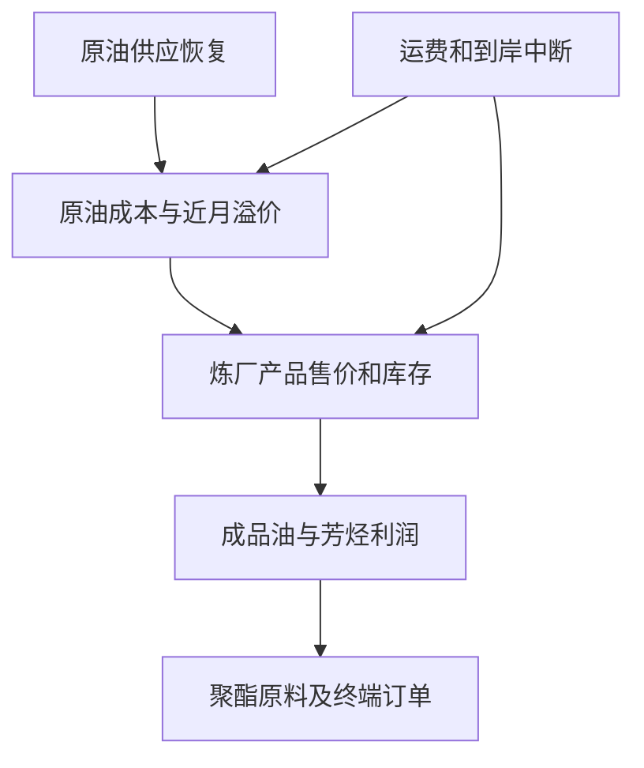
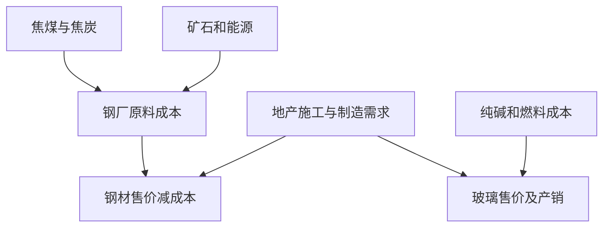
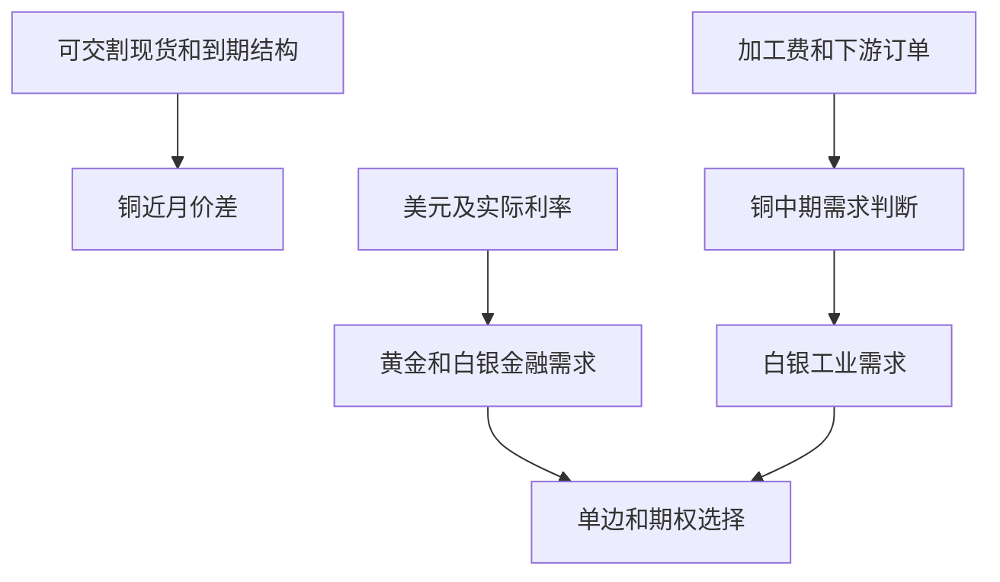
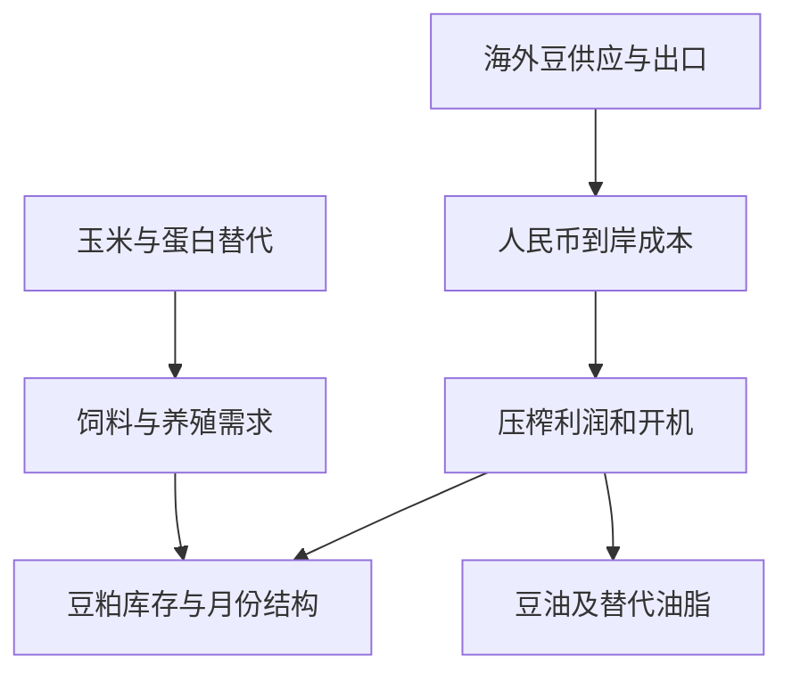
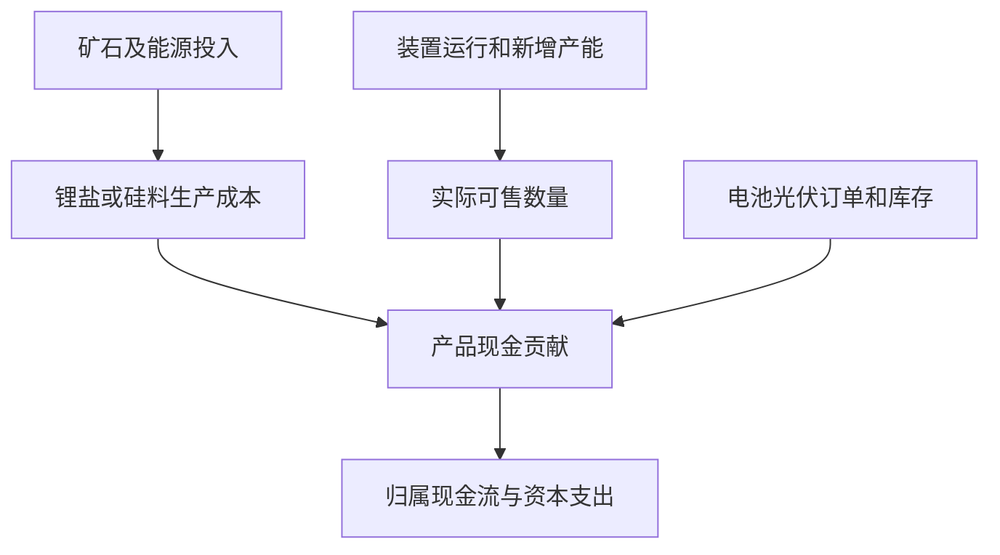

# commodities Radar

run_id: 20261113T172439+0800_563914ada587482986bfba7d67b58de0
information_cutoff_utc: 2026-11-13T09:24:39Z
generated_at_utc: 2026-11-13T09:47:50Z
registry_commit: 98c211cca9bcc97a1bfa8c22e5bd5865ac401c47
prompt_sha256: 7ad9973cd6c8c11095c8e7e323363d50343a1cfb09d56fb507119f77f0a8f813

## 1. 一句话结论

截至17:24，无可立即执行的合格新交易。原油供应恢复值得等待反弹失败确认；苹果长波动待真实成本，豆粕正套等回撤；铜月差与金银急跌不宜追价。

## 2. 数据质量与覆盖数表

**统一截点：2026-11-13 17:24:39北京时间（09:24:39Z）。** 本期日盘已经完成，当前指针为11/13 EOD、as_of15:00；report17:07:45生成，早于截点。研究读取发生在截点后不改变事实可得边界。固定商品提交`908dbe6e76c03b99e92be559abccf14653b3fcc7`，期权引擎提交`a4c16a18d16d039a30e9c162950096c9333a0a49`；完整商品期权研究来自商品库的当前采样链，不能把第二仓库SHA当已取得这些腿的另一独立来源。详见[完整合并输入](https://github.com/farfromexact/China-Commodities-Engine/blob/908dbe6e76c03b99e92be559abccf14653b3fcc7/data/report_input_latest.json)。

|模块/固定路径|requested / 原始观测及生成（北京）|应得/取得/分析|时效、验证与实际影响|
|---|---|---|---|
|Futures data/latest.json|11/13 / 11/13 EOD；16:46:43生成|5所806合同、77品种全读|vendor full_market_ready=true、source_date_match=100%，critical/excluded=0；SHFE238/INE63/DCE214/CZCE243/GFEX48；不是官方独立校价完成|
|Market data/market_state_latest.json|11/13 / 10/15—11/13；16:46生成|77，最多20个观察|缺11/3、11/4；最近20sessions仅18次观察；5D锚11/6、20D锚10/16；同合同不拼接主力，RV/z不当无缺口样本|
|Physical data/physical/latest.json|11/12 / 11/12；21:40生成|20目标、18series、2unavailable、0failed/carried/stale（源自评）|相对本次日盘已落后；C级现货多缺地域/品质/税费/交割，降背景；不能用于基差套利/实体方向确认|
|External data/external/latest.json|11/11 / 11/11；19:12生成|22目标、17映射、5unavailable|data_fresh=false、published=false；全部旧背景，不拿映射数量算当期国际层|
|Night data/night_session/latest.json|交易日11/13；11/12晚—11/13早；08:40生成|806选中/请求，503有夜bar/55产品，303no_night_trade|fresh/validation/published/coverage_complete均true；query_error/缺时点/缺价/未解析/outside均0、warning空；62.4069%是有夜成交比例，不是采集完整率|
|Options index/quality/surface与真实分片|11/13 EOD；16:50:25生成|64/64品种、468采样腿/64series，62ATM、1skew|core_v1/sampled_strikes；PL/ZC无局部ATM；surface/positioning/execution均false，bidask=0；期权价格非成交许可|
|Contract Metadata data/contract_meta.json|11/9；19:01生成|806对应；match67.49%、effective73.45%|partial；multiplier/tick/margin/limit约30.15%，night/delivery-unit为0；SC额外查官方动态通知，其他参数局部待核|
|futures_crosscheck|记录源日11/11，非11/13|官方当期可比较合同未取得|SHFE/INE/CZCE/GFEX为baseline_unavailable，DCE HTTP412 source_error；没有同日已比较“价格不一致”证据，也不能称成交量/OI官方已核|
|相关公司原件|中国石油10/28、天齐10/26披露Q3|限定2家公司，本次公开检索+原财报|经营/财务可读，现时价格、复权历史、行业正式成份与执行未核；不建独立股票榜。原PDF字节hash未取得，保留直达来源及验证级别|

Night的`last_completed_bar_close`、`completed_night_5min_bars`表示供应商已完成5分钟bar；`official_night_close_verified=false`。重点SC、CU准确时刻与官方制度一致；全源查询范围20:00—03:45不当所有产品交易时间。M/AP等未来会话及动态参数仍须按各所核验；未发现重点SHFE/INE calendar mismatch，不将局部核验扩成全77制度审计。今夜11/13尚未发生，不能冒充已完成11/13晚盘。

量价覆盖为46涨、25跌、6平（**settle对前settle**）；72品种源内liquidity_eligible，JR/PM/RI/WH/ZC零量零仓列不适用。77实际品种=63基线+14真实新增；LPG规范映射DCE:PG，绝不重复成78。所有77逐品种判断和缺口在第10栏。`close_return_pct`实际是close/pre_settle−1，本文日收益不用该列冒充前收盘回报；需前收盘比较时用固定Night原始previous_day_close重新计算。输入实际131文件共7,434,090字节（127商品文件4,726,719字节＋4指数期权文件2,707,371字节）的git blob、实际chat字节和重组content哈希证据由同批协调者保存；未另下载原gzip，故不宣称原gzip source_sha独立通过，结构与hash通过不代表行情预测正确。

## 3. 商品仪表盘

以下14项为展示仪表盘；其余63项在第10栏同样完成分析。当前价格为11/13供应商EOD，1D/5D均同合同结算收益%；RV为不完整历史可得样本年化%。量/OI/ΔOI单位手。curve为明确近/次月结算差占次月百分比，**不是自动选择的候选交易组合**。Physical统标C/D背景，未获可用A/B交割基差。

|板块/合约|close / settle|1D / 5D%|量 / OI / ΔOI|RV%|准确curve 与%|局部IV% / 判断|
|---|---:|---:|---:|---:|---|---|
|原油 SC2701|625.5 / 607.1|1.88 / -3.91|111,907 / 27,248 / 508|38.37|SC2612−SC2701 1.33%|54.11；日盘强反弹、近远月升水收窄与17:00供应恢复证据冲突|
|铜 CU2612|105,150 / 105,040|-0.1 / -0.07|115,530 / 185,375 / -4,784|9.74|CU2611−CU2612 3.12%|14.04；主力单边近乎平稳，12—01价差却进一步扩大|
|豆粕 M2701|3,147 / 3,129|-0.32 / 0.9|1,214,441 / 1,878,990 / 9,974|12.64|M2612−M2701 -0.38%|13.5；豆粕1—5价差收盘回升至309，超过旧306禁追|
|苹果 AP701|6,244 / 6,240|2.11 / 4.54|336,504 / 151,359 / -10,116|36.81|AP612−AP701 9.52%；roll|27.33；苹果涨幅较大但减仓，局部IV低于不完整RV样本|
|玻璃 FG701|916 / 914|3.04 / 2.47|1,920,089 / 1,191,514 / 45,465|19.04|FG612−FG701 1.2%；roll|25.47；玻璃涨幅与增仓均突出，强于纯碱|
|纯碱 SA701|991 / 993|1.74 / 1.95|1,803,474 / 1,152,318 / 42,882|18.25|SA612−SA701 -0.7%；roll|23.78；纯碱反弹增仓却弱于玻璃，近月contango|
|乙二醇 EG2701|5,197 / 5,159|3.32 / 4.77|1,723,733 / 361,992 / 1,479|31.27|EG2611−EG2612 -0.36%|35.2；乙二醇延续5/20日上涨且轻增仓|
|黄金 AU2702|841.48 / 840.96|-2.45 / -4.47|131,820 / 132,478 / 5,434|21.31|AU2611−AU2612 0.12%|24.45；黄金急跌且增仓，弱势需面对实际利率/美元反证|
|白银 AG2702|11,985 / 12,060|-3.48 / -4.1|916,271 / 277,627 / 7,346|40.06|AG2611−AG2612 0.52%|42.87；白银跌幅大于黄金且增仓，宏观与工业双因子可能叠加|
|碳酸锂 LC2701|90,580 / 91,580|2.81 / -0.39|314,472 / 367,672 / -16,577|34.67|LC2612−LC2701 0.74%；roll|46.06；碳酸锂反弹减仓、20日仍弱，不能认定新多回流|
|集运指数（欧线） EC2612|2,589.5 / 2,551|4.19 / 8.51|9,490 / 14,524 / -758|50.9|EC2611−EC2612 -15.54%|缺；航运5日反弹最强而20日仍大跌、OI减少|
|焦煤 JM2701|1,439 / 1,424.5|2.22 / 0.71|694,849 / 478,896 / 20,513|27.28|JM2612−JM2701 -0.91%；roll|31；当日反弹且增仓，5日仍仅微涨、20日偏弱|
|多晶硅 PS2701|33,810 / 33,880|-0.16 / -1.58|22,490 / 59,655 / 2,546|25.48|PS2612−PS2701 1.56%|28.07；多晶硅仍弱并增仓，近月升水不证明减产兑现|
|钯 PD2702|239.05 / 239.15|-2.82 / -1.71|5,748 / 8,835 / 869|37.3|PD2612−PD2702 -0.4%|32.9；钯明显下跌并增仓，工业与贵金属属性叠加|

**已完成Night的独立时点表（归11/13，非今夜）。** ΔOI全部缺失，不用表内涨跌推断新多/新空。

|准确合同|最后bar价|vs前close / vs前settle%|时间（北京）|质量与海外新增边界|
|---|---:|---:|---|---|
|SC2701|610.5|1.77 / 2.45|2026-11-13T02:30:00+08:00|fresh完整5min范围；非官方close；Night包含EIA后时段但无事件分钟路径；IEA17:00后尚无新报价|
|CU2612|105,060|0.1 / -0.08|2026-11-13T01:00:00+08:00|fresh完整5min范围；非官方close；外盘11/11映射过期，不声称截点实时传导|
|M2701|3,115|-0.51 / -0.76|2026-11-12T23:00:00+08:00|fresh完整5min范围；非官方close；外盘11/11映射过期，不声称截点实时传导|
|AP701|缺|缺 / 缺|无夜成交/制度待逐所核|不造夜盘收益；外盘11/11映射过期，不声称截点实时传导|
|FG701|913|2.01 / 2.93|2026-11-12T23:00:00+08:00|fresh完整5min范围；非官方close；外盘11/11映射过期，不声称截点实时传导|
|SA701|991|1.02 / 1.54|2026-11-12T23:00:00+08:00|fresh完整5min范围；非官方close；外盘11/11映射过期，不声称截点实时传导|
|EG2701|5,159|2.2 / 3.32|2026-11-12T23:00:00+08:00|fresh完整5min范围；非官方close；外盘11/11映射过期，不声称截点实时传导|
|AU2702|837.94|-1.95 / -2.8|2026-11-13T02:30:00+08:00|fresh完整5min范围；非官方close；外盘11/11映射过期，不声称截点实时传导|
|AG2702|12,066|-2.23 / -3.43|2026-11-13T02:30:00+08:00|fresh完整5min范围；非官方close；外盘11/11映射过期，不声称截点实时传导|
|LC2701|缺|缺 / 缺|无夜成交/制度待逐所核|不造夜盘收益；外盘11/11映射过期，不声称截点实时传导|
|EC2612|缺|缺 / 缺|无夜成交/制度待逐所核|不造夜盘收益；外盘11/11映射过期，不声称截点实时传导|
|JM2701|1,417.5|2.27 / 1.72|2026-11-12T23:00:00+08:00|fresh完整5min范围；非官方close；外盘11/11映射过期，不声称截点实时传导|
|PS2701|缺|缺 / 缺|无夜成交/制度待逐所核|不造夜盘收益；外盘11/11映射过期，不声称截点实时传导|
|PD2702|缺|缺 / 缺|无夜成交/制度待逐所核|不造夜盘收益；外盘11/11映射过期，不声称截点实时传导|

[仪表盘原始数据](https://github.com/farfromexact/China-Commodities-Engine/blob/908dbe6e76c03b99e92be559abccf14653b3fcc7/data/report_input_latest.json)；[Night逐合同](https://github.com/farfromexact/China-Commodities-Engine/blob/908dbe6e76c03b99e92be559abccf14653b3fcc7/data/night_session/latest.json)；[期权局部面](https://github.com/farfromexact/China-Commodities-Engine/blob/908dbe6e76c03b99e92be559abccf14653b3fcc7/data/options/surface_latest.json)。CU交易卡看12—01，仪表盘默认11—12；M交易卡看01—05，仪表盘默认12—01。这一差异是月份选择，不是数据矛盾。

## 4. Delta Research

前序为同模式最近已验证完整批次`20261112T234244+0800_5eb01e91f7534ca58a37d7036a7fddde`，截点11/12 23:42:44北京时间、完成11/13 00:06:29，早于本批。已读MD、JSON、run_manifest并核身份与hash。前序只证明旧观点；当前行情、同合同前日比较从固定数据重新核，不把旧报告当新行情来源。

|观点|previous → current|变化与下一处理|
|---|---|---|
|`COM-E-SC2701-IEA-FAILED-REBOUND-SHORT-20261113`|上版SC2612收复多rev3、64分，条件>614不追；无新供给恢复空头卡。 → 新增SC2701反弹失败空子观点、66分；父多新入场过窗且机制削弱。|EIA在前截点后01:00发布；17:00 IEA增供与水上库存证据新增，但日收上涨/近月仍升水强反证；L2、L3仅两层，等待未来失败反弹。|
|`COM-M-CU2612-2701-CURVE-RESILIENCE-LONG-20261106`|上版12−01 close1680/settle1450，59分，>1250不追。 → 当前2410/2130，较前分别+730/+680；机制线索增强，当前入场赔率更差，研究56分。|固定Night重核前日同合同，夜盘2180再到日收2410；不把默认11−12的z套到12−01，也不把大价差自动当可空泡沫。|
|`COM-M-M2701-2705-WASDE-BACKWARDATION-LONG-20261111`|上版01−05 close294/settle299，11/13 09:00—09:45新入场序列；>306不追，58分。 → 该窗口已过；night286→日收309、settle301，研究仍58分，仅条件性新窗口观察。|目前close超过306追价禁区，不能用夜盘286回填成交；01/05端点差重新计算，实体与准确海外合约仍缺；M Night286仅供应商待核归属观察，不纳正式Night→Day收益/因果或独立支持，L2只凭准确EOD曲线。|
|`COM-V-AP701-LONGVOL-20261112`|rev2准确6200C/P同close302/settle324、Delta+.0124，总支出上限300，未评分。 → 同腿当前close263.5/settle297、Delta+.1204，局部IV27.325%与RV36.806%，仍未评分。|询价预算更值得检查，不能认定真实成本跌破上限；spot/期限/Delta已变且缺bidask、未来事件、可比RV。保留11/24退出。|
|`COM-M-EG2701-RECOVERY-WATCH-20261112`|旧修复watch，需库存和装置负荷，无入场卡、未评分。 → EG2701结算1D+3.325%、5D+4.773%、20D+5.544%，ΔOI+1479；仍watch。|价量线索延续，但港口库存/装置负荷缺，跨化工最强不等于有正期望新交易。|
|`COM-M-AG2702-MACRO-REPRICING-WATCH-20261112`|双向watch，旧short已退役；此前close12341，12480/12820只是待确认观察位。 → 当前close11985、settle12060，结算−3.481%；与AU急跌同属宏观风险，旧空单不恢复。|价格更弱但已远离旧观察位，无新顺序/深度/宏观精确对齐，不补造旧触发；需防价格修复。|

**真实信息先后。** 11/12日盘→当晚至11/13早完整Night→11/13日盘EOD→17:00 IEA→17:24截点。SC2701前close599.9→night610.5→日close625.5，Night和日间端点涨幅分别1.767%与2.457%；后者不是从结算607.1扣出来的“夜盘增量”。SC曲线收窄，CU/M准确交易月差扩大，三者不能统一描述为曲线走弱。EIA于Night期间公开，不能把全段Night收益全部因果归给EIA。AP本源无夜成交，方案只按日盘条件复核；LC当日settle涨2.806%，close对前close却跌0.352%，两个口径说明不同事实，不能选择一边声称新多回流。

**未入榜保留。** EC2612结算5日+8.507%而20日−22.450%，旧反弹空继续方向失效，不因反弹寻找事后做空点；CU与M的旧目标被某端点穿越也不证明成交或组合PnL。首次空头父记录、AG退役和所有8个前序ledger完整保留，第10栏逐项列出。三日已知WASDE不是今日催化；新导入旧Physical/External也不是新证据。相关原始源：[期货](https://github.com/farfromexact/China-Commodities-Engine/blob/908dbe6e76c03b99e92be559abccf14653b3fcc7/data/latest.json)、[Night](https://github.com/farfromexact/China-Commodities-Engine/blob/908dbe6e76c03b99e92be559abccf14653b3fcc7/data/night_session/latest.json)、[IEA](https://www.iea.org/reports/oil-market-report-november-2026)、[AP链](https://github.com/farfromexact/China-Commodities-Engine/blob/908dbe6e76c03b99e92be559abccf14653b3fcc7/data/chat/options_CZCE_AP/part-001.json)。

## 5. 产业链图与公司利润校验

下列箭头是**有条件的传导机制**；箭头本身不增加证据层。五条链覆盖成本、售价、库存、交割与金融表达，季节性只作先验。全市场未入榜异常在第10栏逐项展开。

### 5.1 原油—炼化—聚酯：供给恢复与物流瓶颈并存

SC结算日涨1.880%，5日仍跌3.909%；EG日涨3.325%且5日/20日均正，强于多数仅日内反弹的能源化工；PG/FU/PX等中期仍弱。SC12−01日收差6.8小于前10，供应恢复假说得到期限的一点支持，但仍为backwardation，缺合格仓单/到岸基差证明。Night时SC2701已涨，17:00后新IEA尚无SC可交易反馈；不能写“利空出尽”或“市场忽视报告”。IEA供给/库存结构和EIA累库均计供需同层，不能把两个来源自动化为两个层。柴油与运费紧张使“原油供给多→所有化工利润均扩张”容易出错。SC局部IV溢价15.739pp、EG3.934pp；这限制买方向期权的成本优势，却不授权裸卖波动。[IEA](https://www.iea.org/reports/oil-market-report-november-2026)、[EIA](https://ir.eia.gov/wpsr/overview.pdf)、[当前期货/期权](https://github.com/farfromexact/China-Commodities-Engine/blob/908dbe6e76c03b99e92be559abccf14653b3fcc7/data/report_input_latest.json)。

**中国石油利润桥（有界2家公司中的第1家）。** 本次读取10/28公司原Q3，IFRS、YTD口径：炼油化工和新材料分部经营利润231.32亿元，对追溯后162.40亿元增加68.92亿元（Python算42.44%）。这是实质经营背景，不能证明11/13后油价走势或新增炼化利润已经出现。Q3报告是未审计财报；与归母净利、单季利润、CAS数字分开。[公司原件](https://www.petrochina.com.cn/petrochina/jdbg/202610/ed4e45a0d81149dab4549bd4cc570db4/files/e054e03d628b46588536bf47673d167f.pdf)。

|利润桥变量|若原油下跌的有利条件|转为不利/反证|本次实际决策贡献|
|---|---|---|---|
|售价与投入|产品售价降得慢于进料成本，且可售量稳定|成品价更快下跌或运输成本吞掉裂解差|不能仅凭SC做空同步做多炼厂股|
|销量/装置/结构|负荷与高价值产品比例提高可摊薄固定费|需求弱、检修、低毛利产品比重上升|缺最新装置/分品种量，吨毛利不填数字|
|库存/长协/套保|低价原料逐步替代成本较高库存|旧库存减值、长协锁价、套保损失或时间错配|现价变化不能直接变成当季净利|
|汇率/Capex/税与少数股东|成本节约能转成归属现金流|人民币贬值、投资支出和非控权益吸收收益|股票暴露是综合业务与资产负债表，不是SC一手替代|

有界表达为Δ经营利润≈旧销量×Δ单位贡献+Δ销量×原贡献+结构/库存/套保−增量费用，所有缺项保留未知；没有编每降10美元对应多少EPS。若下一期同口径炼化分部利润和经营现金流同时恶化，且产品—原料差未扩大，成本利好假说被削弱。现价/估值/执行未核，当前**SC条件研究或不交易优于以未知估值买股票**；此公司经营资料不为SC空头凑第三个独立支持层。

### 5.2 焦煤—钢材与纯碱—玻璃：强原料和强成品须分开

JM结算日涨2.225%、增仓20513，而RB/HC并没有对应强势终端证据；原料强可能挤压钢厂，并非全黑色同向利多。FG/SA分别日涨3.044%/1.742%、增仓45465/42882，FG夜盘较前close+2.011%、SA+1.019%，部分涨幅已经在上一夜盘出现。FG近次月+1.204%、SA−0.705%，但两对均roll，不能拿滚动前后价差做稳定z或套利。FG相对SA强可来自玻璃减产、补库或投机仓位，缺产销、冷修、现货成交与厂库是最大缺口。纯碱每吨消耗、燃料工艺与库存计价未核，禁止等手FG−SA直接称“玻璃利润”。IV-RV分别+6.428/+5.530pp，也不证明有廉价长波动。11/16地产/工业数据是下一决定性观测；链条置信度中低，只观察相对表现。[全量数据](https://github.com/farfromexact/China-Commodities-Engine/blob/908dbe6e76c03b99e92be559abccf14653b3fcc7/data/report_input_latest.json)、[统计局排期](https://www.stats.gov.cn/fbyg/?qt=2026)。

### 5.3 铜交割结构与金银：两个不同的风险源

CU单边结算仅−0.095%，准确12−01价差却从1680扩大至2410，Night2180；默认11−12还受更近交割月影响，不能用该对3.123%/z2.488证明交易卡12−01同等极值。最大缺口是可交割库存/仓单、近月集中度与真实借货成本，故不追正套，也不凭“涨多”反套。BC与CU跨所需税费、汇率、品牌、时间与交割转换，未对齐不称无风险价差。AL/AO、NI/SS也只有价格链关系，实际吨耗、加工费、矿端政策未核；相关性不是中性保证。

AU/AG分别结算−2.450%/−3.481%，且增仓，不可把方向判断直接归为“新空入场”；上一Night已分别较前close−1.947%/−2.228%。实际利率和美元为全球报告核验的共同风险，本商品稿没有精确同步现货FX/海外金银合约，不另凑第四层。黄金3—6月有限风险保险可以作为未来工具比较，不能由避险需求推出当日买入；当前AU2702期权1/25到期，**也不自动等于3—6月工具**。AU/AG局部IV-RV+3.134/+2.808pp，未有期限面、Vega或真实ask，暂不选择长凸性价位。白银旧short仍退役，弱势watch与新做空是两回事。置信度：价格与铜结构高、实体解释低。[期货/局部IV](https://github.com/farfromexact/China-Commodities-Engine/blob/908dbe6e76c03b99e92be559abccf14653b3fcc7/data/report_input_latest.json)。

### 5.4 大豆—油粕—饲料养殖：近月紧张不等于整个农业牛市

USDA全球豆库存下调支持紧平衡背景，但已公布三日，不能算本日新催化。M结算日跌0.319%而01—05日收差扩大至309，说明单边与跨期需分开；夜盘差286到日收309并未给本批自动交易机会。RM/Y/P/OI各自贸易政策、油粕联产与季节不同；国际报告不替代中国到港、油厂开机和可交割库存。中国玉米饲用替代在WASDE中构成反证，C/CS弱势仍须国内收购价验证。LH当日反弹减仓并不证明猪企经营拐点，JD较强却要存栏/淘鸡/现货验证；不能把期货反弹映射到股票盈利。M局部IV13.505%对RV12.639%的0.866pp差很小，未足以覆盖交易摩擦；油粕套利缺真实产出率、税费与汇率，保留不交易。置信度：全球粮油月报中、国内近月实际供应低。[WASDE](https://esmis.nal.usda.gov/sites/default/release-files/796142/wasde1126.pdf)、[当前全品种](https://github.com/farfromexact/China-Commodities-Engine/blob/908dbe6e76c03b99e92be559abccf14653b3fcc7/data/report_input_latest.json)。

### 5.5 锂与硅：商品反弹、经营改善、矿储增量是三个时钟

LC结算反弹2.806%却减仓16577，close比前close仍低0.352%；PS日跌0.162%并增仓2546，20日−9.882%。LC近月小升水与PS+1.564%曲线都不证明减产落地；尤其LC pair roll、跨日曲线z不可比。高局部IV（LC46.065%、PS28.075%）及缺仓单/电力/排产让“低价反转”不足以构成新仓。本次相对63代码基线新增覆盖的PD/PT/PL/BZ/OP等单列，未由此推断上市日期，不能把新能源篮子等名义称中性。

**天齐利润桥（第2家，结束本领域限定公司扫描）。** 10/26原Q3披露单季营收60.37亿元、归母13.60亿元、扣非13.34亿元；YTD现金流56.45亿元。公司解释包括销售均价/量改善以及SQM投资收益估计，因此该披露反驳“期货跌所以全行业必亏”，也反驳“股权就是LC同倍率”。这是旧Q3经营信息在本次重核，不能称今日新盈利拐点。最新限定公告检索曾定位11/13措拉资源核实标题，但未取原件，数字与即时产量影响不纳事实支持。[天齐原件](https://static.cninfo.com.cn/finalpage/2026-10-26/1225620881.PDF)。

|利润桥|正向条件|最强反证/可推翻条件|
|---|---|---|
|产品售价/销量与矿成本|售价稳定或回升、可售量增加且投入成本滞后|售价下降快于成本、销售不及产量；缺合同价/矿耗不能量化吨毛利|
|库存、套保与产品结构|低成本库存兑现、价差对冲有效|库存减值、套保错配或产品降级令现金贡献下滑|
|SQM、汇率与归属|联营盈利兑现并可分配、人民币汇率稳定|估计投资收益修正、少数股东及税费吸收利润；现金流不随会计收益|
|Capex与矿储|已核可建产能在可行成本内按期投产|资源核实只是地质/行政阶段，不能直接计今季产量；建设现金开支可能先到|

若下次同口径产品量价与扣非/经营现金流同步恶化，经营修复会被削弱；现有信息不允许填精确敏感系数或合理PE。直接LC期货更纯粹但有保证金和尾险，LC期权成本待询，股票加入矿权/联营/治理/估值/汇率/Capex；当前不具“更优股票表达”的价格证据，维持商品观察和不交易。两公司财务、股价、历史、行业成份、执行能力分别判断：仅原财务可用，其余本次未核。

## 6. 统一机会榜与五层评分

得分仅代表研究优先级，非胜率、仓位或预期收益；原权重逻辑25/赔率25/催化20/价格期限波动15/拥挤技术15。未评分不填0或假数，执行硬门槛独立。相差1分无经济显著性。

|排名/稳定idea|方向、期限、工具与阶段|五层支持/反证/缺失|分项与总分|研究 / 证据 / 执行|
|---|---|---|---|---|
|1 `COM-E-SC2701-IEA-FAILED-REBOUND-SHORT-20261113`|SC2701失败反弹空，1—4交易日，新子观点|L1反对（日涨）；L2支持（升水收窄）；L3支持（IEA/EIA同类供需）；L4缺新同刻映射；L5中性/成本反证|21/16/17/6/6=66，2层上限69|待验证优势 / 中低 / 等触发与报价；裸期货无结构最大损失|
|2 `COM-V-AP701-LONGVOL-20261112`|买AP7016200C+P，至11/24前，rev3|L1涨减仓中性；L2roll中性；L3未来事件缺；L4缺；L5低局部IV相对缺口RV是线索|待评分：关键ask、事件与期限匹配不足|证据不足 / 低 / 待询价；只有实际支出核齐才能限损|
|3 `COM-M-M2701-2705-WASDE-BACKWARDATION-LONG-20261111`|买M2701卖M2705，最迟11/18，rev5|L1单边弱中性；L2支持（准确01/05差扩）；L3国内库存缺；L4旧WASDE不支持月份定价；L5中性|18/16/10/8/6=58，1层上限59|方向假设 / 低 / 旧窗口到期、新条件待核；两腿不封顶|
|4 `COM-M-CU2612-2701-CURVE-RESILIENCE-LONG-20261106`|CU12/01正套观察，最迟沿旧11/20，rev14|L1单边不确认；L2支持但过度追价风险；L3仓单缺；L4准确LME映射缺；L5中性|20/6/9/13/8=56，1层上限59|当前无入场优势 / 低 / 禁追；不机械反套|
|5 `COM-M-EG2701-RECOVERY-WATCH-20261112`|EG2701修复观察，1—20交易日，rev2|L1支持线索；L2默认11/12不解释主力方向；L3库存负荷缺；L4旧源缺；L5溢价中性|待评分：实体和新交易定价不足|证据不足 / 低 / watch，无完整交易卡|

**给分变化解释。** SC是由父多头拆出的新方向，不拿66对旧64声称准确率提升：新增供给催化提高逻辑/催化，但涨价反证压低价格与技术；2层上限硬保留。M总58不变，曲线改善使价格项7→8，WASDE老化使催化11→10，其他不变。CU59→56：曲线项12→13，当前价离价值区更远使赔率8→6，催化10→9、拥挤/技术9→8；没有凭空认定仓位拥挤，技术项仅评执行距离和挤压风险。AP/EG继续未评分，不能以榜单名次代替数值分。

**当前不占新仓额度的重点观察。** FG相对SA与JM相对RB/HC是利润研究入口，配料/库存缺则不建中性篮子；AU/AG急跌、LC回补和EC反弹分别有新价格事实但缺完整新卡，不额外开第二榜。相关公司只校验利润与表达，没有独立股票候选。两报告同SC主题复用同ID，同一油价冲击、美元/实际利率、中国需求与风险资产尾部均合并预算；未知真实账户不声称优化完成。

CU观察完整条件：当前12−01 close2410/settle2130，旧价值区950—1050及>1250禁追保持；没有可验证新完整入场卡。回价值区仅触发重新研究，须交割仓单/深度/费用与准确两腿同步确认。旧stop750、TP1400/1700、11/20 14:45保留在原建仓版本，不因当前价越过目标认定成交或盈利。当前不建新正套，也不凭高价差建立未研究反套。

EG观察完整条件：仅观察EG2701准确合同价量与新港口库存、装置负荷、聚酯订单及成本；结算5日+4.773%、ΔOI+1479不是独立实体确认。没有基本面新增与可成交净R前不设置新入场/止损/TP，也不用0分填缺。局部IV35.205%高于RV31.271%，买call未证便宜；不以oil跌推定利润一定扩张。

## 7. 完整研究与交易卡

### 卡1｜SC2701供给恢复后的反弹失败空：新子观点，当前等待

**身份与三轴。** `COM-E-SC2701-IEA-FAILED-REBOUND-SHORT-20261113`，首次提出为本批研究，父观点`COM-E-SC2612-HORMUZ-RECLAIM-LONG-20261111`。期限1—4个交易日；研究是待验证方向优势，证据只有期限、实体两层支持，66分；执行状态为待新窗口、准确盘口与参数。当前没有触发、订单、持仓或收益回执。旧SC2612多头不是靠换名变为空头；其>614禁追、599止损、630/648目标仍留原台账；最初rev1退出是11/17 22:55，商品前序rev3未来新仓版已提前至11/17 14:55，两版并列保留，不修改任何真实仓位的建仓版本。

**事实、定价、推断与反证。** SC2701当前close625.5、settle607.1，前close599.9/settle595.9；夜盘610.5（11/13 02:30，较前close+1.767%、较前settle+2.450%，ΔOI缺），随后日收较前close+4.267%，当日结算收益+1.880%。准确SC12−01收盘差从前10降至6.8，夜盘为7.4，结算12降至8.1：远月相对更强，不能称整条曲线已经转contango。17:00 IEA在日收之后才公布，本批不能把日盘反弹归因于它。新增供给与累库证据削弱持续短缺解释，但未取得IEA后准确Brent/SC新价格，故“未充分定价”只是下一夜盘待检假说。主要PnL来源为未来反弹失败后绝对油价回落，不是赚曲线差、库存持有收益或已知预测误差。最强竞争解释是货在水上而非到岸、柴油/物流紧张及袭击风险仍需溢价；今日涨价就是强反证。IEA、EIA共享供需冲击仅计L3，不再拆成独立国际第四层；较高SC IV也不计空头第五层。[准确期货](https://github.com/farfromexact/China-Commodities-Engine/blob/908dbe6e76c03b99e92be559abccf14653b3fcc7/data/latest.json)、[已完成Night](https://github.com/farfromexact/China-Commodities-Engine/blob/908dbe6e76c03b99e92be559abccf14653b3fcc7/data/night_session/latest.json)、[IEA](https://www.iea.org/reports/oil-market-report-november-2026)、[EIA](https://ir.eia.gov/wpsr/overview.pdf)。

**工具与参数。** 自然表达为卖SC2701一手或其整数倍；1000桶/手，0.1元/桶tick=100元/手。625.5对应名义625500元，不等于风险或保证金。动态通知为18%限幅、一般20%/套保19%交易所保证金；607.1结算锚的一般保证金121420元/手，券商加收另核。SC2612/2701日内开仓上限500手及实控合并规则不得忽略。SC2701元数据last trade12/31，实物交割；本卡11/19退出不计划roll或交割。静态手册4%/5%已经过时。下一SC合法窗口11/13 21:00—11/14 02:30，归属11/16交易日，由官方规则推导。[合约](https://www.ine.cn/upload/20240325/1711331212000.pdf)、[动态参数](https://www.ine.cn/publicnotice/notice/202610/t20261030_833905.html)、[限额](https://www.shfe.com.cn/publicnotice/notice/202611/t20261109_834009.html)、[会话](https://www.shfe.com.cn/services/calenderandholidays/tradinghours/)。

**新入场AND与先后。** 只在11/13 21:00—21:45重新观察：①首个完整15分钟bar曾进入627—634而收≤624；②21:30前仅观察，不建新仓；21:30计划公布的美国PPI须已实际发布，且之后至少一个完整5分钟bar反测624—625并收≤624（最早21:35才可能确认）；③确认后仍有624—625的真实可成交卖价，AND同刻SC2612−SC2701≤6.8，AND参数、深度、费用、临时通知与账户权限全部通过。627—634和624—625是围绕当日625.5收盘的**主观失败反弹观察带**，不是已测历史阻力。仅OHLC触价不算顺序确认。q≥2且偶数才先50%，另一次独立5分钟反测失败且仍能在624—625成交才余50%；q=1一次完整一手，不能半手。若首个15分钟高于635仍站稳，或直接低开<615没有反测，或21:45前不完整，取消本窗口；报价离开624—625不追，不追到621附近以“利空已确认”为由牺牲赔率。下一天自动重挂不授权。

**止损/逻辑/目标分别处理。** 新仓价格止损635；它是计划订单线，跳空与封板可越过。逻辑失效为15分钟收≥635 OR同期近远月差重新>10且连续两个5分钟保持 OR新可信事实推翻供给恢复；任一满足即取消未成交部分，若有真实仓位则按可成交条件退出。TP1=600，TP2=585：前者接近前日599.9 close，后者为更深回撤的主观情景；不是保证到达。偶数手TP1减半、TP2余半，单手在TP1全部退出；全部最迟11/19 14:55 BJT退出，不延长。首次确认前不得假定有624理想成交。

**成本后赔率。** C为开平手续费与滑点合计元/桶，均是预算假设。净R1=(E−600−C)/(635−E+C)，要求≥1.5等价E−C≥621，且仍须入口624—625。净R2=(E−585−C)/(635−E+C)。

|情景|E / C 元每桶|止损损失/手|TP1净收益/手|净R1 / 净R2|结论|
|---|---:|---:|---:|---:|---|
|好|625 / 0.4|10,400|24,600|2.37 / 3.81|成本门槛通过，仍待所有条件|
|中|624.5 / 1.0|11,500|23,500|2.04 / 3.35|成本门槛通过，仍待所有条件|
|坏|624 / 3.5|14,500|20,500|1.41 / 2.45|放弃|
|禁追边界|621 / 1.0|15,000|20,000|1.33 / 2.33|放弃|

**尾部与规模。** 以624.5入场参考、当前607.1结算及恒定18%假设，一次/连续两次涨停理论价716.378/845.326，损失约91878/220826元每手，尚未计费用且未按tick取整；交易所扩板会更差，绝非最大亏损。跳至660约亏35500元；保证金率再加5个百分点，仅锚点就另需30355元现金。海峡袭击、周末海外大波动、中国休市、买盘消失、人民币贬值均会放大空单损失。试仓计划风险选NAV0.25%，仍在规则0.25%—0.75%区间低端；q同时满足计划止损预算、独立两限幅压力预算与现金约束，尾部损失分母还必须加真实全程费用及额外gap/流动性buffer，再取整数向下；这些输入未知时不给手数。未知NAV/现仓不能报手数；若一手已超尾部承受能力则q=0。确认预算0.75%—1.50%不是本卡自动加仓许可；同能源主题两报告合计上限2.5%—3.0%，现有原油、炼厂股票、运费或相关汇率敞口先扣。跨报告同ID只有一笔风险预算。

**催化与表达选择。** 今晚11/13 21:30美国PPI可能改变美元/利率和油价，未取得未来结果；必须等待实际发布后的完整5分钟确认，延迟发布使21:45前条件不齐则取消，不顺延窗口。来源：[BLS官方排期](https://www.bls.gov/schedule/2026/11_sched_list.htm)。未来1—4交易日检验供应恢复能否压低近月紧张，11/18 23:30下次EIA提供新库存；当日17:00 IEA已发生。新地缘扰动随时可逆转。SC2701局部ATM IV54.11%高于缺口样本RV38.37%，直接买put未证明便宜；可在未来取得完整同到期准确腿和ask后比较有限支出put spread，但现在无可执行成本，不用未报价期权为本期货封顶。原油正反套只赚相对月份机制，与本卡绝对方向不同；当前近月仍升水，使直接做空近月更易受挤压。若得不到失败反弹顺序，**不交易**优于裸卖期权获取高IV。

---

### 卡2｜AP701C6200＋AP701P6200：有界询价的长波动观察

**身份和机制。** 沿用`COM-V-AP701-LONGVOL-20261112` rev3，首次11/12 07:07:30，仍待评分。研究为未来实际波动相对真实期权成本的优势待验证，现有局部IV/RV只是一条有局限的第五层线索；证据不充分、报价未就绪。当前underlying AP701 close6244/settle6240，较前close6201涨0.693%、结算涨2.111%；本源AP无夜成交，已得官方静态日盘规则，本次未取得新增夜盘公告的完备核验，方案不套用商品21:00窗口。可用8条采样腿中选已存在的6200C与6200P，expiry2026-11-26、美式，各+1一组，期货乘数10吨已由郑商所静态业务细则复核；期权tick0.5元/吨即每腿5元/手。C close149/settle168.5、P close114.5/settle128.5，close合263.5、settle297，均非ask或成交。C/P IV26.64/28.01%，Delta+.5610/−.4406，和+.1204；Gamma和.0024为Wind原生，Vega、Theta和标准化验证缺。没有用put-call近乎对冲冒称Delta恒为0。[准确链](https://github.com/farfromexact/China-Commodities-Engine/blob/908dbe6e76c03b99e92be559abccf14653b3fcc7/data/chat/options_CZCE_AP/part-001.json)、[官方手册](https://www.czce.com.cn/cn/rootfiles/2024/03/26/1708572241871702-1708572241883510.pdf)。

**新增与已定价。** 局部ATM IV27.325%对可得样本RV36.806%低9.481个百分点；RV含历史数据缺口，expiry仅余13自然日，与20观察年化样本不等期限。当前两腿close/settle合低于上版302/324，但标的和剩余期限都变，不是已实现波动套利利润。当前减仓10116手与日涨更兼容多种回补/平仓解释。没有已核新天气、品质、库损事件，低IV可以合理反映未来波动减弱、季节性或采样偏差；最强反证正是时间耗损和RV回落。主要PnL来自实际剩余波动/IV重估超过支出及费用，不能以期货涨跌方向替代组合mark-to-market。

**只接受新窗口、完整组和报价。** 按静态日盘安排暂拟11/16，须执行前复核2026郑商所休市与临时通知后，在09:15和09:30各取同刻双腿bid/ask及underlying；AND明确真实事件/波动来源，AND组合绝对Delta≤0.20，AND两次全程成本D+C≤300元/吨，AND可平仓双边深度、行权流程、动态保证金/限幅及交易资格完成；缺一项继续观察。0.20是主观方向暴露上限，不是风险已中性。禁止把价已移动的6200两腿静默换成其他strike/expiry沿旧成本。q≥2且偶数才50%完整组后至少再一根15分钟bar重询价建余50%，总加权支出仍≤300；q=1一次完整组，不拆C/P变方向赌注。

**预算与退出沿袭。** 主观情景为到期相对6200偏离600元/吨；要求该情景净收益至少等于全部期权支出，反推D+C≤300，不赋该幅度概率、不称公平价值。到期理论PnL=10×(|F−6200|−D−C)，只有真实总支出确认且未自行或到期自动行权转为未管理期货时，最大期权损失才等于该支出。当前3000元/组只是上限约束，不是已锁定的成交风险。原rev2条件保留：真实组合可卖出bid总值扣退出费较入场支出下降40%为计划退出线；无bid/跳空可损全部支出。TP1净卖出价值达真实成本1.5倍、偶数组减半，TP2=2倍余半，单组TP1全部退出；逻辑失效为新证据推翻剩余波动假说或双腿深度持续缺失。最迟11/24 14:45退出，早于11/26到期；无延长期限。美式提前行权可能生成期货和保证金，须核券商通知与弃权/平仓流程，不自动承接交割。

|询价预算情景（非报价）|D＋C 元/吨|最大期权支出/组|到期盈亏平衡|偏离600的净收益/净R|处理|
|---|---:|---:|---|---:|---|
|好|264+6=270|2700元|5930/6470|3300元 / 1.22|仅成本合格|
|中|294+6=300|3000元|5900/6500|3000元 / 1|仅成本合格|
|坏|324+10=334|3340元|5866/6534|2660元 / 0.8|超预算放弃|

在300总支出情景，到期5800或6600只赚1000元，6200亏3000元；因此“看起来历史波动大”不能代替概率/成交。静态AP期货8%限幅只作风险比较：6240锚的一次跌停每手损4992元、恒定两次跌停9584.64元，两次涨停空单损10383.36元；本次未把11/9的8%/9%元数据当当前已核参数。期货单腿虽没有双权利金耗损，却必须选对方向；长跨式预付成本换凸性，短跨式/卖strangle有跳空尾险，拒绝用卖方IV溢价伪装无风险。IV塌陷、无移动、周末流逝、两腿bid消失为最不利组合；Vega未取得不编每1vol盈亏。q≤floor(0.0025×NAV/真实每组全支出)，同农品/极端天气主题先合并，未知NAV与持仓不给手数。确认后0.75%—1.50%及主题2.5%—3.0%只是规则边界，不自动扩仓。

补充静态规则来源：[郑商所苹果期货业务细则](https://www.czce.com.cn/cn/uploadfile/2024/03/05/20240305170625629.pdf)，10吨/手、1元/吨tick、09:00—11:30/13:30—15:00、10:15—10:30休息；静态规则不替代当期休市/新增夜盘公告或动态参数。

**到期核验级别。** 11/26为固定供应商准确两腿的expiry字段。已重读官方期权手册第43—44页：苹果到期为交割月前两个月最后日历日（含）之前倒数第3个交易日；2027年1月对应2026年11月末，在常规周一至五安排下11/30、11/27、11/26相容。但未取得郑商所当期完整休市和临时变更清单，不冒称具体AP701到期日已获交易所最终独立确认；执行必须复核，若冲突取消本卡而非悄悄改expiry。

---

### 卡3｜M2701−M2705正套：旧窗口到期后只设新观察，不追309

**身份与判断。** `COM-M-M2701-2705-WASDE-BACKWARDATION-LONG-20261111` rev5，首次11/11 07:08:24，58分=18/16/10/8/6。研究是国内近月相对远月紧张的方向假设；当前只有准确曲线L2算独立支持，WASDE全球豆紧不能证明国内月份错价，故按1层封顶59。执行为新观察窗口等待、参数未齐。此前11/13 09:00—09:45已过去，OHLC没有证明先回撤再确认，不假定已成交。新窗口计划只适用于未来新仓，不替未知旧仓调整参数。

**准确双腿及反证。** 买M2701/卖M2705，1:1整数手；两腿同口径货币PnL为m×[(01退出−01入场)−(05退出−05入场)]−全部费用，m须官方核准，两合约乘数不得用保证金名义替代。当前close3147/2838差309，settle3129/2828差301；前close3131/2837差294，前settle3139/2840差299。11/12 23:00完成夜盘3115/2829差286；01较前close−0.511%、较前settle−0.765%，05为−0.282%/−0.387%，两腿ΔOI缺。夜盘差先比前日低、日收又高，只是同刻端点序列，不证明日内交易先后；当前01 ΔOI+9974也不代表净新多。默认数据near-next是M2612/M2701，不能替代本卡01/05。USDA11/10已经被市场看见，国内到港、库存、开机和人民币/CBOT同期准确合约仍缺；近月升水可由交割和季节性产生，并非无套利偏离。[期货](https://github.com/farfromexact/China-Commodities-Engine/blob/908dbe6e76c03b99e92be559abccf14653b3fcc7/data/latest.json)、[夜盘](https://github.com/farfromexact/China-Commodities-Engine/blob/908dbe6e76c03b99e92be559abccf14653b3fcc7/data/night_session/latest.json)、[WASDE](https://esmis.nal.usda.gov/sites/default/release-files/796142/wasde1126.pdf)。

**新观察的AND顺序。** 首先核大商所M下一实际夜盘规则与假日安排；仅若11/13夜盘确实开放，21:00—21:45测试价差296—300且首15分钟低≥290→21:15完整15分钟收≥303→后续5分钟低≥300且收301—303→确认后仍有可执行价差301—303。AND准确、同一已识别CBOT豆粕/大豆映射合约及币种口径能支持旧1220阈值；前序未给足可核合约身份，因此**该国际条件当前不能通过**，也不能把任意连续合约1220填入。AND双腿bid/ask、手续费、乘数/tick、现行限幅/保证金、组合优惠、最后交易/交割与资格全部核齐。无此核验只观察，不能发送订单；已知已过早盘绝不重放。大商所会话未核前，21:00只是条件性候选时间，不能称正式已核合法许可。

**保留参数和撤单。** 新入场50%在301—303，至少再一根5分钟守303且可成交≤306才其余50%，q须≥2且偶数，否则一次完整1:1组。所有腿同步深度校验，部分成交立刻按预设对冲/撤单流程，不承受未知裸腿。>306不追；成本E+C≤310，否则放弃。止损仍290；逻辑失效仍15分钟价差<296 OR原准确海外映射<1220 OR国内库存/交割证据否定近月紧张。TP1=340、TP2=370，偶数组半半、单组TP1退出；最迟11/18 14:55，不延长。原rev1的268/330/360与后续290/340/370并列留台账，不能挪真实旧仓的止损。该序列只有回撤后重新收复才成立，当前309不能获得更好历史成本。

**净R与压力。** 价差单位下，净R1=(340−E−C)/(E−290+C)，净R2=(370−E−C)/(E−290+C)。C包括两腿开平、滑点和部分成交预留，均假设。

|情景|E/C|计划止损损失点|TP1净收益点|净R1/净R2|处理|
|---|---:|---:|---:|---:|---|
|好|301/2|13|37|2.85/5.15|成本合格仍待所有输入|
|中|303/4|17|33|1.94/3.71|成本合格仍待所有输入|
|坏|306/6|22|28|1.27/2.64|放弃|

两腿现行限幅/保证金仍缺，不伪造1/2停板具体金额。若01跌停而05涨停，单次损失=m×(3129L01+2828L05)，连续两次为m×[3129(1−(1−L01)^2)+2828((1+L05)^2−1)]；m与L必须取真正适用值，且扩板会更坏。相关性断裂、近月交割挤压、汇率变化、进口政策、海外周末波动、单腿无报价和取消组合保证金是尾部；“双腿”不保证限损。试仓0.25%NAV的q公式必须同时满足上述尾部及保证金现金，当前输入不齐q没有可发布数值。直接M多头承担更多豆价/汇率风险；跨期减少部分共同价格暴露却保留交割尾险；期权月份组合需两到期真实报价，不能以假设权利金替代本卡。未来1—3交易日国内到港/库存和下周中国数据才决定复核；无新增实物证据时等待优于追价。

**夜盘解释限定。** M01−05的286为供应商已完成5分钟bar观察；DCE官方归属与会话本次尚未独立核齐，原始时点/标签保持，不纳正式Night→Day因果、收益分解或独立支持。58分中L2仅凭当前准确同合同EOD曲线，未用该Night观察增加证据层。

## 8. 商品期权专项

**覆盖边界。** 11/13同一EOD，64目标/64成功产品、468采样腿、64series；62局部ATM、仅C一项skew ready，PL/ZC不可用。`core_available`不等完整面；`surface_ready=false`、`positioning_ready=false`、`execution_ready=false`且bidask覆盖0。AP、SC、LC、PS、AO已读实际分片，其中AP8腿逐腿审；剩余按完整series面扫描，没有将468样本冒称全链。如下15项对照，全部64的局部状态并入第10栏77品种矩阵；所有值为百分数，差为百分点。[完整局部面](https://github.com/farfromexact/China-Commodities-Engine/blob/908dbe6e76c03b99e92be559abccf14653b3fcc7/data/options/surface_latest.json)。

|标的/到期|ATM strike|ATM IV%|可得RV%|IV−RV pp|研究含义|
|---|---:|---:|---:|---:|---|
|AP701 / 2026-11-26|6,200|27.325|36.806|-9.481|局部低IV仅研究线索，缺未来路径/真实成本|
|PD2702 / 2027-01-08|240|32.9|37.304|-4.404|局部低IV仅研究线索，缺未来路径/真实成本|
|AO2701 / 2026-12-25|2,650|14.375|14.529|-0.154|局部低IV仅研究线索，缺未来路径/真实成本|
|CF701 / 2026-12-11|15,600|9.455|10.481|-1.026|局部低IV仅研究线索，缺未来路径/真实成本|
|C2701 / 2026-12-16|2,180|8.54|7.802|0.738|正溢价可能是事件/流动性补偿，不自动可卖|
|M2701 / 2026-12-16|3,150|13.505|12.639|0.866|正溢价可能是事件/流动性补偿，不自动可卖|
|CU2612 / 2026-11-24|106,000|14.04|9.738|4.302|正溢价可能是事件/流动性补偿，不自动可卖|
|SC2701 / 2026-12-15|610|54.11|38.371|15.739|正溢价可能是事件/流动性补偿，不自动可卖|
|FG701 / 2026-12-11|910|25.47|19.042|6.428|正溢价可能是事件/流动性补偿，不自动可卖|
|SA701 / 2026-12-11|990|23.78|18.25|5.53|正溢价可能是事件/流动性补偿，不自动可卖|
|EG2701 / 2026-12-16|5,200|35.205|31.271|3.934|正溢价可能是事件/流动性补偿，不自动可卖|
|LC2701 / 2026-12-07|92,000|46.065|34.67|11.395|正溢价可能是事件/流动性补偿，不自动可卖|
|PS2701 / 2026-12-07|34,000|28.075|25.476|2.599|正溢价可能是事件/流动性补偿，不自动可卖|
|AU2702 / 2027-01-25|840|24.445|21.311|3.134|正溢价可能是事件/流动性补偿，不自动可卖|
|AG2702 / 2027-01-25|12,100|42.87|40.062|2.808|正溢价可能是事件/流动性补偿，不自动可卖|

**事件凸性。** AP是成本最值得复核的已知准确结构，但13自然日到期与历史RV不匹配，未核天气/品质新事件，不将负IV−RV当预期盈利。SC较高IV可能补偿供应/地缘尾部；买put/payoff有限损结构需真实ask，卖put或跨式则仍有跳空/封板尾险。LC同样高溢价，减仓反弹与政策/排产疑问使IV高有竞争解释。AU保险适合另查3—6月期限；当期1/25采样不是那条曲线，不能把它外推成长期便宜。持有有限凸性还要面对时间耗损，低名义波动不代表低风险。

**Skew与仓位。** C2701 12/16的局部RR25=+0.26pp、BF25=+0.43pp，仅本series具备采样delta插值条件，不能推广全玉米期限或全部商品；先复核源定义、同刻Delta和小价差的可成交性，当前没有skew交易优势。SI产品已ready的是SI2701、12/7到期、ATM8600/IV13.73%，期货主力却SI2612，故产品ready不等于主力IV-RV可配对。其余63不算RR25、尾部斜率或期限面；有call/put OI也不能推dealer净Gamma方向。AP Delta+.1204、Gamma原生和.0024只是在6240结算邻域的局部估计，现时标的变化需重算；Vega/Theta缺失，禁止写精确对冲手数或单位vol利润。

**Vol相对价值与替代。** 可观察AP/PD相对SC/LC的IV−RV差，但跨商品maturity、实现样本、跳跃结构和相关性不同，当前未形成可实施的long-cheap/short-rich篮子。等名义、等权利金和等Vega是不同风险口径；没Vega不冒称Vega-neutral。没有未来事件证据时买更贵的保险也可劣于等待；若对冲真实库存/期货，先量清Delta风险，再决定支出上限，不能将对冲效用算独立alpha。

**回避与减风险。** 不卖未核尾部的裸call/put/strangle，不用IV-RV一列授权short-vol；不得把结算权利金与close标的混成可执行包。事件落地而未来波动理由消失时减少Vega/退出，价格逻辑失效时减少Delta，不为延后止损随意roll；只有已核成本和期限、流动性充足的有限支出凸性可在已知账户预算内保留。本批没有账户信息，全部为条件研究。

## 9. 下一合法交易窗口风险地图

**当前边界。** 17:24是周五日盘后；11/13日盘EOD已完成，11/12晚归11/13的Night为旧会话，今晚还未开始。SHFE官方年度休市与交易时间推导下一SC/AU/AG为11/13 21:00—11/14 02:30、CU等至01:00，归交易日11/16；EC仅下一11/16日盘。不得因周六出现凌晨行情把它标为11/14交易日。M的DCE安排、AP的CZCE日盘细节与临时通知尚需官方再核，未把统一21:00施加到所有77品种。[官方时间](https://www.shfe.com.cn/services/calenderandholidays/tradinghours/)、[2026休市](https://www.shfe.com.cn/services/calenderandholidays/holiday/)。

|主题|最近已完成事实与本截点新增|高开|低开|平开/区间|15 / 30 / 45分钟计划|
|---|---|---|---|---|---|
|SC2701 / 12−01|夜610.5→日625.5；差7.4→6.8；17:00新IEA无新盘口|>635或近月重新大升水不硬空；先判供给假说是否被价格拒绝|<615直接低开不追空，利空可能已反映且赔率恶化|627—634失败→624—625反测才进研究卡；curve≤6.8及费用同步|21:15只观察完整bar；21:30前不建仓，PPI实际公布后完整5m失败反测才确认（最早21:35）；21:45未完成全AND取消窗口|
|CU12−01|night2180→close2410；前close1680|继续拉大升水，禁止追旧正套/强行反套|回落也先看是否交割冲击消退，不急接|950—1050仅重新研究价值区，当前距离很远|15分钟查近月深度；30分钟核同刻价差与仓单；45分钟没有实体不挂单|
|M01−05|供应商待核归属night286；EOD close309，旧09:00序列已过|>306禁追，不能选择早前286当成本|先排除到港/库存冲击，价格<290取消新多观察|296—300后收复303才重研究，仍被准确CBOT/参数缺口阻断|若官方确认11/13夜盘开放，21:15/30/45按卡；否则转下一已核日盘重新审，不机械重挂|
|AP701跨式|本源无夜成交，日close6244，期权EOD263.5/297非成交|周末跳涨导致Delta/ask重估，不能沿用成本|跳跌同样先询完整两腿与行权风险|11/16日盘核09:15/09:30同步报价及未来事件，成本≤300才进一步|09:15估moneyness；09:30再次询价；09:45仍无成本/催化继续等待，不用晚到报价倒填|
|FG/SA、EG|上一夜盘已出现大部分上涨；FG/SA当期roll|不把高开解释为全行业利润确认|先查库存/装置，防利润叙事反转|仅观察真实价量与产业链相对表现|开盘后15/30/45分别看报价、持续性、实物证据；不构造等手中性|
|AU/AG|夜盘已急跌，日盘弱；SC新IEA与贵金属不是同一催化|反抽不能复活已退役AG方向|低开追空面临反抽；保险支出先询|核海外同刻现货、USD/实际利率，不用旧external|15分钟gap；30分钟海外对齐；45分钟无独立支持仍不交易|
|LC/PS/PD/EC等无夜成交记录品种|供应商no_night_trade不是全部统一日历证明|下一实际日盘先核参数及周末事件|同样不沿上次EOD设保证成交价|EC已核无夜盘；其他逐所日历/会话未核则只条件观察|11/16具体开放确认后再做15/30/45计划；不从周五夜盘推定这些品种同步可交易|

**内外冲突的处理。** IEA在国内收盘后发布，下一SC开盘弹性才会告诉我们传导是否存在；外盘准确合约/币种/时间未取得，旧11/11 External不能填今晚方向。M有国际豆供需背景却国内单边弱、月份差强，要识别是交割/季节还是需求。铜价差强与单边平、LC结算涨与收盘对前收盘跌，都是需要保留的冲突，不抹平。假设已有仓位，先按其原建仓版本失效/止损处理；套保需要真实库存或持仓量，未知账户不编“应减多少Delta”。跨周末若一手线性仓两限幅压力已不能承受，取消新计划而不是靠止损幻想封顶。

## 10. 未来24小时与7天事件、覆盖和观点台账

所有时间为北京时间；下列均为已读排期或明确未知，不以未来结果支持当前交易。24小时窗口止11/14 17:24，7天止11/20 17:24。首次公布秒级日志未取得的旧公开资料以日期/官方排期为界，不冒称精确server发布时间。

|时间/状态|事件与来源|影响与Delta/Vega处理|
|---|---|---|
|已发生：11/13 01:00 EIA、17:00 IEA|本批新增证据，非未来待公布；原始[周报](https://ir.eia.gov/wpsr/overview.pdf)/[OMR](https://www.iea.org/reports/oil-market-report-november-2026)|SC方向需下一窗口响应，不把已公布数据再次当后续催化|
|未来24h：11/13 21:30|美国PPI 08:30 EST，[BLS排期](https://www.bls.gov/schedule/2026/11_sched_list.htm)|SC卡21:30前只观察；实际公布后至少完整5分钟失败反测/同步曲线和费用重核，21:45前未齐取消；结果尚未知|
|未来24h：11/13 21:00起至11/14凌晨|已核SHFE/INE夜盘，所属11/16；[官方时间](https://www.shfe.com.cn/services/calenderandholidays/tradinghours/)|先看SC失败反弹与CU月差；周末前线性尾部预算不过则推迟，不先立裸仓|
|11/14 09:30（周六）|统计局重要生产资料价格[排期](https://www.stats.gov.cn/fbyg/?qt=2026)|期货休市时公开，解释口径与采样频率；不能星期六假定国内交易，周一重定价准备|
|11/16 09:30、10:00|住宅价格；国民经济、工业/投资/地产/零售/能源[排期](https://www.stats.gov.cn/fbyg/?qt=2026)|FG/SA、钢材、有色与化工需求检验；不只挑支持项，弱需求可同时推翻多个主题；共因子预算合并|
|11/17 04:30|CFTC因假日延后，美东11/16 15:30，[官方排期](https://www.cftc.gov/MarketReports/CommitmentsofTraders/ReleaseSchedule/index.htm)|不是本周五常规发布；COT是滞后仓位，不用推dealer Gamma；拥挤新证可减少方向风险|
|11/18 23:30（美东10:30常规）|下次EIA周报，按[官方安排](https://www.eia.gov/petroleum/supply/weekly/schedule.php)推定常规周三，临时变化另核|SC时间退出11/19前含此事件；未实现目标且赔率恶化可按原卡提前退出，不能为等新数据延长旧仓期限|
|7天内没有新WASDE；下一12/10|[本期USDA](https://esmis.nal.usda.gov/sites/default/release-files/796142/wasde1126.pdf)已11/10公布|不重复计算老月报新催化；农产品查实际天气、出口/到港与库存，当前没有已核精确新发布日期|
|11/24、11/26；范围外但需提前管理|CU2612局部期权11/24到期；AP70111/26到期，本卡11/24 14:45退出|期权剩余时间快速缩短，若未来事件不再覆盖时间价值，减少Vega；不靠roll逃避认错|
|随时；没有本批确认的新固定日期|OPEC+后续决定、地缘袭击、矿山/油田/炼厂/装置、农业天气、交易所临时限额/提保|无可核会议/停产/天气原件则明示缺；不编事件日或数量。新证逆转机制则取消未成交条件，已有真实仓位依原卡退出|
|两家公司后续披露：未取得新确定日|中国石油/天齐已完成限定最新公告/IR检索；天齐新矿储标题待原件|资源核实不等可售产量；财报新数据与股价反应分别核。未核股票价格/执行不发股票新仓|

### 输入版本、局部能力与风险复核

Registry固定`98c211cca9bcc97a1bfa8c22e5bd5865ac401c47`，商品固定`908dbe6e76c03b99e92be559abccf14653b3fcc7`，期权引擎固定`a4c16a18d16d039a30e9c162950096c9333a0a49`。公司只读两家公开原件，未访问或间接使用暂停的股票仓库；现有自动化与引擎均无变更。核心商品77/77已扫、Night806/806流程闭环、期权64/64采样均完成；限制集中于Physical18/20且等级不足、External17/22但旧、官方11/13交叉校验缺、元数据动态项/执行价不齐。不能将这些局部缺口说成全篇无研究，也不能把完整扫描说成所有品种证据充分。实际源链接：[Futures](https://github.com/farfromexact/China-Commodities-Engine/blob/908dbe6e76c03b99e92be559abccf14653b3fcc7/data/latest.json)、[Market](https://github.com/farfromexact/China-Commodities-Engine/blob/908dbe6e76c03b99e92be559abccf14653b3fcc7/data/market_state_latest.json)、[Physical](https://github.com/farfromexact/China-Commodities-Engine/blob/908dbe6e76c03b99e92be559abccf14653b3fcc7/data/physical/latest.json)、[External](https://github.com/farfromexact/China-Commodities-Engine/blob/908dbe6e76c03b99e92be559abccf14653b3fcc7/data/external/latest.json)、[Night](https://github.com/farfromexact/China-Commodities-Engine/blob/908dbe6e76c03b99e92be559abccf14653b3fcc7/data/night_session/latest.json)、[Options](https://github.com/farfromexact/China-Commodities-Engine/blob/908dbe6e76c03b99e92be559abccf14653b3fcc7/data/options/surface_latest.json)、[Metadata](https://github.com/farfromexact/China-Commodities-Engine/blob/908dbe6e76c03b99e92be559abccf14653b3fcc7/data/contract_meta.json)。

所有自建金额/分数/风险数学保留于`work/calculations-commodities.json`：SC一次/两次限幅、gap与额外保证金；AP有限支出盈亏与期货对照；M两腿参数化压力，不虚构现行限幅。跨主题共因子包括能源物流、美元/实际利率、中国需求、地缘与人民币；价格相关性可能断裂，不能让SC空+炼厂股/EG多自动净为0。未知实际NAV与持仓不报账户净风险。期货计划止损不是最大损失，期权只有真实成本且不转出未管期货时才可封顶。

本稿结构化候选完整保留AND/OR、先后、整数分批、放弃、止损/失效/TP/时间退出及预算，复杂条件同时保留完整Markdown；`machine_representation_complete=false`，禁止机器自动提取后下单。当前只有研究产物，正式归档状态由同批协调者实际写入/回读核验后另报，不把本节静态完成当远端归档成功。

### 全部77实际品种覆盖及局部缺口

`分析`表示逐品种已读取价格/量仓、可用期限与局部期权并形成判断，不等于实体证据齐全或交易许可。`不适用`只用于本期零量零仓的期货执行；不代表其现货没有波动。基线63已齐（LPG映射PG）；14新增为BZ/JR/LG/OP/PD/PL/PM/PT/RI/RR/RS/WH/WR/ZC。实际源外未被发现的新挂牌品种不能据此声称全市场官方审计完毕。

|代码/准确主力与状态|1D / 5D / 20D结算%|ΔOI / 期限|局部期权与独立结论、最大缺口|
|---|---|---|---|
|I I2701 / 已分析|-0.45 / -2.83 / -0.59|-1,825；I2612−I2701 0.3%|ATM 15.8%/差2.4pp，2026-12-16；矿石弱于焦煤焦炭；未有铁水与港口库存新增，不能将补库逻辑当已证实，保留钢厂利润挤压的反证。|
|JM JM2701 / 已分析|2.22 / 0.71 / -4.11|20,513；JM2612−JM2701 -0.91%，roll不作跨日z|ATM 31%/差3.72pp，2026-12-16；当日反弹且增仓，5日仍仅微涨、20日偏弱；供给扰动和空头回补都可解释，等待煤矿/进口和焦化利润。|
|J J2701 / 已分析|1.4 / 1.24 / -0.71|3,335；J2612−J2701 3.19%|本源无期权series，不推断制度有无；焦炭随焦煤反弹，近月升水可含交割约束；终端需求和提涨落地未核，不追原料端双重暴露。|
|RB RB2701 / 已分析|0.07 / -0.26 / -1.27|-54,920；RB2612−RB2701 0.49%|ATM 9.21%/差1.63pp，2026-12-25；螺纹近乎横盘并明显减仓，不能把减仓当资金看多；建筑需求未验证，政策期权先作情景。|
|HC HC2701 / 已分析|-0.16 / -0.9 / -1.91|-5,832；HC2611−HC2612 0%|本源无期权series，不推断制度有无；热卷弱于焦炭，板材需求证据不足；与RB相对收益不能直接当吨钢利润，需要配料和吨耗。|
|FG FG701 / 已分析|3.04 / 2.47 / 6.16|45,465；FG612−FG701 1.2%，roll不作跨日z|ATM 25.47%/差6.43pp，2026-12-11；玻璃涨幅与增仓均突出，强于纯碱；缺产销率、冷修和库存变化，保留趋势线索但不将其称需求拐点。|
|SA SA701 / 已分析|1.74 / 1.95 / 5.64|42,882；SA612−SA701 -0.7%，roll不作跨日z|ATM 23.78%/差5.53pp，2026-12-11；纯碱反弹增仓却弱于玻璃，近月contango；与FG相对价值待实物利润桥，C级现货不足确认套利。|
|SF SF701 / 已分析|0.69 / 1.75 / -1.36|-4,575；SF612−SF701 0.21%|ATM 12.87%/差3.17pp，2026-12-11；5日回升、20日仍负，价涨减仓；电价、开工和钢招未核，暂不足主导方向。|
|SM SM701 / 已分析|0.48 / 0.69 / 0.62|-8,962；SM612−SM701 -0.07%，roll不作跨日z|ATM 11.2%/差-2.91pp，2026-12-11；涨幅有限并减仓，期限接近平坦；矿价/钢招与库存缺证，禁止把微小曲线差视作可交易套利。|
|CU CU2612 / 已分析|-0.1 / -0.07 / -3.43|-4,784；CU2611−CU2612 3.12%|ATM 14.04%/差4.3pp，2026-11-24；主力单边近乎平稳，12—01价差却进一步扩大；价差已远离旧价值区，不追正套，也不凭高价差逆势反套。|
|BC BC2612 / 已分析|-0.26 / -0.21 / -3.62|220；BC2612−BC2701 2%|ATM 16.14%/差5.11pp，2026-11-24；保税铜与沪铜同向偏弱；境内外币种、升贴水、税费和时点未对齐，不能构造跨所无风险价差。|
|AL AL2701 / 已分析|-0.31 / -3.1 / -2.34|12,373；AL2611−AL2612 1.43%|ATM 13.68%/差-2.74pp，2026-12-25；铝价弱且增仓，不能据此确认新空；氧化铝成本、云南电力、社会库存须独立验证。|
|AO AO2701 / 已分析|-0.45 / -0.45 / 0.73|1,573；AO2611−AO2612 2.05%，roll不作跨日z|ATM 14.38%/差-0.15pp，2026-12-25；氧化铝轻跌且20日仍微正，近月升水不等于全国缺货；缺仓单与氧化铝厂负荷，未评分。|
|AD AD2701 / 已分析|-0.11 / -3.17 / -3|-274；AD2611−AD2612 0.11%|ATM 13.67%/差-0.32pp，2026-12-25；铸造铝合金回落且减仓，二次铝原料/汽车需求未核；不以铝价变化机械估利润。|
|ZN ZN2701 / 已分析|-0.69 / -1.41 / -0.96|12,909；ZN2611−ZN2612 0.2%|ATM 15.46%/差6.14pp，2026-12-25；锌轻跌增仓，曲线近平坦；炼厂检修、加工费和可交割库存缺少，暂为价格观察。|
|PB PB2701 / 已分析|0.41 / -1.47 / -2.18|-1,320；PB2611−PB2612 0.16%|ATM 12.18%/差2.89pp，2026-12-25；铅小涨减仓、5日仍弱，单日反弹不构成库存收紧；再生铅利润与电池淡旺季仅先验。|
|NI NI2701 / 已分析|0.09 / -0.33 / 5.95|2,925；NI2611−NI2612 -0.22%|ATM 18.21%/差-3.08pp，2026-12-25；镍20日正收益而5日横盘；印尼供给与矿端政策未取当期原件，方向和产业反证并列。|
|SN SN2612 / 已分析|0.03 / 1.05 / -6.93|-404；SN2611−SN2612 2.38%|ATM 29.59%/差6.38pp，2026-11-24；锡当日平、5日微正但20日弱，近月升水可能交割驱动；缺矿端/库存变化，不把高波动当便宜凸性。|
|SS SS2701 / 已分析|0.07 / -1.45 / 5.8|-1,254；SS2612−SS2701 -0.75%，roll不作跨日z|本源无期权series，不推断制度有无；不锈钢20日正、5日负，与镍不完全同步；原料成本上升可挤压钢厂，不能双腿等手称利润中性。|
|AU AU2702 / 已分析|-2.45 / -4.47 / -6.67|5,434；AU2611−AU2612 0.12%|ATM 24.45%/差3.13pp，2027-01-25；黄金急跌且增仓，弱势需面对实际利率/美元反证；3—6月有限风险保险另看成本，不将避险叙事抵消价格。|
|AG AG2702 / 已分析|-3.48 / -4.1 / -13.38|7,346；AG2611−AG2612 0.52%|ATM 42.87%/差2.81pp，2027-01-25；白银跌幅大于黄金且增仓，宏观与工业双因子可能叠加；旧退役空单不复活，当前追空存在跳空反抽风险。|
|SC SC2701 / 已分析|1.88 / -3.91 / -14.57|508；SC2612−SC2701 1.33%|ATM 54.11%/差15.74pp，2026-12-15；日盘强反弹、近远月升水收窄与17:00供应恢复证据冲突；首选新窗口反弹失败条件研究，当前不能预判利空必跌。|
|FU FU2701 / 已分析|1.86 / -4.02 / -13.82|166；FU2612−FU2701 5.3%|ATM 61.72%/差7.78pp，2026-12-18；高硫燃料油反弹但5/20日仍显著弱；不可与低硫燃料油、柴油同质化，炼化结构和船燃需求缺证。|
|LU LU2701 / 已分析|1.99 / -1.95 / -11.43|-880；LU2612−LU2701 5.1%|本源无期权series，不推断制度有无；低硫反弹，20日仍弱；柴油与物流瓶颈构成能源空头反证，不借原油供应改善推导所有成品同步过剩。|
|BU BU2701 / 已分析|2.08 / -3.95 / -2.13|-5,728；BU2611−BU2612 8.87%|ATM 40.13%/差0.73pp，2026-12-25；沥青反弹减仓，近月升水高；冬季施工与炼厂排产需核，不直接用原油下跌推导做多炼厂利润。|
|LPG≡PG PG2701 / 已分析|0.82 / -7.3 / -13.02|5,339；PG2612−PG2701 5.44%|ATM 40.65%/差-3.96pp，2026-12-16；液化石油气5/20日最弱之一；进口/PDH负荷与运费限制可能独立于原油，期权与单边均等准确成本。|
|PX PX701 / 已分析|1.84 / 0.28 / -7.42|1,481；PX612−PX701 2.25%|ATM 31.25%/差5.64pp，2026-11-26；芳烃随原油反弹但20日明显弱；PX—石脑油及PTA利润缺同步腿，不把近月升水当高加工利润。|
|TA TA701 / 已分析|1.7 / 0.89 / -5.83|-14,361；TA612−TA701 4.98%|ATM 29.83%/差6.04pp，2026-12-11；PTA涨而减仓，PX传导与聚酯需求需分开；旧成本下移未充分定价是假说而非已确认错价。|
|PF PF701 / 已分析|1.82 / 1.29 / -3.09|345；PF612−PF701 3.31%|ATM 26.79%/差5.71pp，2026-12-11；短纤反弹、20日弱；原料与终端订单可能同时变，缺库存和现金流报价，暂不建加工费多头。|
|PR PR701 / 已分析|1.9 / 1.9 / -3.04|-572；PR612−PR701 2.78%|ATM 28.08%/差3.53pp，2026-12-11；瓶片反弹伴减仓；PET与饮料季节性仅背景，准确产能投放/出口量与成本未齐。|
|MA MA701 / 已分析|1.87 / 0.34 / 1.1|-45,520；MA612−MA701 7.85%，roll不作跨日z|ATM 43.8%/差9.39pp，2026-12-11；甲醇反弹减仓且近月升水大，可能近月供给或交割压力；不能凭远月回升就追近月正套。|
|PP PP2701 / 已分析|1.3 / -2.04 / -0.85|-10,891；PP2612−PP2701 6.08%|ATM 30.33%/差-1.1pp，2026-12-16；聚丙烯反弹减仓、近月升水，5日仍负；油/煤制成本差与新增装置未核，不构造简单PP—L中性。|
|L L2701 / 已分析|0.9 / -3.65 / -3.24|426；L2612−L2701 5.32%|ATM 28.97%/差0.15pp，2026-12-16；塑料反弹、5日仍弱，近月升水高；农膜季节性不能替代库存、排产和可交割货源。|
|V V2701 / 已分析|1.14 / 0.16 / 2.85|3,007；V2612−V2701 -0.68%，roll不作跨日z|ATM 19.51%/差-0.79pp，2026-12-16；PVC日涨并增仓、20日正；地产与电石双链均须复核，当前无独立实物方向支持。|
|EG EG2701 / 已分析|3.32 / 4.77 / 5.54|1,479；EG2611−EG2612 -0.36%|ATM 35.2%/差3.93pp，2026-12-16；乙二醇延续5/20日上涨且轻增仓；比同类化工更强但港口库存与负荷未核，旧修复观察增强不升格已知alpha。|
|EB EB2612 / 已分析|2.39 / -1.51 / -7.36|-50,399；EB2611−EB2612 5.37%，roll不作跨日z|ATM 34.74%/差2.21pp，2026-11-17；苯乙烯反弹伴大幅减仓，20日仍弱；与BZ纯苯的共同原料冲击去重，利润方向须真实加工费。|
|RU RU2701 / 已分析|0.33 / 5.02 / -1.76|-2,164；RU2611−RU2701 -2.33%|ATM 23.88%/差6.79pp，2026-12-25；橡胶5日偏强，日内幅度有限且减仓；近月价差受不同交割月影响，天气/轮胎开工缺证。|
|NR NR2701 / 已分析|0.48 / 6.02 / -1.13|2,516；NR2612−NR2701 0.33%|ATM 24.95%/差5.07pp，2026-12-25；20号胶5日强于沪胶且增仓；规格和交割差异使RU/NR比值不能作裸套利。|
|BR BR2701 / 已分析|2.03 / 2.76 / 0.22|3,967；BR2611−BR2612 2.87%，roll不作跨日z|ATM 32.65%/差2.29pp，2026-12-25；合成胶反弹增仓，与天然橡胶成本替代仅假设；丁二烯与轮胎订单未齐，保留观察。|
|SH SH701 / 已分析|-0.71 / 0.72 / -11.47|18,500；SH612−SH701 0.26%|ATM 27.87%/差3.13pp，2026-12-11；烧碱跌且增仓，20日明显弱；氧化铝需求与液氯联产品利润须共同看，低价不自动成本支撑。|
|UR UR701 / 已分析|-0.11 / 0.17 / 4.43|-9,744；UR612−UR701 -0.52%，roll不作跨日z|ATM 12.34%/差0.06pp，2026-12-11；尿素轻跌减仓而20日仍正；出口、保供和农业季节需原件，单日弱不否定中期机制也不触发交易。|
|SP SP2701 / 已分析|-0.17 / -0.26 / -2.43|14,855；SP2611−SP2612 0.18%|ATM 15.15%/差3.68pp，2026-12-25；纸浆跌且增仓、近月基本平坦；港口库存/纸厂开工与汇率缺证，当前无供给收缩确认。|
|LC LC2701 / 已分析|2.81 / -0.39 / -7.57|-16,577；LC2612−LC2701 0.74%，roll不作跨日z|ATM 46.06%/差11.4pp，2026-12-07；碳酸锂反弹减仓、20日仍弱，不能认定新多回流；天齐财报可反驳行业全面亏损叙事，但矿储公告非当期供给增量。|
|SI SI2612 / 已分析|0 / 1.29 / -3.04|-12,128；SI2612−SI2701 0.76%，roll不作跨日z|SI2701 ATM8,600/IV13.73%、2026-12-07已ready；与主力不同，IV-RV不跨合同；工业硅单日平、5日微强、20日弱且减仓；电价、仓单和硅料需求未核，低波动不等于风险消失。|
|PS PS2701 / 已分析|-0.16 / -1.58 / -9.88|2,546；PS2612−PS2701 1.56%|ATM 28.07%/差2.6pp，2026-12-07；多晶硅仍弱并增仓，近月升水不证明减产兑现；须区分自律/政策消息与真实排产变化。|
|A A2701 / 已分析|-0.44 / 1.03 / -3.98|-2,996；A2701−A2703 -0.15%|ATM 13.42%/差1.9pp，2026-12-16；国产豆稍跌减仓，5日仍正；食用需求和进口豆不可直接替代，USDA仅提供全球背景。|
|B B2701 / 已分析|-0.21 / 0.6 / -3.81|790；B2612−B2701 -0.75%|ATM 13.55%/差1.04pp，2026-12-16；进口豆小跌、全球大豆库存下调支持有限；缺人民币/到港和压榨利润，同海外映射不成独立套利。|
|M M2701 / 已分析|-0.32 / 0.9 / -5.15|9,974；M2612−M2701 -0.38%|ATM 13.5%/差0.87pp，2026-12-16；豆粕1—5价差收盘回升至309，超过旧306禁追；USDA已公布三日，国内到港/库存未核，重新等待回撤确认。|
|RM RM701 / 已分析|0.71 / 2.88 / -2.64|-27,267；RM701−RM703 2.24%|ATM 16.52%/差1.49pp，2026-12-11；菜粕涨但减仓，5日强于豆粕；贸易政策/水产季节与蛋白替代缺证，不能等手对冲所有需求。|
|Y Y2701 / 已分析|0.07 / 0.71 / -0.6|-8,431；Y2612−Y2701 -0.18%|ATM 11.1%/差-1.53pp，2026-12-16；豆油涨幅小于棕油/菜油，USDA美豆油价格预测下调是中期反证；缺可比裂解与国内库存。|
|P P2701 / 已分析|0.71 / 2.69 / -4.6|-22,138；P2612−P2701 -1.35%|ATM 18.19%/差-0.67pp，2026-12-16；棕油反弹减仓，5日强20日弱；马来/印尼供给与生柴政策未核，不将天气标题当新供给缺口。|
|OI OI701 / 已分析|0.93 / 2.36 / -2.01|5,642；OI701−OI703 2.92%|ATM 14.43%/差0.58pp，2026-12-11；菜油相对偏强且增仓，5日正20日弱；缺当期进口/库存和政策原件，强弱只留相对观察。|
|C C2701 / 已分析|-0.32 / -2.07 / -1.18|24,288；C2701−C2703 -1.13%，roll不作跨日z|ATM 8.54%/差0.74pp，2026-12-16；玉米下跌增仓、近月contango；WASDE全球粗粮库存增加与中国饲用替代是反证，但本国收购基差未核。|
|CS CS2701 / 已分析|-0.53 / -1.99 / -0.08|5,009；CS2701−CS2703 -0.44%|ATM 8.48%/差0.08pp，2026-12-16；淀粉随玉米走弱且增仓；只有产品—原料差额不能称加工利润，吨耗、能耗和开工缺证。|
|LH LH2703 / 已分析|1.64 / 5.31 / -6.24|-4,253；LH2611−LH2701 -19.92%|ATM 25.82%/差6.26pp，2027-02-25；生猪反弹减仓、20日仍弱；11—01的大负价差与节日/交割结构相关，不能泛化为同季节套利。|
|JD JD2701 / 已分析|1.2 / 6.31 / 4.61|8,406；JD2611−JD2612 7.84%|ATM 26.9%/差2.67pp，2026-12-16；鸡蛋5日较强且增仓，近月升水大；存栏、淘鸡和现货可储性需核，追期货可能透支旺季。|
|CF CF701 / 已分析|0.13 / 1.3 / -2.11|7,811；CF701−CF703 1.11%，roll不作跨日z|ATM 9.46%/差-1.03pp，2026-12-11；棉花微涨增仓、20日弱；WASDE供给与需求均下修，净方向有限，缺国内纺织订单确认。|
|CY CY701 / 已分析|-0.02 / 0.42 / -2.99|18；CY701−CY703 0.61%|本源无期权series，不推断制度有无；棉纱近乎平且成交薄，棉花传导不等于纱厂利润扩张；先检可成交深度。|
|SR SR701 / 已分析|-0.75 / -1.49 / -4.63|32,929；SR701−SR703 -0.62%|ATM 11%/差2.79pp，2026-12-11；白糖跌且增仓、5/20日均弱；国际糖预测不能替代中国新榨季产销，等待真实库存与进口成本。|
|AP AP701 / 已分析|2.11 / 4.54 / 2.36|-10,116；AP612−AP701 9.52%，roll不作跨日z|ATM 27.33%/差-9.48pp，2026-11-26；苹果涨幅较大但减仓，局部IV低于不完整RV样本；保留6200跨式待询价，不能把历史实现波动当未来收益。|
|CJ CJ701 / 已分析|1.1 / -1.07 / 0.31|2,351；CJ612−CJ701 -3.33%|ATM 30.18%/差6.8pp，2026-11-26；红枣反弹增仓但5日负，近月折价；仓单/新季品质差异缺证，短期复苏不等于缺货。|
|PK PK703 / 已分析|-0.03 / -0.56 / -3.61|9,292；PK612−PK701 -0.03%|ATM 8.72%/差2.45pp，2027-02-11；花生平稳增仓，5/20日弱；进口、油厂收购与花生油利润未核，不以低RV构造卖波动。|
|EC EC2612 / 已分析|4.19 / 8.51 / -22.45|-758；EC2611−EC2612 -15.54%|本源无期权series，不推断制度有无；航运5日反弹最强而20日仍大跌、OI减少；远月升水与实际运价未验证，旧反弹空继续退役，不由反弹幅度找顶。|
|BZ BZ2612 / 已分析|2.14 / -3.31 / -12.57|-2,020；BZ2612−BZ2701 2.51%|ATM 42.86%/差9.89pp，2026-11-17；纯苯反弹减仓但5/20日弱，苯乙烯跟涨或反映共同成本；与EB利润差需按工艺比率测算。|
|JR JR611 / 不适用|0 / 0 / 0|0；无可比期限对|本源无期权series，不推断制度有无；当日零量零仓、曲线缺失，报价虽非零仍不具可执行价格发现；列不适用而非无风险或零波动机会。|
|LG LG2701 / 已分析|-0.49 / 1.77 / -2.6|-243；LG2701−LG2703 0.56%|ATM 6.68%/差-2.15pp，2026-12-16；原木轻跌、5日正、20日负；进口运费、港存和建筑需求缺失，不能仅据近月升水做多。|
|OP OP2701 / 已分析|0.22 / 0.95 / -3.21|-133；OP2612−OP2701 -0.17%|ATM 15.6%/差4.6pp，2026-12-25；胶版印刷纸微涨减仓、20日负；纸浆与成品利润需成纸销量/能耗/产品结构，当前不足相对交易。|
|PD PD2702 / 已分析|-2.82 / -1.71 / -11.29|869；PD2612−PD2702 -0.4%|ATM 32.9%/差-4.4pp，2027-01-08；钯明显下跌并增仓，工业与贵金属属性叠加；缺实物/海外准确合约与汇率对齐，拒绝金属价格比套利。|
|PL PL701 / 已分析|1.92 / -2.19 / -0.59|1,123；PL612−PL701 5.87%|有采样但产品ATM未就绪；丙烯反弹、5日仍负，局部ATM不可用；新增链需核丙烷/石脑油成本与PDH负荷，保持价格观察。|
|PM PM611 / 不适用|0 / 0 / 0|0；无可比期限对|本源无期权series，不推断制度有无；当日零量零仓且期限对缺失，历史零收益不代表低风险；不进入方向或波动率排名。|
|PT PT2702 / 已分析|-0.72 / 0.84 / -6.54|289；PT2612−PT2702 -0.07%|ATM 31.69%/差-7.2pp，2027-01-08；铂单日弱而5日微强，不能与钯等名义当行业中性；催化与当地库存未核。|
|RI RI611 / 不适用|0 / 0 / 0|0；无可比期限对|本源无期权series，不推断制度有无；当日零量零仓，日线静止是无交易限制；不以该报价代表早籼稻现货。|
|RR RR2612 / 已分析|0.17 / 0.42 / 2.73|-67；RR2612−RR2701 1.15%|本源无期权series，不推断制度有无；粳米波动小且减仓，国内政策与仓储属性为主要反证；缺深度时不用低波动放大仓位。|
|RS RS701 / 已分析|0.35 / 1.08 / -1.18|-108；RS701−RS703 0.06%|本源无期权series，不推断制度有无；油菜籽微涨减仓，国内品种与国际菜籽结构不同；深度和交割品级未核，不作油粕利润腿。|
|WH WH611 / 不适用|0 / 0 / 0|0；无可比期限对|本源无期权series，不推断制度有无；当日零量零仓，无可实施期货表达；USDA小麦数据仅背景，不能换成国内挂牌合约成交。|
|WR WR2701 / 已分析|0.37 / -0.45 / -3.65|1；无可比期限对|本源无期权series，不推断制度有无；线材成交极少、可比第二腿缺失；不把与螺纹报价差视作无摩擦可交易价差。|
|ZC ZC612 / 不适用|0 / 0 / 0|0；无可比期限对|有采样但产品ATM未就绪；当日零量零仓、期权局部ATM也未就绪；保留覆盖，不推断煤炭实物市场没有波动。|

### 旧观点台账与参数继承

全部8条前序记录保留，另加1个SC新子观点。下表显示原始/上一/现时；JSON保留原完整原文、首次时间、历史链接与未知状态。真正旧仓是否存在未提供，任何参数变更只适用未来新方案，不能移动既有止损、延长到期或认定收益。

|稳定ID与首次可核时间|原始方案|上一方案|本次状态/变更|
|---|---|---|---|
|`COM-M-M2701-2705-WASDE-BACKWARDATION-LONG-20261111` / 2026-11-11T07:08:24+08:00|首次rev1：测试280—286且不破270→15m收≥288→5m守284—288→CBOT≥1215且深度正常，全部AND；第一半约286、第二次守290后余半；stop268；逻辑15m<268 OR CBOT<1200 OR近月深度恶化；TP330/360，11/18日收前退出。|本版rev4：旧11/12晨盘入场窗口已过，未提供成交，日收294弱于原逻辑阈值但无分钟路径，不定性旧仓成交/止损；仅11/13新序列，参数见卡1，新增E+C≤310；stop290/TP340/370/11/18 14:55不变。|rev5：11/13早盘新入场窗口已过；当前close差309超过306禁追，夜盘286不回填成交。仅下一经官方核实窗口的新观察，stop290/TP340、370/11/18 14:55不变；全条件见卡3。 上一58→本期58；催化老化与曲线增强互抵，原始268及330/360仍保留，只改变未来观察窗口。 生效为本批未来方案；实际持仓未提供，不适用于改写未知旧仓。|
|`COM-M-CU2612-2701-CURVE-RESILIENCE-LONG-20261106` / 2026-11-06T07:09:57+08:00|首次rev1：价差850—900回落→15m不破800→收复900 AND CU2612≥103800 AND同刻双腿深度；900/925/950按30/30/40%，stop750；逻辑15m<750 OR LME铜<13800；TP1400/1700，11/20 14:45退出；直接≥1050放弃。|本版rev13：59分，close1680/settle1450，机制相对增强但赔率恶化；维持禁止追价，回价值区只触发重新研究，不给新订单；不改原TP/止损/时间退出，不延长11/20 14:45。|rev14：close2410/settle2130进一步远离价值区，56分；>1250禁追不变，950—1050仅重新研究；没有新订单。原stop750/TP1400、1700/11/20 14:45不改。 上一59→56，机制增强而当前赔率恶化；未把穿目标当真实盈利，未立反套子观点。 生效为本批未来方案；实际持仓未提供，不适用于改写未知旧仓。|
|`COM-E-SC2612-HORMUZ-RECLAIM-LONG-20261111` / 2026-11-11T19:32:42+08:00|首次rev1：21:00 Brent≥93 AND15m SC≥610→5m守608—611 AND curve≥10；50%610、50%≤612；>614放弃，stop599；逻辑Brent<91.80 OR curve<5；TP630/648，11/17 22:55。父方向为11/9失效short，保留父ID。|本版rev3：旧晨盘窗口已过；日高/低穿过入场/止损并不证明顺序；仅EIA后01:15或备选09:15新确认，新增E+C≤611.4；stop599/TP630/648/11/17 14:55保留。新参数不能改任何假设旧仓；无持仓不说应减持。|rev4：旧新入场窗口到期；SC2612 close632.3>614禁追，准确12−01差6.8低于上一逻辑7阈值的EOD端点，但无15分钟路径/成交不得认旧仓已止损。17:00供给恢复削弱短缺多头；不再开旧多，另设明确新方向子ID。 原始rev1退出11/17 22:55；商品前序rev3未来新仓版已提前为11/17 14:55，本版分别保留，不改真实仓建仓版本。方向改变新子ID链接父记录，不删除旧父short追溯。 生效为本批未来方案；实际持仓未提供，不适用于改写未知旧仓。|
|`COM-V-AP701-LONGVOL-20261112` / 2026-11-12T07:07:30+08:00|首次可验证rev1：11/12晨报，AP701局部长波动、61分，未取得准确两腿/净成本/完整触发/止损/TP/时间退出，不能反向补造。|本版rev2未评分，首次指定实际已读6200C/P、expiry11/26，成本总上限300元/吨，最大支出只在实价确认后成立；09:15/09:30重估、11/24 14:45退出；这是新候选卡，不替旧仓改参数。|rev3：同6200C/P当前close263.5/settle297、Delta+.1204；总支出上限300、净可卖值跌40%退出/TP1.5×及2×/11/24 14:45保留，转11/16合法日盘询价；仍未评分。 价格与Delta/剩余期限变，不伪造盈利；只更新新观察日期，不改未知真实旧仓。 生效为本批未来方案；实际持仓未提供，不适用于改写未知旧仓。|
|`COM-M-AG2702-MACRO-REPRICING-WATCH-20261112` / 2026-11-12T07:07:30+08:00|首个可验证新watch在11/12晨报rev1，59分，12480下方/12820上方仅待确认；不是旧空头复活。|当前close12341，弱势增加，但相同确认顺序、当前报价/宏观缺，不重设为已触发short；继续双向观察。|rev2：当前11985更弱，但旧12480/12820观察不能事后认完整信号；保留双向watch，未制定新short卡。 更弱价格是新增事实，执行顺序/宏观对齐仍缺；方向不从退役short借尸还魂。 生效为本批未来方案；实际持仓未提供，不适用于改写未知旧仓。|
|`COM-M-AG2702-SHORT-20261106` / 未取得|历史short在前序台账中已invalidated/retired；首次完整入场数值本次有限回溯未取得，不补造。|仍退役，今日下跌不证明旧交易成功，不改ID或删失败记录。|仍invalidated/retired；今日下跌不证明旧交易成功，首次参数缺失继续保留。 状态不变，保留未知首次时间，不删失败记录。 生效为本批未来方案；实际持仓未提供，不适用于改写未知旧仓。|
|`COM-F-EC2612-REBOUND-FADE-20261106` / 未取得|前序台账记旧反弹做空rev8方向失效/观察，首次完整参数未取得，首次时间未知。|仍方向失效观察；5日回升与20日跌幅不能代替新运价证据，无新入场卡。|仍方向失效/观察；本期反弹更强不推导可空，运价原件/新交易卡缺。 保留原未知首次参数；没有新增有效方向，未用20日大跌包装5日反弹空。 生效为本批未来方案；实际持仓未提供，不适用于改写未知旧仓。|
|`COM-M-EG2701-RECOVERY-WATCH-20261112` / 2026-11-12T23:42:44+08:00|本批首次提出观察；仅价量线索、无原始交易卡。|当前新watch，未评分，待港口库存/负荷与成本后报价，未制定入场/止损/TP，不能执行。|rev2 watch增强但未评分：1D/5D/20D结算均涨、ΔOI+1479；库存/负荷、成本/执行缺，不设入场止损TP。 仅新价量延续，不借无实物证据升为可执行趋势单。 生效为本批未来方案；实际持仓未提供，不适用于改写未知旧仓。|
|`COM-E-SC2701-IEA-FAILED-REBOUND-SHORT-20261113` / 本批17:34:13|新SC2701短空卡，父`COM-E-SC2612-HORMUZ-RECLAIM-LONG-20261111`|无|仅未来新序列，624—625/635/600、585/11月19日14:55；66分，未触发|

## 11. 最终行动四行

以下四行是本批最终行动，均以本报告截点、完整条件和未知实际持仓为边界；不构成已经触发或成交的记录。

A. 截至本次截点可立即建立的新仓：没有。现时窗口、完整触发、可靠报价与风险输入未同时满足，完整研究不等于交易许可。

B. 仅应挂研究条件：新SC2701反弹失败空只按11/13 21:00—21:45的首15m观察→21:30 PPI实际公布后完整5m失败反测→仍可成交624—625、同期12−01≤6.8及全部参数/深度/成本AND；E−C≥621、stop635/TP600、585/11月19日14:55。M01−05只在下一官方确认窗口回撤296—300后重收303、双腿与准确海外合同/成本全齐再审，>306不追；当前不发送任何订单。

C. 继续观察：AP7016200C/P在11/16适用日盘核双腿报价、未来事件、|Delta|≤0.20与总支出≤300，保留11/24退出；CU正套只回价值区且得交割证据后重研，EG待库存/负荷。FG/SA、金银、锂硅和EC异常及全部77行持续作为观察，不把待评分填成0。

D. 必须回避：追旧SC多>614、追M差>306、追CU差>1250、低开SC无反测追空、无bid/ask期权成交假设和裸卖尾险。若真实旧仓存在，只按其原建仓版本失效/止损/目标/期限处理；本次不认定成交、不移动旧止损、不延长退出，不复活已退役AG/EC/SC方向。
